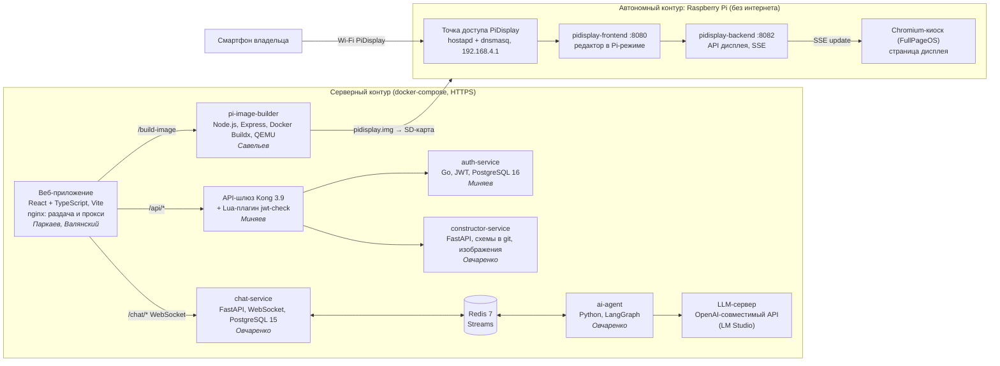

# PiConstruct — единый источник информации о проекте

> **Для чего этот файл.** Это единый источник фактов, цифр и формулировок для курсовых всех участников команды №1 (ЭФБО-04-23). Если в старых отчётах по неделям, презентациях или на лендинге написано по-другому, правильно так, как здесь. Что именно поменялось относительно старых отчётов, перечислено в разделе 9.
>
> **Актуально на 12.11.2026.** Финмодель взята из последней таблицы команды («Финансовый план», Numbers → xlsx) и перепроверена. Техническая часть сверена с кодом репозитория (последний коммит `8dcb768`). Цены конкурентов и рыночная статистика проверены 08.11–12.11.2026.
>
> **Структура соответствует методичке по курсовому проекту 2026 года.** Глава 1 (анализ, бизнес-модель, расчёты) у всех общая и пишется по разделам 2–6 этого файла. Главы 2–3 у каждого свои, про свою часть кода (раздел 1.2); общий контекст для них даёт раздел 7.

---

## Содержание

0. [Как пользоваться файлом](#0-как-пользоваться-файлом)
1. [Паспорт проекта и команда](#1-паспорт-проекта-и-команда)
2. [Проблема, предметная область и целевой сегмент](#2-проблема-предметная-область-и-целевой-сегмент)
3. [Анализ существующих решений](#3-анализ-существующих-решений)
4. [Концепция продукта и бизнес-модель](#4-концепция-продукта-и-бизнес-модель)
5. [Финансово-экономическое обоснование](#5-финансово-экономическое-обоснование)
6. [Выход на рынок, проверка гипотез, риски, инвестиционное предложение](#6-выход-на-рынок-проверка-гипотез-риски-инвестиционное-предложение)
7. [Общая техническая часть: требования, архитектура, данные, тесты](#7-общая-техническая-часть)
8. [Единые формулировки: как говорим и как не говорим](#8-единые-формулировки)
9. [Что исправлено относительно старых отчётов](#9-что-исправлено-относительно-старых-отчётов)
10. [История работы по неделям](#10-история-работы-по-неделям)
11. [Открытые вопросы к команде](#11-открытые-вопросы-к-команде)
12. [Источники](#12-источники)

---

## 0. Как пользоваться файлом

1. **Цифры берём только отсюда:** цены, рынок, финмодель, конкуренты, сроки. Если нужной цифры здесь нет, её нет и в курсовой (или сначала добавляем сюда).
2. **Факт и допущение — разные вещи.** Методичка прямо запрещает писать «спрос подтверждён», если были только предположения команды. Поэтому в файле есть пометки:
   - **[факт]** — проверено по коду, тестам или открытому источнику (источник указан);
   - **[допущение]** — оценка команды, в тексте курсовой так и пишем: «по оценке команды», «предполагается»;
   - **[план]** — ещё не сделано.
3. **Глава 1 общая.** Методичка разрешает использовать в первой главе совместные материалы, но их коллективный характер нужно обозначить, например: «материалы подготовлены командой проекта совместно». Текст при этом каждый пишет своими словами.
4. **Введение и заключение у каждого свои:** актуальность общая, а цель, задачи и результаты — свои (см. 1.2).
5. **Главы 2–3 — только про свою часть.** Про чужие компоненты достаточно знать общую архитектуру (раздел 7) и не описывать их как свои.
6. **ИП/ООО, юридическая база и выход в Казахстан в курсовых не используются** (решение команды). Эти материалы есть только в истории (раздел 10).

---

## 1. Паспорт проекта и команда

### 1.1 Паспорт

| Параметр | Значение |
|---|---|
| Название | **PiConstruct** — конструктор информационных табло |
| Одной фразой | Веб-конструктор, который по макету пользователя собирает готовый образ ОС для Raspberry Pi: записал на карту, включил — на экране табло, а меню правится с телефона по Wi-Fi самого табло, без интернета и подписки |
| Тема курсового проекта (общая) | «Разработка информационной системы для создания и управления цифровыми табло на базе Raspberry Pi на основе стартап-проекта «PiConstruct»» |
| Дисциплина | «Стартап в информационных технологиях», ИПТИП РТУ МИРЭА |
| Преподаватель | Адышкин С.С. |
| Группа / команда | ЭФБО-04-23, команда №1 |
| Стадия | Pre-Seed: работающий MVP, первых продаж нет |
| Лендинг | https://piconstruct.monconnect.xyz/ (Яндекс Метрика, счётчик 112920547) |
| Развёрнутое веб-приложение | https://188.126.58.2/ |
| Демонстрационный ролик | https://youtu.be/-AvU9NU5hJw |
| Целевое устройство | Raspberry Pi 5 (на нём проводилась отладка); образ на базе FullPageOS, 32-битное окружение, контейнеры linux/arm/v7 |

### 1.2 Команда, роли и зоны ответственности в коде

В каждой курсовой указывается одна и та же таблица: бизнес-роль в стартапе и закреплённая часть программного продукта. Распределение кода согласовано 07.11.2026: каждый компонент закреплён ровно за одним человеком, пересечений нет.

| Участник | Роль в стартапе | Часть программного продукта (главы 2–3) | Ключевые файлы и каталоги |
|---|---|---|---|
| **Савельев Сергей** | Тимлид, дизайнер | Сервис сборки загрузочного образа и автономное устройство: сборка образа Raspberry Pi с офлайн-дисплеем, точка доступа Wi-Fi, автозапуск, тестовый стенд | `pi-image-builder/`, `docker-compose.pi-test.yml` |
| **Овчаренко Константин** | Архитектор, разработчик | AI-помощник и бэкенд-сервисы: AI-агент (LangGraph + LLM через OpenAI-совместимый API, генерация схемы табло в JSON), чат-сервис (WebSocket, очередь и стриминг через Redis Streams), сервис хранения схем (git) и изображений | `ai-agent/`, `chat-service/`, `constructor-service/`, `backend/constructor-service/`, `.env.example` |
| **Валянский Андрей** | Разработчик | Редактор схем и дизайн-система: канвас с drag-and-drop и resize, панели, слои, история версий, undo/redo, JSON-импорт и экспорт, общий рендер блоков, фронтенд офлайн-дисплея (SSE + опрос), интеграция редактора с бэкендом | `Editor.tsx`, `src/components/Editor/*`, `shared/`, `design-system/` |
| **Паркаев Илья** | Аналитик | Каркас веб-приложения и деплой: роутинг, страницы (главная, вход, регистрация, тарифы, профиль, проекты), авторизация на фронте, чат-панель в редакторе, Dockerfile фронтенда, nginx, HTTPS, сведение сервисов в единый docker-compose | `App.tsx`, `AuthContext.tsx`, `api.ts`, `vite-project/Dockerfile`, `nginx.conf`, `docker-compose.yml` |
| **Миняев Тимофей** | Маркетолог | Авторизация и API-шлюз: Go-микросервис (регистрация, вход, refresh, JWT, PostgreSQL, миграции), автонастройка Kong, собственный Lua-плагин Kong для проверки JWT | `auth-service/`, `setup-kong.sh`, `check-plugin/` |

**Договорённости о границах (чтобы тексты не пересекались):**

1. `Editor.tsx`: всё про редактор схем — у Андрея; чат-панель и WebSocket-подключение внутри редактора — у Ильи.
2. Авторизация: фразу «сделал авторизацию» пишет Тимофей (auth-service, Kong). Илья пишет только про подключение фронтенда к ним.
3. AI-чат: Константин — бэкенд (ai-agent, chat-service), Илья — фронтенд чата.
4. Raspberry Pi: Сергей — сборка образа и устройство; Андрей — только фронтенд того, что показывается на экране (страница дисплея).
5. Служебные файлы (`.gitignore`, `.idea`, `README.md`, `Start.md`) в распределение не входят.

**Бизнес-задачи по ролям** (для глав 1 и 3, раздел «вклад»):
- Савельев — координация, приоритеты, релизы, UX конструктора и лендинга, демо для клиентов;
- Миняев — каналы привлечения, cold outreach, сообщества, контент;
- Паркаев — метрики, финмодель, юнит-экономика, приоритизация ICE;
- Овчаренко — архитектура системы;
- Валянский — дизайн-система, шаблоны.

**Пример индивидуальной цели (по образцу методички):** «Спроектировать, реализовать и протестировать <свою подсистему>, обеспечивающую <функцию> в составе информационной системы PiConstruct». Задачи: анализ предметной области (общий) → требования к своей подсистеме → проектирование → реализация → тестирование → экономика (общая).

---

## 2. Проблема, предметная область и целевой сегмент

### 2.1 Проблема

Малые кафе, столовые, кофейни, пекарни и магазины у дома ежедневно меняют блюда дня, цены и акции. Сейчас они делают это так:
- печатают меню в типографии или на принтере;
- пишут на меловых и маркерных досках;
- показывают слайды на телевизоре с USB-флешки.

**Процесс «как есть»** (персона: владелец кафе-столовой). Утром составить меню → набрать в Word → распечатать или заказать в типографии → разложить по папкам; акции пишутся маркером на доске. Каждая смена цены означает новый тираж.

**Процесс «как будет» с PiConstruct:**
1. Один раз: собрать макет в веб-конструкторе → скачать образ → записать на SD-карту → вставить в Raspberry Pi и подключить к экрану.
2. Каждый день: подключиться с телефона к Wi-Fi табло → поправить цены → нажать «На экран».

Существующие цифровые решения рассчитаны не на этот сегмент:
- облачные платформы берут подписку за каждый экран и требуют интернет;
- бесплатные open-source решения требуют ставить и настраивать Linux.

### 2.2 Рынок [факт]

- **Общепит РФ, 2025 год:** оборот 4,3–4,4 трлн ₽ (+≈8 %), заведений больше 240 тыс., средний чек +11 % (Saby, янв. 2026) [1].
- **Структура отрасли:** больше 210 тыс. компаний и ИП, из них больше 150 тыс. (71 %) — индивидуальные предприниматели (Rusprofile, янв. 2026) [2]. Большинство участников рынка — малый бизнес без собственной ИТ-службы.
- **Мировой рынок digital signage:** 20,1 млрд $ в 2025 году → 30,9 млрд $ к 2032 году, CAGR 6,6 % (MarketsandMarkets) [3].

> В старых отчётах встречались «~200 000 заведений (Минэкономразвития)», «4,29 трлн, +21 %», «890K точек МСП», «CAGR 17 %». Эти цифры не используем: источник не подтверждён (см. раздел 9).

### 2.3 Целевой сегмент

**Кто:** владельцы и управляющие малых заведений общепита (кафе, столовые, кофейни, пекарни, фастфуд) и магазинов у дома: 1–3 точки, нет штатного ИТ-специалиста. Решение о покупке принимает один человек.

**Персона [допущение — собирательный образ]:** Андрей, 36 лет, владелец кафе-столовой на 45 мест, меню 30–40 позиций, бизнес-ланч меняется ежедневно. Linux не знает, смартфоном пользуется уверенно.

Типичные возражения:
- «Raspberry Pi — это для программистов»;
- «а вдруг зависнет в рабочее время?»;
- «зачем платить, если можно крутить флешку на ТВ?».

**Jobs To Be Done:**
1. Когда я утром составляю меню дня, я хочу обновить экран с телефона за несколько минут, чтобы гости с открытия видели актуальные цены.
2. Когда я открываю точку или хочу выглядеть современно, я хочу поставить табло без вызова специалиста.
3. Когда я запускаю акцию («бизнес-ланч за 350 ₽»), я хочу сразу вывести её на экран и убрать по окончании.

**Критерии выбора решения:**
- простота без ИТ-навыков;
- низкая стоимость владения;
- работа без интернета;
- обновление со смартфона;
- скорость запуска.

**Оценки команды без проверенного источника [допущение].** Их можно упоминать только как гипотезы или вообще не использовать:
- затраты на перепечатку 2–5 тыс. ₽/мес и ожидание тиража 1–3 дня;
- 2–4 часа в неделю на макеты;
- «у 40 % кафе нестабильный Wi-Fi», «80 % ЦА не знают, что такое Raspberry Pi», «78 % без сисадмина»;
- рост среднего чека от цифрового меню на 15–20 % (это маркетинговые заявления производителей табло);
- бюджет сегмента «до 15 000 ₽ на всё решение».

---

## 3. Анализ существующих решений

Цены проверены 08.11–12.11.2026. Пересчёт по курсу ЦБ РФ на 09.11.2026: 1 € = 92,19 ₽, 1 $ = 82,14 ₽ [10]. Методичка требует не меньше трёх аналогов — в таблице ровно три.

| Решение | Тип | Стоимость | Интернет для обновления | Сложность настройки | Готовый контент в образе | Правка с телефона без внешней сети |
|---|---|---|---|---|---|---|
| **Yodeck** [4] | облачная платформа | 8 / 11 / 15 € за экран в месяц (Basic / Premium / Enterprise), ≈ 740–1 380 ₽ | нужен | низкая | нет | нет |
| **piSignage** [5] | облако или свой сервер | 2 экрана бесплатно (с водяным знаком); лицензия плеера 25 $ разово; облако 20 $/год за 12 кредитов ≈ 1,67 $/экран/мес (≈ 140 ₽) | нужен (облако или свой сервер) | средняя | нет | нет |
| **FullPageOS** [6] | киоск-дистрибутив | бесплатно | нужен (страница по сети) | высокая (SSH, конфиги) | нет | нет |
| **PiConstruct** | конструктор + готовый образ | Basic 0 ₽; PRO 2 499 ₽ разово; AI+ 499 ₽/мес (по желанию) | не нужен | низкая (запись одного файла) | **да** | **да** (собственная точка доступа) |

Для ориентира — инструменты подготовки образов из смежной области (они объясняют наш технический подход):
- **pi-gen** [7] — официальная сборка Raspberry Pi OS: долгая и требует своих сценариев;
- **Raspberry Pi Imager** [8] — запись образа на карту, но приложение и контент в систему не встраивает;
- **balenaOS** [9] — контейнеры на устройстве, но ориентирована на облако balenaCloud.

**Честное сравнение по цене:**
- PRO за 2 499 ₽ дешевле года Yodeck Basic (≈ 8 850 ₽) примерно в 3,5 раза.
- Год piSignage (≈ 1 650 ₽ за экран) дешевле PRO. Наше преимущество перед piSignage не в цене, а в том, что не нужны облако или свой сервер и пользователь получает готовый образ со своим макетом.
- Оборудование нужно всем решениям на базе Raspberry Pi. Официальная цена Raspberry Pi 5 4 ГБ — 85 $ (≈ 7 000 ₽, октябрь 2026) [11], но в российской рознице плата стоит заметно дороже: например, 26 400 ₽ (12.11.2026) [12].

**Вывод.** Облачные платформы удобны, но берут плату за экран каждый месяц и зависят от интернета. Бесплатные решения требуют технической квалификации. Ни одно из рассмотренных решений не выдаёт пользователю готовый образ с его макетом и не даёт править контент со смартфона без внешней сети. Эту нишу занимает PiConstruct.

Ограничение вывода: отсутствие у конкурента одной функции само по себе не доказывает преимущество. Ценность офлайн-работы и разовой оплаты для сегмента — гипотеза, пока не проверенная продажами (раздел 6.2).

---

## 4. Концепция продукта и бизнес-модель

### 4.1 Ценностное предложение (единая формулировка)

> Для владельцев малых кафе, столовых и магазинов, которым нужно часто обновлять информацию на экране, PiConstruct позволяет запустить цифровое табло без ИТ-специалиста, без постоянного интернета и без подписки. Обновлять меню можно со смартфона, а не перепечатывать или платить облачному сервису каждый месяц.

На чём держится предложение:
1. **Готовый образ:** один файл → SD-карта → табло, без установки и настройки Linux.
2. **Работа без интернета:** контент и все программные компоненты лежат на самом устройстве.
3. **Обновление со смартфона:** устройство само раздаёт Wi-Fi сеть, через неё открывается редактор.
4. **Разовая оплата:** основной функционал покупается один раз, а не оплачивается каждый месяц за экран.

### 4.2 Основные сценарии

**Первичная настройка (один раз):**
1. Регистрация в веб-конструкторе → макет из текстовых блоков и изображений.
2. Кнопка «Образ для Pi» → скачивание `pidisplay.img`.
3. Raspberry Pi Imager → «Использовать собственный образ» → запись на SD-карту.
4. Вставить карту в Raspberry Pi, подключить экран по HDMI и питание. Первый запуск занимает несколько минут, затем табло открывается на весь экран.

**Ежедневное обновление (без интернета):**
1. Телефон подключается к сети **PiDisplay** (пароль по умолчанию `pidisplay`).
2. В браузере открыть `http://192.168.4.1:8080`.
3. Поправить текст, цены или фото → «На экран». Табло обновляется без перезагрузки, через несколько секунд.

**Карта пути клиента (CJM):**

| Этап | Действия | Точка контакта | Барьер | Решение в продукте |
|---|---|---|---|---|
| Осознание | Перепечатывает меню при каждой смене цен | — | Время, деньги | — |
| Знакомство | Видит пост в сообществе, смотрит ролик | Лендинг, видео | «Raspberry Pi — это для программистов» | Демо «от макета до экрана» |
| Макет | Регистрируется, собирает меню | Веб-конструктор | Страх сложного редактора | Визуальный редактор, AI-помощник (бета) |
| Образ | «Образ для Pi», ждёт сборки | Конструктор, сервис сборки | Ожидание, непонятный формат | Автосборка, индикатор «Сборка…» |
| Запись | Raspberry Pi Imager | Imager | Страх ошибиться | Инструкция, пункт «собственный образ» |
| Запуск | Карта → Pi → экран | Устройство | «А вдруг не заработает» | Автозапуск без настройки |
| Ежедневно | Wi-Fi табло → правка → «На экран» | Редактор в Pi-режиме | Нет времени, нет интернета | Локальная сеть PiDisplay |

### 4.3 Состав MVP и статус функций

Статусы проверены по исходному коду репозитория (последний коммит `8dcb768`, 133 коммита, февраль — сентябрь 2026).

| Функция | Статус | Кто отвечает |
|---|---|---|
| Регистрация и вход: пароли хранятся как bcrypt-хеш, access- и refresh-токены JWT (HS256), проверка токена на шлюзе Kong | ✅ реализовано | Миняев (бэкенд), Паркаев (фронт) |
| Визуальный редактор: текст и изображения, drag-and-drop, resize, слои, undo/redo, JSON-импорт и экспорт, формат 16:9, адаптация под мобильные | ✅ реализовано | Валянский |
| Проекты: список, сохранение, удаление, **история версий и откат** (каждое сохранение — коммит в git), загрузка изображений | ✅ реализовано | Овчаренко (сервис), Валянский (интеграция) |
| AI-помощник в чате редактора: по описанию генерирует схему табло (JSON-массив блоков), кнопка «Применить схему» переносит её на холст | ✅ реализовано как **бета** | Овчаренко (бэкенд), Паркаев (фронт чата) |
| Генерация образа `.img` по макету | ✅ реализовано | Савельев |
| Автозапуск табло на весь экран | ✅ реализовано | Савельев |
| Собственная точка доступа Wi-Fi, правка с телефона, кнопка «На экран» | ✅ реализовано | Савельев (устройство), Валянский (страница дисплея) |
| Деплой веб-приложения (docker-compose, nginx, HTTPS) | ✅ реализовано | Паркаев |
| Страница тарифов Basic / PRO / AI+ | ✅ есть, **статичная**: кнопки «Выбрать» ничего не делают | Паркаев |
| **Приём оплаты и ограничения тарифов** | ⏳ **не реализовано**: в коде нет ни оплаты, ни проверки тарифа | — |
| **Готовые шаблоны для общепита** (3 в Basic, все в PRO) | ⏳ **не реализовано**: шаблоны упоминаются только в тексте страницы тарифов. Новый проект открывается с блоками по умолчанию, макет можно загрузить из JSON | — |
| Ротация слайдов, расписание показа, выбор ориентации | ⏳ план | — |
| Облачная синхронизация, мультиэкранность, аналитика показов | ⏳ позже | — |

**Ключевой сквозной сценарий MVP (требование методички):** макет в конструкторе → образ → запись → табло на экране → правка с телефона без интернета. Он работает и показан в демо-ролике и в тестах (раздел 7.6).

### 4.4 Бизнес-модель и тарифы (единая сетка)

Гибридная модель freemium: бесплатный вход, разовая покупка основного функционала и необязательная подписка на AI.

| | **Basic** | **PRO** | **AI+** |
|---|---|---|---|
| Цена | 0 ₽ | **2 499 ₽ разово** | **499 ₽/мес**, требует PRO |
| Конструктор и предпросмотр | ✓ | ✓ | ✓ |
| Образы ОС | 1 образ | без ограничений | — |
| Шаблоны | 3 базовых | все + индивидуальные | — |
| Правка по Wi-Fi с телефона | — | ✓ | — |
| Расширенная загрузка медиа | — | ✓ | — |
| AI-помощник (генерация макета) | — | — | ✓ |

**Отвергнутые варианты модели:**
- только разовая покупка — нет повторной выручки;
- только подписка 999 ₽/мес — главный барьер сегмента как раз нежелание подписываться.

**Важно:**
- тарифы — это **бизнес-модель**: в MVP оплата и ограничения не реализованы, а шаблонов пока нет (4.3). На странице тарифов у AI+ перечислены также «автообновление по расписанию», «облачная синхронизация» и «приоритетная поддержка». Это планы, в курсовой описываем их только как развитие;
- оборудование (Raspberry Pi, SD-карта от 8 ГБ, блок питания, экран с HDMI) **покупает клиент**, в цену PRO оно не входит;
- AI+ работает в веб-конструкторе и требует интернета; само табло интернета не требует.

---

## 5. Финансово-экономическое обоснование

### 5.1 Исходные данные

Источник — последняя финмодель команды (xlsx, листы «Модель (консервативный/базовый/оптимистичный вариант)»). Модель пересчитана независимо, все итоги совпадают до рубля.

| Параметр | Обозн. | Базовый | Консерв. | Оптим. | Тип |
|---|---|---|---|---|---|
| Цена PRO | P | 2 499 ₽ | 2 499 ₽ | **2 999 ₽** | решение команды |
| Цена AI+ | A | 499 ₽/мес | 499 | 499 | решение команды |
| Доля покупателей PRO с подпиской AI+ | s | 20 % | 20 % | **25 %** | допущение |
| Рост числа покупателей в месяц | g | **30 %** | **20 %** | **40 %** | допущение (самое рискованное) |
| Покупателей в 1-й месяц | N₁ | 1 | 1 | 1 | допущение |
| Стоимость привлечения покупателя | CAC | 150 ₽ | 150 | 150 | допущение (бесплатные каналы: сообщества, карты, SEO) |
| Постоянные расходы (VPS для сборки образов) | F | 1 500 ₽/мес | 1 500 | 1 500 | факт (тариф хостинга) |

«Месяц 1» — первый месяц после запуска приёма оплаты. Сейчас оплата ещё не реализована и продаж нет.

### 5.2 Формулы

- накопленные покупатели: N₁ = 1, Nₜ = ⌈Nₜ₋₁ · (1 + g)⌉;
- новые покупатели: nₜ = Nₜ − Nₜ₋₁;
- подписчики AI+: Sₜ = ⌈s · Nₜ⌉ (оттока в модели нет);
- выручка: Rₜ = nₜ · P + Sₜ · A;
- расходы: Cₜ = F + nₜ · CAC;
- операционная прибыль: Πₜ = Rₜ − Cₜ; рентабельность = ΣΠ / ΣR.

### 5.3 Помесячный прогноз, базовый сценарий, ₽

| Мес. | Покупателей (накоп.) | Новых | Подписок AI+ | Выручка PRO | Выручка AI+ | Выручка | Маркетинг | Расходы | Прибыль |
|---|---|---|---|---|---|---|---|---|---|
| 1 | 1 | 1 | 1 | 2 499 | 499 | 2 998 | 150 | 1 650 | 1 348 |
| 2 | 2 | 1 | 1 | 2 499 | 499 | 2 998 | 150 | 1 650 | 1 348 |
| 3 | 3 | 1 | 1 | 2 499 | 499 | 2 998 | 150 | 1 650 | 1 348 |
| 4 | 4 | 1 | 1 | 2 499 | 499 | 2 998 | 150 | 1 650 | 1 348 |
| 5 | 6 | 2 | 2 | 4 998 | 998 | 5 996 | 300 | 1 800 | 4 196 |
| 6 | 8 | 2 | 2 | 4 998 | 998 | 5 996 | 300 | 1 800 | 4 196 |
| 7 | 11 | 3 | 3 | 7 497 | 1 497 | 8 994 | 450 | 1 950 | 7 044 |
| 8 | 15 | 4 | 3 | 9 996 | 1 497 | 11 493 | 600 | 2 100 | 9 393 |
| 9 | 20 | 5 | 4 | 12 495 | 1 996 | 14 491 | 750 | 2 250 | 12 241 |
| 10 | 26 | 6 | 6 | 14 994 | 2 994 | 17 988 | 900 | 2 400 | 15 588 |
| 11 | 34 | 8 | 7 | 19 992 | 3 493 | 23 485 | 1 200 | 2 700 | 20 785 |
| 12 | 45 | 11 | 9 | 27 489 | 4 491 | 31 980 | 1 650 | 3 150 | 28 830 |
| **Итого** | **45** | | **9 к 12 мес.** | **112 455** | **19 960** | **132 415** | **6 750** | **24 750** | **107 665** |

MRR подписки на 12-й месяц: 9 × 499 = **4 491 ₽**.

### 5.4 Три сценария (12 месяцев)

| Сценарий | Рост/мес | Покупателей | Подписок к 12 мес. | Выручка | Расходы | Операционная прибыль | Рентабельность | С налогом 6 % и эквайрингом 3 % |
|---|---|---|---|---|---|---|---|---|
| Консервативный | 20 % | 22 | 5 | **67 952 ₽** | 21 300 ₽ | **46 652 ₽** | **68,7 %** | 40 535 ₽ (59,7 %) |
| **Базовый (рабочий план)** | 30 % | 45 | 9 | **132 415 ₽** | 24 750 ₽ | **107 665 ₽** | **81,3 %** | 95 747 ₽ (72,3 %) |
| Оптимистичный* | 40 % | 79 | 20 | **271 851 ₽** | 29 850 ₽ | **242 001 ₽** | **89,0 %** | 217 534 ₽ (80,0 %) |

\* В оптимистичном сценарии меняются сразу три параметра: рост 40 %, цена PRO 2 999 ₽ и доля AI+ 25 %. Если поменять только рост, а цену и долю оставить базовыми, получится 79 покупателей, выручка 225 864 ₽ и прибыль 196 014 ₽ (86,8 %).

**Налоги и комиссии.** В модели команды их нет. Методичка требует либо включить их, либо явно назвать ограничением. Поэтому в курсовых основная цифра — операционная прибыль, а отдельной строкой — результат с налогом 6 % с выручки и комиссией за приём платежей ≈ 3 % (последний столбец). Ставка 3 % — оценка: точный тариф ЮKassa / СБП зависит от договора.

**Как называем показатель:** «рентабельность по операционной прибыли», а не «валовая маржа». Эта прибыль уже учитывает маркетинг и сервер.

### 5.5 Безубыточность

- Одна продажа PRO приносит P − CAC = 2 499 − 150 = **2 349 ₽**, с налогом и комиссией ≈ 2 124 ₽. Это больше постоянных расходов F = 1 500 ₽, значит **операционная безубыточность наступает при 1 продаже PRO в месяц**.
- Если продаж PRO нет, сервер окупают ⌈1 500 / 499⌉ = **4 подписки AI+**.
- В модели не учитываются труд команды, оборудование для тестов, домен (≈ 300 ₽/год), отток подписчиков и расходы на оформление продаж. Это её ограничения, их нужно назвать в тексте.

### 5.6 Чувствительность (базовый сценарий, до налогов)

| Изменение | Покупателей | Выручка | Прибыль | Рентабельность |
|---|---|---|---|---|
| База | 45 | 132 415 | 107 665 | 81,3 % |
| Рост 15 %/мес вместо 30 % | 18 | 56 958 | 36 258 | 63,7 % |
| Рост 10 %/мес | 13 | 42 966 | 23 016 | 53,6 % |
| CAC 830 ₽ (треть цены PRO — потолок из антикризисных правил) | 45 | 132 415 | 77 065 | 58,2 % |
| CAC 1 667 ₽ (уровень платной рекламы из кейса нед. 6 сем. 7) | 45 | 132 415 | 39 400 | 29,8 % |
| Цена PRO 1 999 ₽ | 45 | 109 915 | 85 165 | 77,5 % |
| Цена PRO 2 999 ₽ | 45 | 154 915 | 130 165 | 84,0 % |
| Доля AI+ 10 % | 45 | 124 431 | 99 681 | 80,1 % |

**Выводы для курсовой:**
1. Постоянные расходы малы: модель окупает инфраструктуру с первой продажи в месяц и прибыльна во всех трёх сценариях, в том числе с учётом налога и комиссии.
2. Результат сильнее всего зависит от темпа привлечения покупателей и CAC. При росте 10–15 % в месяц выручка за год 43–57 тыс. ₽, при платной рекламе с CAC 1 667 ₽ прибыль падает до ≈ 39 тыс. ₽. Цена PRO влияет слабее.
3. Рост 30 % в месяц пока **не подтверждён**: продаж нет, первый outreach дал 1 ответ на 10 контактов. Поэтому проект жизнеспособен как бизнес с низкими постоянными затратами, а инвестиционная привлекательность появится, когда продажи подтвердят темп роста.

---

## 6. Выход на рынок, проверка гипотез, риски, инвестиционное предложение

### 6.1 Стратегия выхода на рынок

Модель роста через продукт (product-led growth): бесплатный Basic → впечатление от табло → апгрейд в PRO → рекомендация знакомым.

| Период | Каналы и действия | Метрика |
|---|---|---|
| 0–3 мес. | Персональные сообщения в VK- и Telegram-сообществах общепита (30 контактов с демо-видео); письма по 2ГИС и Яндекс Картам; демо-созвоны | доля ответов: **цель ≥ 15 %, порог тревоги < 10 %**; ≥ 2 демо; ≥ 1 оплата PRO |
| 3–6 мес. | Кейсы первых клиентов (фото табло, цифры) → контент-петля; реферальный оффер: +1 мес. AI+ за приведённого клиента | ≥ 3 платящих к 3-му мес.; NPS ≥ 8 |
| 6–12 мес. | SEO-страницы («шаблон меню для кафе»), бесплатные шаблоны | 45 покупателей, 9 подписок AI+ к 12-му мес. (базовый план) |

Платная реклама возможна только после отладки воронки: стартовый бюджет не больше 10 % выделенного, плановый CAC не выше трети цены PRO (≈ 830 ₽), стоп-параметры через 72 часа. Это вывод из кризисного кейса недели 6 семестра 7.

### 6.2 Что проверено на самом деле [факт]

| Гипотеза | Как проверяли | Результат |
|---|---|---|
| Сквозной сценарий технически работает | Запись образа и запуск на Raspberry Pi, правка с телефона | ✅ подтверждено (демо-ролик, тесты в 7.6) |
| Владельцы отвечают на персональные сообщения | Cold outreach: **10 контактов** из 30 запланированных | **1 ответ (10 %)** — на пороге тревоги, ниже цели 15 % |
| Готовность платить 2 499 ₽ | Тест продажами | ❌ **оплат пока нет** |
| Проблема существует (интервью), тест цены на лендинге, usability-тест «≤ 15 минут» | Были запланированы в нед. 3–6 сем. 6 | ⚠️ результатов в отчётах нет: в курсовых пишем «запланировано» |

> «Запуск за 15 минут» — **целевое значение** (нефункциональное требование), а не замер. «Спрос подтверждён» не пишем.

### 6.3 Риски

| № | Риск | Вероятность / влияние | Меры |
|---|---|---|---|
| 1 | Низкая конверсия в оплату, рост ниже 30 %/мес | средняя / высокое | Тест продажами, корректировка цены PRO в диапазоне 1 499–3 499 ₽, кейсы, реферальная программа |
| 2 | Пользователь не справится с записью SD-карты («регистрация → активное табло») | высокая / среднее | Пошаговая инструкция и видео; в перспективе — продажа готовых карт |
| 3 | **Стоимость Raspberry Pi** в рознице РФ (≈ 26 тыс. ₽ за Pi 5 4 ГБ) выше бюджета сегмента | средняя / высокое | Проверить работу на более дешёвых моделях (Pi 4); комплекты через партнёров; использовать уже имеющийся экран |
| 4 | Сбои сборки образа, несовместимость с моделью Pi | средняя / высокое | Тестовый стенд, автотесты сборки, тестирование на Pi 4/5 |
| 5 | Конкурент добавит офлайн-режим или разовую оплату | средняя / среднее | Фокус на простоте «из коробки» и готовом образе с контентом |
| 6 | Несанкционированный доступ к Wi-Fi табло (одинаковый пароль у всех) | низкая / высокое | WPA2-PSK; уникальное имя сети и пароль для каждого образа (план) |
| 7 | Срыв сроков из-за совмещения с учёбой, зависимость от одного человека в каждой подсистеме | средняя / среднее | Распределение компонентов, документация (этот файл) |
| 8 | Табло перестанет работать в рабочие часы | низкая / высокое | Автозапуск systemd, политика перезапуска контейнеров, контент хранится на устройстве |
### 6.4 Инвестиционное предложение (исправленная версия)

| Параметр | Значение |
|---|---|
| Запрос | **250 000 ₽**, конвертируемый займ или ресурсная поддержка, стадия Pre-Seed, горизонт 6–9 месяцев |
| Оценка до инвестиций (pre-money) | **750 000 ₽** → после инвестиций (post-money) 1 000 000 ₽ → доля инвестора при конвертации **25 %** |
| Как получена оценка | Венчурный метод. Допущение команды: выручка через 3 года ≈ 1,57 млн ₽ в год (в 12-месячной модели не рассчитывается) × мультипликатор 5 = стоимость при выходе ≈ 7,9 млн ₽. Доля 25 % → ≈ 2 млн ₽, то есть **≈ 7,9× на вложенные 250 тыс. ₽** при реализации допущений |
| Использование средств | 40 % (100 000 ₽) — доработка MVP до v1.0, включая приём оплаты; 25 % (62 500 ₽) — маркетинг и тест продажами; 20 % (50 000 ₽) — инфраструктура и тестовое оборудование (VPS, домен, Raspberry Pi для тестов); 15 % (37 500 ₽) — операционные расходы |
| Вехи | Мес. 1–2: ≥ 1 оплата PRO, доля ответов ≥ 15 %, MVP → v1.0. Мес. 3: ≥ 3 платящих, публичный доступ, реферальная программа. Мес. 4–5: 2–3 кейса, NPS ≥ 8. Мес. 6: **≥ 8 покупок PRO и ≥ 2 подписки AI+ (MRR ≥ 998 ₽)** — совпадает с базовой моделью |
| Профили инвестора | 1) бизнес-ангел из HoReCa/IT, чек 100–500 тыс. ₽; 2) акселератор или грант до 1 млн ₽ |
---

## 7. Общая техническая часть

Этот раздел нужен всем для понимания продукта. Подробно каждый описывает только свою подсистему, со ссылками на свои файлы в репозитории.

### 7.1 Функциональные требования (весь продукт)

| ID | Требование | Приоритет MVP | Подсистема / владелец |
|---|---|---|---|
| FR-01 | Регистрация, вход, обновление токена; доступ к сервисам только через API-шлюз с проверкой JWT | обязательно | auth-service, Kong — Миняев |
| FR-02 | Создание проекта и макета табло из текстовых блоков и изображений: перемещение, размер, слои, отмена действий | обязательно | Редактор — Валянский |
| FR-03 | Сохранение и загрузка схем проектов и изображений | обязательно | constructor-service — Овчаренко; интеграция — Валянский |
| FR-04 | AI-помощник в чате генерирует схему табло (JSON-массив блоков) по текстовому описанию; пользователь применяет её к холсту одной кнопкой | желательно (бета) | ai-agent, chat-service — Овчаренко; чат на фронте — Паркаев |
| FR-05 | По кнопке «Образ для Pi» формируется образ `.img` со встроенным макетом и всем ПО для работы без интернета | обязательно | pi-image-builder — Савельев |
| FR-06 | После включения устройство само показывает табло на весь экран | обязательно | Устройство — Савельев |
| FR-07 | Устройство создаёт защищённую точку доступа Wi-Fi и выдаёт адреса клиентам | обязательно | Устройство — Савельев |
| FR-08 | Правка контента с телефона по локальной сети; табло обновляется без перезагрузки | обязательно | Устройство — Савельев; страница дисплея — Валянский |
| FR-09 | Веб-приложение доступно по HTTPS, все сервисы поднимаются одной командой | обязательно | Деплой — Паркаев |
| FR-10 | Приём оплаты и ограничения тарифов | **следующий этап** | — |

### 7.2 Нефункциональные требования

| ID | Требование |
|---|---|
| NFR-01 | Автономность: после записи образа устройство работает без интернета, все зависимости внутри образа |
| NFR-02 | Совместимость: Raspberry Pi со встроенным Wi-Fi; отладка — на Raspberry Pi 5; FullPageOS, 32-битное окружение, контейнеры linux/arm/v7 |
| NFR-03 | Производительность (целевые значения): сборка образа ≤ 5 мин, размер ≤ 5 ГБ, обновление табло после «На экран» — секунды |
| NFR-04 | Удобство (целевое значение, не замер): пользователь без подготовки запускает табло по инструкции за ≤ 15 мин |
| NFR-05 | Безопасность: JWT на шлюзе; WPA2-PSK на точке доступа; экранирование текста при генерации страницы дисплея |
| NFR-06 | Сопровождаемость: контейнеризация всех сервисов, единый docker-compose, конфиги устройства отдельно от кода |

### 7.3 Архитектура

Система состоит из двух контуров, которые связаны один раз — через файл образа.

**Серверный контур.** Единая точка входа — nginx в контейнере фронтенда (порты 80 и 443, сертификат Let's Encrypt). Он раздаёт собранное SPA и проксирует запросы по трём маршрутам:

| Путь | Куда | Авторизация |
|---|---|---|
| `/api/*` | Kong (`:8000`) → auth-service или constructor-service | JWT проверяет Kong (см. ниже) |
| `/chat/*` | chat-service (`:8083`), WebSocket | **мимо Kong**: id пользователя передаётся параметром запроса `X-User-ID` |
| `/build-image` | pi-image-builder (`:3000`), таймаут 600 с, тело до 50 МБ | без авторизации |

**Маршруты Kong** (их создаёт контейнер `kong-setup` при старте):

| Сервис | Публичные маршруты | Защищённые плагином jwt-check |
|---|---|---|
| auth-service | `POST /api/v1/register`, `POST /api/v1/auth` | `POST /api/v1/refresh` |
| constructor-service | `GET /api/uploads/{id}/{file}` (картинки для тегов ``) | `GET /api/my`, `POST /api/save`, `GET/DELETE /api/{id}`, `GET /api/{id}/history`, `GET /api/{id}/version/{sha}`, `POST /api/upload/{id}` |

Плагин `jwt-check` (Lua, библиотека `resty.jwt`) проверяет подпись токена из заголовка `Authorization: Bearer …`. Если токен верный, плагин передаёт сервису заголовок `X-User-ID` из поля `user_id` токена. Без токена или с неверным токеном — ответ 401.

**Сервисы:**
- **auth-service** (Go): регистрация, вход, обновление токенов. Access- и refresh-токены — JWT HS256, время жизни задаётся переменными `ACCESS_TTL` / `REFRESH_TTL`.
- **constructor-service** (Python, FastAPI): схемы проектов, история версий, изображения. На устройстве этот же сервис работает как бэкенд дисплея (`/api/display/*`: страница табло, поток SSE, публикация макета).
- **AI-помощник** (две части):
  - chat-service принимает сообщение по WebSocket и кладёт задачу в Redis Stream `llm:generate_requests`;
  - ai-agent (LangGraph) забирает задачу, обращается к LLM через OpenAI-совместимый API и пишет ответ по частям в поток `chat:{id}:run:{run}`. chat-service пересылает эти части в браузер;
  - LLM: сервер LM Studio, модель Qwen 3.5 9B (по `.env.example`);
  - формат ответа задаёт системный промпт и JSON-схема блоков (пресет LM Studio `startup 6.preset.json`): ответ — массив блоков `text` / `image` в процентных координатах;
  - каркас для вызова инструментов (tool calling, MCP) в агенте есть, но сами инструменты отключены.
- **pi-image-builder** (Node.js): получает от редактора блоки макета (изображения в base64) и возвращает готовый образ.

**Автономный контур.**
- На Raspberry Pi работают:
  - точка доступа: hostapd, сеть PiDisplay, WPA2; dnsmasq раздаёт адреса 192.168.4.2–20, а любое имя резолвится в 192.168.4.1;
  - два контейнера: редактор в Pi-режиме без авторизации (`:8080`) и бэкенд дисплея (`:8082`);
  - Chromium в режиме киоска.
- Опубликованный макет сохраняется в `/opt/pidisplay/display.html`, поэтому переживает перезагрузку.
- Табло получает обновления через Server-Sent Events, при обрыве соединения — опросом раз в 3 секунды.

**Почему такие технологии:**
- микросервисы в контейнерах — каждый участник отвечает за свой сервис, всё поднимается одной командой;
- Kong — централизованная проверка JWT вместо проверки в каждом сервисе;
- FullPageOS как основа образа — готовый браузер-киоск: модифицировать копию образа быстрее, чем собирать дистрибутив через pi-gen, и, в отличие от balenaOS, не нужно облако;
- linux/arm/v7 — потому что у FullPageOS 32-битное окружение.

### 7.4 Данные

| Хранилище | Структура | Владелец |
|---|---|---|
| PostgreSQL 16 (auth-service, во внутренней сети Docker `internal-net`) | Таблица `users`: `id` SERIAL PK, `fullname` VARCHAR(50) (3–50 символов), `email` VARCHAR(50) UNIQUE с проверкой формата, `password` — bcrypt-хеш. Refresh-токены в БД **не хранятся**: JWT проверяются по подписи. Интерфейс хранилища сессий в коде есть, но не подключён | Миняев |
| PostgreSQL 15 (chat-service, миграции alembic) | Таблица `chats`: `chat_id` PK (один чат на проект), `user_id` (индекс), `messages` JSON (вся история сообщений) | Овчаренко |
| Redis 7 (Streams) | `llm:generate_requests` — очередь задач для AI, группа обработчиков `llm-workers`; `chat:{id}:run:{run}` — поток частей ответа. Данные сохраняются на диск (AOF) | Овчаренко |
| constructor-service: git-репозиторий `schemas/` | Один файл `{schema_id}.json` на проект: `schema_id`, `schema_name`, `user_id`, `payload` (массив блоков). Каждое сохранение — коммит, из истории коммитов строятся версии и откат | Овчаренко |
| constructor-service: `uploads/{schema_id}/` | Загруженные изображения | Овчаренко |
| PostgreSQL 13 (Kong) | Служебная конфигурация шлюза: сервисы, маршруты, плагины | Миняев |
| Raspberry Pi | `/opt/pidisplay/display.html` (последний опубликованный макет), загруженные изображения, архивы контейнеров (`backend.tar`, `frontend.tar`) | Савельев |

Связь между хранилищами — по `user_id` из JWT (`users.id`). Внешних ключей между базами нет: каждый сервис хранит `user_id` у себя.

Схема блока макета (общий формат редактора, AI, дисплея и сборщика):
- `type`: `text` или `image`;
- `id`;
- `x`, `y`, `width`, `height` — в процентах от экрана (0–100);
- для текста: `content`, `fontSize`, `fontWeight`, `color`, `textAlign`, `verticalAlign`, `fitText`;
- для изображения: `src`, `objectFit` (`cover` / `contain` / `fill`).

### 7.5 Развёртывание

| Что | Как |
|---|---|
| Веб-приложение и сервисы | `docker compose up --build -d` из корня репозитория (13 контейнеров: frontend, kong, kong-db, kong-migrations, kong-setup, auth-service, auth-service-db, backend, chat-service, chat-postgres, chat-redis, ai-agent, pi-image-builder); nginx, HTTPS (Let's Encrypt); сервер 188.126.58.2. Настройки — в `.env` (образец `.env.example`) |
| AI-помощник | Нужен доступный LLM-сервер с OpenAI-совместимым API (`LLM_URL`, `MODEL_NAME`). Если сервер недоступен, чат работает, но ответы не генерируются |
| Сервис сборки образа | Linux x86-64, Docker + Buildx + binfmt_misc; базовый `fullpageos.img` в `pi-image-builder/images`; проверка `GET http://localhost:3000/health` → `{"ok":true}`; ≥ 10 ГБ свободного места |
| Тестовый стенд Pi без устройства | `docker compose -f docker-compose.pi-test.yml up --build -d` → редактор `http://localhost:8080`, табло `http://localhost:8082/api/display/` |
| Устройство | Raspberry Pi Imager → «Использовать собственный образ» → `pidisplay.img` |

Секреты (`.env`, ключи LLM, пароли БД) в отчёты и публичный репозиторий **не попадают** — требование методички.

### 7.6 Сквозные проверки продукта (общие для всех)

| ID | Сценарий | Ожидаемый результат | Факт | Кто проверяет |
|---|---|---|---|---|
| E2E-1 | Регистрация → вход → открыть редактор; запрос без токена | Доступ с токеном; без токена шлюз отвечает отказом | **вписать после проверки** | Миняев, Паркаев |
| E2E-2 | Собрать макет меню, сохранить, перезагрузить страницу | Макет восстанавливается | **вписать после проверки** | Валянский, Овчаренко |
| E2E-3 | Описать табло в AI-чате | Сгенерирована схема, блоки появились в редакторе | **вписать после проверки** | Овчаренко, Паркаев |
| E2E-4 | «Образ для Pi» → запись Raspberry Pi Imager → загрузка Pi | Табло с макетом на весь экран без действий пользователя | Пройдено (демо-ролик, курсовая Савельева, Т-12/Т-13) | Савельев |
| E2E-5 | Телефон → Wi-Fi PiDisplay → правка цены → «На экран» | Табло обновляется без перезагрузки | Пройдено при отладке точки доступа | Савельев, Валянский |
| E2E-6 | Ошибка сборки (недоступен Docker) | Код 500 с текстом ошибки, разделы размонтированы | Пройдено с замечанием: временный каталог сборки остаётся на диске | Савельев |

В E2E-1…3 не пишем «пройдено», пока проверка не проведена: методичка требует фактические результаты. Подробные тест-кейсы своей подсистемы (корректные и некорректные сценарии) каждый приводит в главе 3.

### 7.7 Ограничения и технический долг (общий список)

- Нет приёма оплаты, ограничения тарифов не применяются; готовых шаблонов нет.
- chat-service подключён мимо Kong и принимает id пользователя из параметра запроса без проверки токена.
- Refresh-токены не хранятся на сервере, поэтому их нельзя отозвать до истечения срока.
- В плагине jwt-check и в docker-compose у секрета JWT есть значение по умолчанию прямо в коде; секрет нужно брать только из окружения.
- AI работает, только пока доступен LLM-сервер (сейчас LM Studio в локальной сети); инструменты агента отключены.
- В репозитории лежит устаревшая копия `backend/constructor-service`, она не используется в docker-compose.
- Имя сети и пароль Wi-Fi одинаковы во всех образах.
- Сборка образа синхронная: прогресса не видно, параллельно идёт одна сборка.
- Сервис сборки работает в привилегированном контейнере; во внешнюю сеть его можно открывать только за шлюзом.
- Смещения разделов FullPageOS заданы константами.
- Отладка выполнена только на Raspberry Pi 5.
- AI-помощник в статусе бета.

---

## 8. Единые формулировки

| Говорим так | Не говорим так |
|---|---|
| «Запуск табло **за 15 минут** — целевое значение» | «за 10 минут», «за один вечер», «проверено: 15 минут» |
| «Обновление **с телефона за 30 секунд**» (маркетинг; технически табло обновляется за секунды после «На экран») | «за 2 минуты» |
| «Табло **не требует интернета**; интернет нужен только чтобы скачать образ и для AI+» | «интернет нужен только для обновления», «по вашей Wi-Fi-сети» (сеть своя — PiDisplay) |
| «AI-помощник — **бета**» | «AI — roadmap» или «AI полностью готов» |
| «Продаж пока нет; первый outreach: 10 контактов → 1 ответ» | «продукт продаётся», «спрос подтверждён», «прибыльны с первого месяца» |
| «Рентабельность по операционной прибыли 81,3 % (база, до налогов и комиссий)» | «валовая маржа 83 %», «маржа ≈ 100 %» |
| «Оборудование покупает клиент» | «себестоимость SD-карты и Raspberry Pi учтена» |
| «PRO дешевле года Yodeck примерно в 3,5 раза; piSignage дешевле, но требует облака или своего сервера» | «в 3–10 раз дешевле годовой подписки конкурентов», «сопоставима с 1–2 месяцами подписки» |
| «Операционная прибыль 107 665 ₽; с налогом 6 % и комиссией 3 % — 95 747 ₽» | «рентабельность 81 %» без оговорки, что это до налогов и комиссий |
| «Образ для Raspberry Pi (FullPageOS); другие платы потребуют отдельной сборки» | «.img запускается на любом ARM-устройстве», «Orange Pi» |
| «Заведений общепита в РФ — больше 240 тыс. (Saby, 2025)» | «~200 000 (Минэкономразвития)», «890K точек МСП» |
| «Состояние табло видно по логам экспорта на сервере и обратной связи клиентов» | «heartbeat-телеметрия» (табло офлайн и на сервер ничего не шлёт) |
| «Доля ответов: цель ≥ 15 %, порог тревоги — 10 %» | разные цели 10 / 15 / 20 % в разных местах |

---

## 9. Что исправлено относительно старых отчётов

**Рынок (TAM/SAM/SOM) — пересчитан.** Старые цифры противоречили сами себе:
- SAM «8 млн ₽ = 89 000 × 90 000 ₽», а это на самом деле 8 млрд;
- SOM «350 тыс. ₽ = 270 × 90 000», а это 24,3 млн;
- конверсия 0,03 % от 89 000 даёт 27 клиентов, а не 270;
- TAM получался меньше SAM;
- LTV 90 000 ₽ невозможен при PRO 2 499 + AI+ 499 ₽/мес: даже три года подписки дают ≈ 20,5 тыс. ₽;
- источника для «890K / 89K точек» нет.

Новый расчёт по тому же методу, что и для Казахстана (точки × цена PRO), на проверяемых данных:

| Уровень | Определение | Точек | Объём |
|---|---|---|---|
| TAM | Все заведения общепита РФ [1] | ≈ 240 000 | 240 000 × 2 499 ≈ **600 млн ₽** |
| SAM | Общепит, работающий как ИП, — малый бизнес без ИТ-службы [2] | ≈ 150 000 | ≈ **375 млн ₽** |
| SOM | Базовый план на 12 мес. | 45 | **132 тыс. ₽** (0,03 % SAM) |

Магазины у дома в расчёт не входят, поэтому оценка консервативная.

**Финмодель** (нед. 11–13 сем. 6, питч сем. 7):
- было две модели, 157 тыс. и 132 тыс.; оставлена последняя таблица (132 415 ₽);
- маржа «57 % / 83,3 % / ≈ 100 %» → 68,7 / 81,3 / 89,0 %;
- в нед. 11 ИТОГО расходов 45 500 ₽, а прибыль считалась от 26 250 ₽;
- MRR «5 490 ₽ (9 подписок)» → 4 491 ₽;
- сценарии отличаются ростом 20/30/40 %, а не «конверсией ±10 %»; в оптимистичном к тому же другая цена (2 999 ₽) и доля AI+ (25 %);
- «рост 35 %/мес» из нед. 11 → 30 %;
- модель «67K → 68K» и прочие мелочи выровнены;
- добавлена строка с налогом 6 % и комиссией за платежи 3 % (требование методички).

**Оценка компании:**
- «оценка 3× ARR ≈ 2 250 000» была арифметической ошибкой (3 × 850 000 = 2 550 000); метод мультипликаторов убран, потому что ARR второго года не обоснован;
- диапазоны «2,5–6,8 млн» и «1,0–6,8 млн» убраны;
- оставлен pre-money 750 тыс. ₽ (венчурный метод);
- «ROI ×9» → ≈ 7,9× при реализации допущений.

**Вехи инвестиций:** «MRR ≥ 3 992 ₽ при ≥ 8 платящих» означало, что AI+ покупают все 100 % → «≥ 8 PRO и ≥ 2 AI+, MRR ≥ 998 ₽».

**Цены и тарифы:**
- ранние «₽500/мес» (нед. 5), «$15–30» (нед. 6) и A/B-цены 990 / 1 990 / 2 490 ₽ (нед. 3) — этапы поиска; итоговая сетка в 4.4;
- сравнение «в 3–10 раз дешевле» исправлено (раздел 8).

**Продукт:**
- «AI — roadmap» (питч) против «бета» (лендинг) → бета;
- «MVP — в разработке» в блоке «подтверждено ✓» → MVP работает;
- «прибыльны с первого месяца» убрано;
- «себестоимость Raspberry Pi учтена» → оборудование покупает клиент;
- «heartbeat-телеметрия» (нед. 5 и 7 сем. 7) — табло офлайн, телеметрии нет;
- «интернет нужен только для обновления», «по вашей Wi-Fi-сети» (нед. 5 сем. 7) → сеть табло PiDisplay, интернет не нужен;
- «2 минуты» / «30 секунд» / «10 минут» / «15 минут» → раздел 8;
- «любое ARM-устройство / Orange Pi» (InvestorPersona) → только Raspberry Pi.

**Роли:**
- в питче и RACI нед. 14 сборка `.img` была записана на Овчаренко, а Wi-Fi и прошивки — на Валянского; в нед. 5 сем. 7 tech lead инцидента со сборкой — Овчаренко;
- по коду эти части у Савельева, страница дисплея — у Валянского;
- правильное распределение — в 1.2.

**Метрики outreach:** цели 10 / 15 / 20 % → цель 15 %, порог 10 %. «Sales test: 10 контактов» — это фактически отправленные 10 из 30 запланированных.

**Нумерация и ссылки:**
- в нед. 6 сем. 7 упомянут «кейс №7 недели 5», а в неделе 5 был кейс №6;
- в нед. 14 сем. 6 номера в таблице ICE сдвинуты относительно бэклога (в бэклоге 15 пунктов, в ICE есть №16);
- номера занятий в сем. 7 (нед. 5 — №10, нед. 6 — №12, нед. 7 — №13) стоит сверить с расписанием.

**Прочее:**
- неподтверждённые цифры сегмента (40 %, 80 %, 78 %, CAGR 17 %, «PiSignage заблокирован в РФ», «+21 % оборота») в курсовых не используем;
- в нед. 3 сем. 6 было написано «спрос подтверждён» (по обсуждениям на форумах) — по методичке так писать нельзя.

**Если правим старые отчёты в репозитории**, в первую очередь стоит поправить:
- питч сем. 7 нед. 4 (слайды 1, 4, 5, 8, 9, 11);
- InvestorPersona;
- нед. 11–12 сем. 6;
- нед. 5 сем. 7 (SWOT, диалог, кризис).

---

## 10. История работы по неделям

Статусы: ✅ используем в курсовой · ♻️ использовали как исходник, цифры заменены этим файлом · 📁 только история.

### Семестр 6 (весна 2026)

| Нед. | Тема | Что сделали | Статус |
|---|---|---|---|
| 1 | Конструирование продукта, анализ рынка | 5 идей (3D-аутфит, Антигид, конструктор для Raspberry Pi, отслеживание цен на маркетплейсах, умный плеер) | 📁 |
| 2 | Формирование идеи | Выбран «Конструктор приложений для мини-компьютеров Raspberry Pi», трекер задач | 📁 |
| 3 | Портрет потребительского сегмента | Паспорт сегмента, персона, JTBD, desk research, 7 гипотез, план проверки ТОП-3 | ♻️ (2.3) |
| 4 | Слайды дека: рынок, конкуренты | Первые TAM/SAM/SOM без цифр | ♻️ |
| 5 | Ценностное предложение, конкуренты | Конкурентная матрица, гипотеза ценности, ядро MVP, план проверки | ♻️ (3, 4) |
| 6 | Ценностное предложение и функциональность | Сценарии, карта функций Core/Support/Later, истории US-1…US-8, риски | ✅ (4.2, 4.3) |
| 7 | Создание MVP | Диаграмма принципов работы системы (плановая) | ♻️ (7.3) |
| 8–9 | Разработка и тестирование MVP | Скриншоты MVP | ✅ |
| 10 | Минимальный бизнес-прототип, выход на рынок | Демо-ролик | ✅ |
| 11 | Модель монетизации, тест продажами | Гибридная модель, тарифы, план sales test, первая финмодель | ♻️ (4.4, 5) |
| 12 | Стратегия роста, финплан, оценка | PLG, эксперименты, 3 сценария, венчурная оценка | ♻️ (5, 6) |
| 13 | Профиль инвестора, оффер, питч-дек | InvestorPersona, полный и сокращённый питч-дек | ♻️ (6.4) |
| 14 | Продуктовый план, модель команды | Цели и метрики, бэклог, ICE, roadmap, RACI, риски №1–5 | ♻️ (6.3) |
| 15–16 | Развёртывание | Веб-приложение на 188.126.58.2 | ✅ |

### Семестр 7 (осень 2026)

| Нед. | Тема | Что сделали | Статус |
|---|---|---|---|
| 1 | Товарный знак и брендирование | Название, УТП, дизайн-система (палитра из 4 цветов логотипа, шрифт Rubik, тёмная и светлая темы) | ✅ |
| 2–3 | Хостинг лендинга | Лендинг из 9 блоков, Яндекс Метрика, политика ПДн | ✅ |
| 4 | Поиск инвесторов | Питч-дек (обновлённый) | ♻️ (6.4, исправления в 9) |
| 5 | Решения, риски, коммуникации | Кейс №6 «Высокая конкуренция»: SWOT, альтернативы А1–А4, матрица рисков → дифференциация в нише; инцидент «чёрный экран»; ролевая игра с клиентом | ✅ для рисков и стратегии (с исправлениями из 9) |
| 6 | Кризисные ситуации | Кейс №4 «Ошибки маркетинговой стратегии» (модельный): диагностика воронки, антикризисная стратегия, правило 10 %, CAC ≤ 1/3 цены; маркировка рекламы | ✅ для правил GTM (6.1) |
| 7 | Международное расширение | Казахстан: рынок, локализация, вход через партнёра | 📁 в курсовых не используем |
| 8 | Правовая база | ИП → ООО, интеллектуальная собственность, товарный знак, партнёрское соглашение | 📁 в курсовых не используем |
| 9 | Регистрация ООО | Комплект документов ООО «ПиКонстракт», налоговый режим | 📁 в курсовых не используем |

---

## 11. Открытые вопросы к команде

Пока ответов нет, в курсовых эти места пишем осторожно или не упоминаем.

Вопросы о шаблонах, оплате, AI, базах данных и маршрутах Kong закрыты по коду репозитория (разделы 4.3, 7.3, 7.4). Остались три, на них код не отвечает:

1. **Интервью, тест цены, usability-тест** из нед. 3–6 сем. 6 — проводились ли? Если да — нужны выборка и результаты. (Миняев, Паркаев)
2. **Размер и время сборки образа** — фактические замеры для NFR-03. (Савельев)
3. **Raspberry Pi 4** — проверить образ, чтобы снизить стоимость входа для клиента (риск 3). (Савельев)
---

## 12. Источники

Даты обращения указаны для открытых сайтов. В курсовой список оформляется по ГОСТ 7.32 и требованиям РТУ МИРЭА; рекомендуется 5–20 источников, часть из них — не старше пяти лет.

1. Самохвалова О. Итоги 2025 года для общепита: обзор ключевой статистики по рынку // Saby. — 28.01.2026. — URL: https://saby.ru/articles/presto/rynok_obshchestvennogo_pitaniya_2025 (дата обращения: 08.11.2026).
2. Rusprofile: в России замедлилось развитие сферы общепита // Mail.ru Финансы. — 21.01.2026. — URL: https://finance.mail.ru/article/rusprofile-v-rossii-zamedlilos-razvitie-sferyi-obschepita-69195602/ (дата обращения: 08.11.2026).
3. Digital Signage Market — Global Forecast to 2032 // MarketsandMarkets. — URL: https://www.marketsandmarkets.com/Market-Reports/digital-signage-market-513.html (дата обращения: 08.11.2026).
4. Yodeck Pricing Update 2026 // Yodeck. — URL: https://www.yodeck.com/docs/user-manual/2026-yodeck-pricing-update/ (дата обращения: 08.11.2026).
5. Free Digital Signage Software: Complete Pricing Guide 2026 // piSignage Blog. — 31.10.2025. — URL: https://blog.pisignage.com/free-digital-signage-software-complete-pricing-guide-2-screens-free-forever/ (дата обращения: 08.11.2026).
6. FullPageOS: репозиторий // GitHub. — URL: https://github.com/guysoft/FullPageOS (дата обращения: 08.11.2026).
7. pi-gen: Tool used to create Raspberry Pi OS images // GitHub. — URL: https://github.com/RPi-Distro/pi-gen (дата обращения: 08.11.2026).
8. Raspberry Pi Imager // Raspberry Pi Ltd. — URL: https://www.raspberrypi.com/software/ (дата обращения: 08.11.2026).
9. balenaOS Overview // balena Documentation. — URL: https://docs.balena.io/reference/os/overview (дата обращения: 08.11.2026).
10. Курсы валют ЦБ РФ на 9 ноября 2026 // Myfin. — URL: https://ru.myfin.by/article/kursy-valut-9-noabra-dollar-821386-evro-921924-3099 (дата обращения: 12.11.2026).
11. Component shortages drive Raspberry Pi prices up by up to 23 percent // Tom's Hardware. — 02.10.2026. — URL: https://www.tomshardware.com/raspberry-pi/component-shortages-drive-raspberry-pi-prices-up-by-up-to-23-percent-escalating-lpddr4-lpddr5-costs-trigger-the-third-price-hike-of-the-year (дата обращения: 12.11.2026).
12. Микрокомпьютер Raspberry Pi 5 4GB // ServerFlow. — URL: https://serverflow.ru/catalog/komplektuyushchie/odnoplatnye-kompyutery/mikrokompyuter-raspberry-pi-5-4gb/ (дата обращения: 12.11.2026).
Технические источники для глав 2–3 (по своим подсистемам):
- Docker Multi-platform builds — https://docs.docker.com/build/building/multi-platform/
- Express — https://expressjs.com/
- MDN Server-sent events — https://developer.mozilla.org/en-US/docs/Web/API/Server-sent_events
- hostapd — https://w1.fi/hostapd/
- dnsmasq — https://thekelleys.org.uk/dnsmasq/doc.html
- systemd.service — https://www.freedesktop.org/software/systemd/man/latest/systemd.service.html
- ГОСТ Р ИСО/МЭК 25010-2015 (модель качества — для NFR)
- документация Kong, Go, PostgreSQL, Redis, React и Vite — по необходимости.
