# Стартап в информационных технологиях
## Участники команды №1:

| ФИО                  | Роль                     |
| -------------------- | ------------------------ |
| Овчаренко Константин | Архитектор/Разработчик 💀 |
| Миняев Тимофей       | Маркетолог 🗣️           |
| Паркаев Илья         | Аналитик ✍️              |
| Савельев Сергей      | Тимлид/Дизайнер 🧑‍🎨    |
| Валянский Андрей     | Разработчик 💻           |

---

## Практическая неделя 11
## Тема практического занятия: Подготовка к ИТ-аккредитации

Решения опираются на действующее законодательство РФ по состоянию на ноябрь 2026 года и продолжают линию прежних недель: параметры ООО «ПиКонстракт» зафиксированы в неделе 9 (доли 28/24/20/14/14, УК 10 000 ₽, управляющий — ИП Савельева, УСН «доходы» 6%, основной ОКВЭД 62.01), пакет для регистрации подан через МФЦ и общество зарегистрировано в первой декаде ноября 2026. В неделе 9 ИТ-аккредитация была отмечена как «перспектива после первого найма» — при проверке по действующей редакции Положения об аккредитации (постановление Правительства РФ от 30.09.2022 № 1729 в редакции от 01.06.2026) это ограничение не подтверждается: заявка возможна сразу, а два критерия, которые обычно блокируют молодые компании, к нам в этом году не применяются. Правила ужесточились с 1 января 2026 года (постановление Правительства РФ от 28.11.2025 № 1949): отменено «автоматическое продление» статуса, долю доходов заменили на долю выручки по данным бухгалтерского учёта, появились требования к иностранным контролирующим лицам и судимости руководителя; летом 2026 приняты поправки № 673 (дедлайн подтверждения-2026 перенесён на 1 июля, госучастие ≥ 50% разблокировано для исполнителей госзаказа). Прототипы документов для заявки — в папке attachments, презентация — 12 слайдов.

## Задание №1. Проверка критериев

### Что меняется в 2026 году и два разных порога

Критерии аккредитации и условия налоговых льгот — это два разных порога, и в 2026 году их путаница стала дороже:

| Порог | Для чего | Кто проверяет | По каким данным |
|---|---|---|---|
| **более 30% ИТ-выручки** | получение и ежегодное подтверждение аккредитации (пп. «в» п. 4 Положения № 1729) | Минцифры | бухгалтерская выручка за предыдущий год (для молодых компаний — за период с даты регистрации или с 1 января) |
| **не менее 70% ИТ-доходов** | налоговые льготы: взносы 15%/7,6% (тариф — п. 2.2-2, условие доли — п. 5 ст. 427 НК РФ), налог на прибыль 5% (п. 1.15 ст. 284 НК РФ) | ФНС | налоговые доходы нарастающим итогом по отчётным периодам |

«Статус есть — льгот нет» — нормальная ситуация: аккредитация с долей 45% даёт запись в реестре, отсрочку от призыва и льготную ипотеку сотрудникам, но не право на пониженные взносы. У нас вся выручка — от ПО и сервисов на его базе, поэтому оба порога закрываются с запасом.

Что изменилось с 01.01.2026 (ПП № 1949) и летом 2026 (ПП № 673), значимое для нас:

| Изменение | Как было | Как стало |
|---|---|---|
| Плановая ежегодная проверка | применяющие льготные взносы освобождались от подтверждения | подтверждают все; заявление + справка о выручке до 1 июня (в 2026 — до 1 июля по ПП № 673) |
| Зарплатный критерий (пп. «б» п. 4) | формально применялся ко всем | не применяется к компаниям, созданным менее чем за квартал до подачи заявления |
| Доля ИТ-выручки | «доля доходов» | «доля выручки» по данным бухгалтерского учёта; для компаний в году регистрации проверяется только при выручке свыше 1 млн ₽ |
| Контроль и учредители | — | более 50% долей — у российских ЮЛ/ФЛ; у руководителя не должно быть неснятой/непогашенной судимости (проверка МВД) |
| Задолженность | «недоимка по налогам» | отрицательное сальдо ЕНС свыше 3 000 ₽ (включая пени и штрафы) |
| Сайт (пп. «г» п. 4) | базовое описание деятельности | дополнительные требования — приказ Минцифры от 02.06.2025 № 511 (действуют с 21.11.2025) |
| Госучастие ≥ 50% | блокировало аккредитацию | разблокировано по пяти критериям (ПП № 673) — для нас неактуально, но расширяет рынок потенциальных заказчиков |

### Уточнение к неделе 9

| Утверждение недели 9 | Как по действующей редакции Положения (ред. от 01.06.2026) |
|---|---|
| «с 2026 для аккредитации снова требуется среднесписочная численность от 7 человек» | критерия минимальной численности в Положении нет: п. 4 требует соответствия зарплатному и выручечному критериям и раскрывает сведения, но численность не ограничивает снизу. Ценз «среднесписочная ≥ 7 человек» — это условие льготы МСП по п. 13.2/13.3 ст. 427 НК РФ, к ИТ-тарифу и аккредитации он не относится |
| «ИТ-аккредитация — перспектива после первого найма» | заявка возможна сразу после регистрации ООО: зарплатный критерий не применяется к компаниям младше квартала, выручечный — пока выручка периода не превышает 1 млн ₽ |
| взносы 15% в пределах базы и 7,6% сверх — с 2026 года | подтверждается: п. 2.2-2 ст. 427 НК РФ в редакции 425-ФЗ, предельная база 2 979 000 ₽ (ПП от 31.10.2025 № 1705); условие — аккредитация и доля ИТ-доходов ≥ 70% |

### Соответствие критериям аккредитации

Заявку подаёт ООО «ПиКонстракт» — аккредитация доступна только юридическим лицам (ИП не аккредитуются), поэтому переход из недели 8–9 закрывает и этот вопрос: у ИП Савельева статус и не нужен, и невозможен.

| Критерий (п. 4 Положения № 1729) | Требование | PiConstruct | Обоснование |
|---|---|---|---|
| а) Основной ОКВЭД | вид деятельности из перечня (приложение № 1): класс 62, подкласс 63.1 и др.; отдельным кодам нужны доп. виды класса 62/63.1 | ✅ | основной ОКВЭД 62.01 «Разработка компьютерного программного обеспечения» входит в класс 62 перечня; дополнительные условия (как для 58.29 или 85.30) на основной код не распространяются; дополнительные ОКВЭД 62.02, 62.03, 62.09, 63.11, 58.29 — в запасе |
| б) Средняя зарплата | среднемесячные выплаты работникам за 3 месяца не ниже средней по РФ или региону за предшествующий квартал | ⭕ не применяется | общество создано менее чем за квартал до даты подачи (регистрация — первая декада ноября 2026, подача — декабрь 2026), критерий к таким компаниям не применяется; работников у ООО пока нет, управляющий — ИП. При найме (QA и sales — план недели 14) контролируем среднюю ЗП; альтернатива — включение ПО в реестр российского ПО: правообладателям, получающим доход от его реализации, критерий не проверяется |
| в) Доля ИТ-выручки | более 30% выручки (строго больше) по бухучёту; в году регистрации — только если выручка с даты регистрации превысила 1 млн ₽ | ⭕ не проверяется | подаём в году регистрации при выручке до 1 млн ₽; вся выручка — ИТ: продажа ключей Pro — реализация прав на ПО, подписки AI+ — услуги на базе ПО (≈ 100%) |
| г) Официальный сайт | информация об ИТ-деятельности на русском языке, актуальные сведения об услугах, сведения о ПО из реестра (при наличии) | ✅ с доработкой | лендинг piconstruct.monconnect.xyz (недели 2–3) на русском, описание сервиса и цены есть; реквизиты ООО и коды видов ИТ-деятельности добавляем до подачи — см. задание №2 |
| д) Согласие на раскрытие сведений | согласие в ФНС на передачу Минцифры данных о выплатах работникам и применении льготных тарифов, за предыдущий и текущий год и не менее 2 лет вперёд | ✅ готовим | согласие с кодом комплекта 20009 (форма КНД 1110058): период — с 2026 года, без конечной даты; подаётся до заявления |
| е) Нет оснований для отказа (п. 17) | не банк/БКИ/страховая/значимый оператор связи, не госучреждение, госучастие < 50%, сальдо ЕНС ≤ 3 000 ₽, у руководителя нет неснятой/непогашенной судимости, согласие подано | ✅ | ООО — обычное коммерческое общество; налогообязательств нет (счета открыты по плану недели 9, задолженности нет); у управляющего Савельева судимостей нет — справка заказывается заранее для сверки с данными МВД |
| ж) Российский контроль | более 50% долей — у российских ЮЛ/ФЛ | ✅ | 100% долей у пяти учредителей — граждан РФ (28/24/20/14/14); иностранных контролирующих лиц нет |

Отдельно проверены критерии, которые в нашем случае выполняются «автоматически», но дорогостоящи при нарушении: доля считается строго по бухгалтерскому учёту (с 2026 — «доля выручки», не «доходов»), и «ровно 30%» критерий не закрывает — нужно строго больше.

---

## Задание №2. Подготовка документов

### Комплект для заявки

Большинство сведений Минцифры получает по межведомственным каналам (ФНС — выплаты и сальдо ЕНС, МВД — судимость руководителя, ЕГРЮЛ — ОКВЭД и учредители, ГИР БО — бухгалтерская отчётность), поэтому комплект минимален. На запрашиваемые сведения ведомства отвечают в течение 5 рабочих дней, при запросе через систему межведомственного электронного взаимодействия — 48 часов.

| № | Документ/действие | Что фиксирует | Как подаётся | Примечание |
|:-:|---|---|---|---|
| 1 | Заявление о предоставлении государственной аккредитации | сведения об организации: реквизиты из ЕГРЮЛ, ОКВЭД, адрес сайта, подтверждение соответствия критериям | личный кабинет ИТ-компании на Госуслугах, подпись УКЭП | УКЭП у управляющего — ИП Савельева уже есть (неделя 9); часть полей заполняется автоматически из ЕГРЮЛ |
| 2 | Согласие на раскрытие сведений, составляющих налоговую тайну (код комплекта 20009, форма КНД 1110058) | разрешение ФНС передать Минцифры сведения о выплатах работникам и применении пониженных тарифов взносов | личный кабинет ФНС/Госуслуги — до подачи заявления | период — с 2026 года (год регистрации), конечную дату можно не ставить — согласие действует до отзыва; без него заявление не рассматривается |
| 3 | Справка о выручке от ИТ-деятельности | выручка от ИТ-видов деятельности и её доля за период с даты регистрации по день перед подачей | прикладывается к заявлению, подписывает руководитель | форма — по приказу уполномоченного органа (п. 6 Положения); прототип — в attachments; при выручке до 1 млн ₽ критерий «в» не проверяется, но справка готовится на случай дозапроса |
| 4 | Справка об отсутствии судимости управляющего | сверка с тем, что МВД передаст Минцифры автоматически | заказывается заранее на Госуслугах | не подаётся с заявкой, но неснятая судимость руководителя — основание для отказа; лучше выявить расхождение до подачи, а не из отказа |
| 5 | Доработанный сайт | актуальная информация об ИТ-деятельности на русском | проверяется Минцифры по общедоступным источникам | требования приказа № 511 — см. чек-лист ниже |

Дополнительно проверена корректность информации о компании в открытых источниках: данные ЕГРЮЛ (наименование ООО «ПиКонстракт», ОКВЭД, адрес) совпадают с решениями недели 9; расхождение сведений заявления с отчётностью (РСВ, декларации) — одна из главных причин дозапросов и отказов, поэтому пакет сверяется бухгалтерией до подачи.

### Чек-лист сайта по приказу Минцифры № 511

| Требование | На сайте сейчас | Действие | Ответственный |
|---|---|---|---|
| Полное наименование и адрес организации, ИНН | реквизиты ИП Савельева (отсрочка до перехода активов — п. 7 плана недели 9) | заменить на реквизиты ООО «ПиКонстракт» (ИНН, ОГРН, адрес) | Паркаев |
| Основной ОКВЭД | не указан | добавить 62.01 в блок реквизитов | Паркаев |
| Коды видов ИТ-деятельности (приказ Минцифры от 11.05.2023 № 449) | не указаны | добавить коды разработки и сопровождения ПО в описание сервиса | Валянский |
| Описание товаров/услуг на русском языке | есть: конструктор табло, шаблоны, AI-генерация | сохранить; англоязычная версия допустима только как дополнение | — |
| Достоверная информация о стоимости | есть: Pro — 2 499 ₽ разово, подписки AI+ | проверить актуальность; формулировка «от X ₽» допустима, «по запросу» — повод для отказа | Миняев |
| Контакты: e-mail и телефон | e-mail есть | добавить телефон поддержки | Паркаев |
| Свободный доступ без регистрации и без передачи персональных данных при просмотре | лендинг открыт, формы с ПДн на посадочных страницах нет | сохранить | — |
| Круглосуточная доступность | CI-деплой, мониторинг доступности | сохранить | Овчаренко |
| Сведения о ПО из реестра российского ПО (при наличии) | ПО в реестре не состоит | не применимо; включение в реестр — отдельное решение (см. риски) | — |

### Прототипы документов

Шаблоны (наименование компании, даты и реквизиты управляющего заполняются при подаче):

| Документ | Содержание прототипа |
|---|---|
| [Согласие на раскрытие налоговой тайны (код 20009)](attachments/Согласие_на_раскрытие_налоговой_тайны_20009.docx) | по форме КНД 1110058: раскрытие Минцифры сведений о среднемесячном размере выплат работникам и о применении пониженных тарифов страховых взносов (ст. 427 НК РФ); период — с 1 января 2026 года, срок действия — не ограничен |
| [Справка о выручке от ИТ-деятельности](attachments/Справка_о_выручке_ПиКонстракт.docx) | по форме уполномоченного органа (п. 6 Положения № 1729): выручка за период с даты государственной регистрации по день, предшествующий дате подачи, с разбивкой по видам ИТ-деятельности (разработка ПО с реализацией прав на него; сопровождение и обновление) и её долей в общей выручке |

---

## Задание №3. План действий и риски

### Пошаговый план подачи

План запускается с даты регистрации ООО (день 0 — первая декада ноября 2026). Цель — подать заявление в декабре 2026, пока не истёк квартал с даты регистрации (зарплатный критерий не применяется) и пока выручка ООО не достигла 1 млн ₽ (выручечный критерий не проверяется). Компании, созданные и аккредитованные в 2026 году, освобождены от планового подтверждения 2026 года — первое подтверждение только в 2027-м.

| № | Срок | Действие | Ответственный | Внешний сервис |
|:-:|---|---|---|---|
| 1 | день 0 | получить лист записи ЕГРЮЛ и устав с отметкой; сверить наименование, ОКВЭД 62.01, адрес с решениями недели 9 | Савельев | ФНС |
| 2 | дни 1–10 | чек-лист сайта по приказу № 511: реквизиты ООО, ОКВЭД, коды видов ИТ-деятельности, телефон поддержки, актуальные цены | Паркаев, Валянский | лендинг (CI-деплой) |
| 3 | дни 1–10 | сверка с ФНС: нулевое сальдо ЕНС, отсутствие задолженностей и пеней | Савельев | бухгалтерский сервис (неделя 9, п. 4) |
| 4 | дни 5–15 | заказать справку об отсутствии судимости управляющего (для сверки с данными МВД) | Савельев | Госуслуги |
| 5 | дни 10–20 | подать согласие на раскрытие налоговой тайны: код комплекта 20009, период с 01.01.2026, без конечной даты | бухгалтерия | ЛК ФНС / Госуслуги |
| 6 | дни 10–20 | подготовить справку о выручке по форме уполномоченного органа за период с даты регистрации (прототип — attachments) | бухгалтерия | бухгалтерский сервис |
| 7 | дни 20–30 (первая половина декабря) | подать заявление через личный кабинет ИТ-компании на Госуслугах, подписать УКЭП управляющего; проконтролировать статус рассмотрения | Савельев | Госуслуги |
| 8 | +15 рабочих дней | решение Минцифры; при дозапросе — ответ в течение 5 рабочих дней (рассмотрение приостанавливается на время запроса); при положительном решении — запись в реестре аккредитованных ИТ-компаний и уведомление в личный кабинет | Савельев | Госуслуги |
| 9 | после аккредитации | обновить страницу реквизитов на лендинге (статус из реестра); пересчитать финансовый план недели 14 с учётом тарифа взносов 15%/7,6% при найме | Миняев, Овчаренко | — |

### Ежегодное подтверждение: календарь

Автоматического продления с 2026 года нет: заявление о прохождении плановой процедуры подтверждения подают все аккредитованные компании. Для нас цикл начинается с первого подтверждения в 2027 году.

| Что | Срок |
|---|---|
| Справка о выручке за период с 1 января (выручки за 2026 — год регистрации — у ООО нет) | готовится в мае |
| Заявление о прохождении плановой процедуры подтверждения + справка | до 1 июня 2027 |
| Сведения от ФНС в Минцифры | до 20 мая (передаёт ведомство) |
| Решение по итогам проверки | до 1 сентября (срок кампании-2026) |
| Уведомления в личный кабинет | до 22 сентября (срок кампании-2026) |
| Ответ на дозапрос Минцифры | 5 рабочих дней |

Срок «до 1 июня» в 2026 году был продлён до 1 июля разовым постановлением № 673 — на 2027 год ориентируемся на базовый срок. Контрольная дата добавляется в календарь отчётности из задания №2 недели 9.

### Риски и меры

Дополнение к риск-реестру (неделя 14 прошлого семестра — №1–5, неделя 5 — №6–7, неделя 6 — №8–9, неделя 7 — №10–14, неделя 8 — №15–17, неделя 9 — №18–20):

| № | Риск | Вероятность | Влияние | Триггер для реакции | Мера |
|:-:|---|:-:|:-:|---|---|
| 21 | Сайт не соответствует приказу № 511 на момент проверки (реквизиты ИП вместо ООО, нет кодов видов ИТ-деятельности, цены «по запросу») | Средняя | Среднее | дозапрос или отказ Минцифры со ссылкой на сайт | чек-лист задания №2 закрывается до подачи (п. 2 плана); формулировки цен «от 2 499 ₽»; проверка рендера лендинга после CI-деплоя |
| 22 | Согласие 20009 не действует или не покрывает период — Минцифры не получает данные ФНС | Средняя | Среднее | дозапрос с приостановкой рассмотрения (наши ответы — 5 рабочих дней) | согласие подаётся до заявления (п. 5 плана), период — с 2026 года без конечной даты; реквизиты согласия сверяются с формой КНД 1110058 |
| 23 | Пропуск первого ежегодного подтверждения (до 1 июня 2027) — исключение из реестра без предупреждения | Низкая | Высокое | май без подготовленной справки о выручке | контрольная дата — в календаре отчётности недели 9; справка готовится бухгалтерией в мае (формат — тот же, что для заявки) |
| 24 | Утрата права на пониженные взносы после найма: доля ИТ-доходов просела ниже 70% (сторонние услуги, например монтаж табло у клиентов) | Низкая | Среднее | доля по итогам квартала < 70% | новые услуги (монтаж, обучение) оформляются как доп. услуги к ПО, а не отдельная выручка; мониторинг доли — ежеквартально вместе с авансом УСН (календарь недели 9) |

Стратегическая опция за пределами этого занятия: включение программ для ЭВМ PiConstruct в единый реестр российского ПО. Это снимает зарплатный критерий при будущих проверках (правообладателям, получающим доход от реализации такого ПО, он не проверяется) и открывает освобождение от НДС при передаче прав на ПО (пп. 26 п. 2 ст. 149 НК РФ) — актуально после выхода за порог УСН 20 млн ₽ и перехода на ОСНО (неделя 9).

---

## Типичные ошибки и как они закрыты (к обсуждению)

| Ошибка стартапов | Чем грозит | Как закрыто у нас |
|---|---|---|
| Сайт «в разработке» или англоязычный без русской версии | отказ: сайт — самостоятельное основание для отказа, с 21.11.2025 требования расширены приказом № 511 | лендинг на русском с 2026 года, чек-лист приказа № 511 закрывается до подачи (задание №2) |
| Цены «по запросу» или их отсутствие | повод для отказа; «от X ₽» — допустимо | цены указаны: Pro — 2 499 ₽ разово, подписки AI+ — с ценами на лендинге |
| Заявление без действующего согласия 20009 | Минцифры не получает данные ФНС — дозапросы, приостановка | согласие подаётся до заявления (п. 5 плана), без конечной даты |
| Сверка «на глаз»: доля доходов по налоговой базе вместо бухвыручки | расхождение с данными ГИР БО — дозапрос | доля считается по бухгалтерскому учёту; при нашей модели она ≈ 100% при любом способе счёта |
| Ставка на «автопродление» статуса | с 2026 льготники не освобождены от ежегодного подтверждения; пропуск 1 июня — исключение из реестра | первое подтверждение — 2027 год, дата в календаре отчётности; справка о выручке — формат заявки повторно используется |
| Подача «когда наняли людей» | теряется окно: после квартала с даты регистрации применим зарплатный критерий, а при найме нужен контроль средней ЗП | подача в декабре 2026 в пределах квартала; при найме — контроль средней ЗП или реестр российского ПО как альтернатива |

---

## Презентация

Результаты оформлены в виде презентации на 12 слайдов (компания и статус → льготы 2026 → правила 2026 → проверка критериев → комплект документов → сайт по приказу № 511 → план подачи → решение и ежегодное подтверждение → типичные ошибки → риски → выводы): [PiConstruct_ИТ_аккредитация.pptx](attachments/PiConstruct_ИТ_аккредитация.pptx).

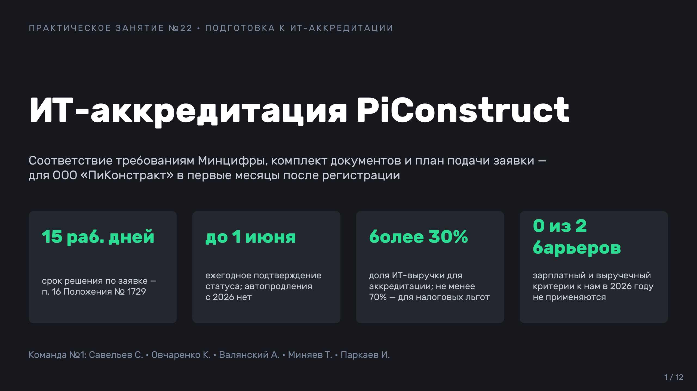
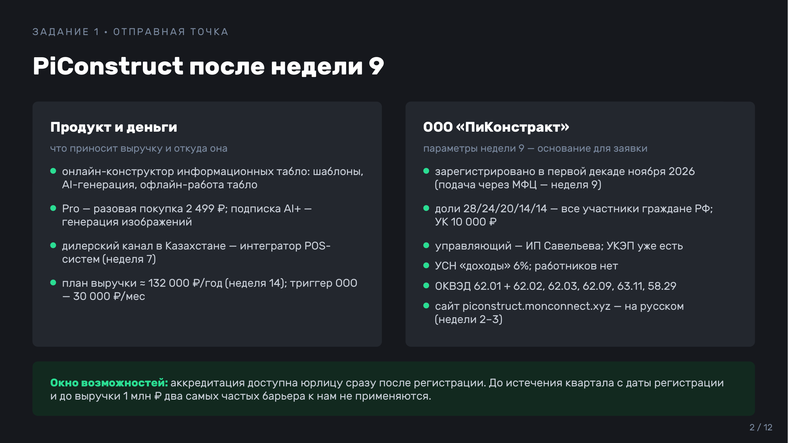
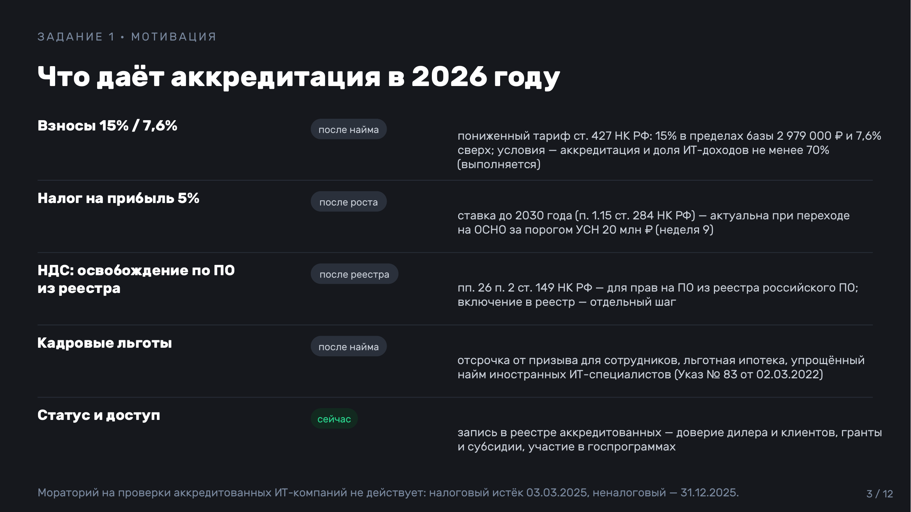
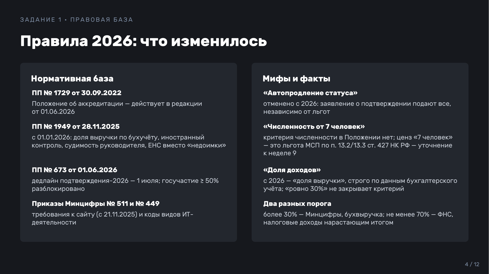
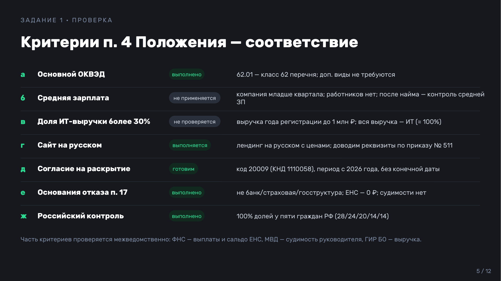
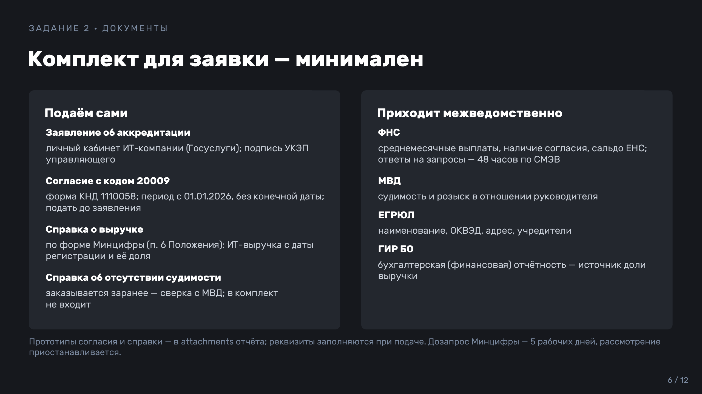
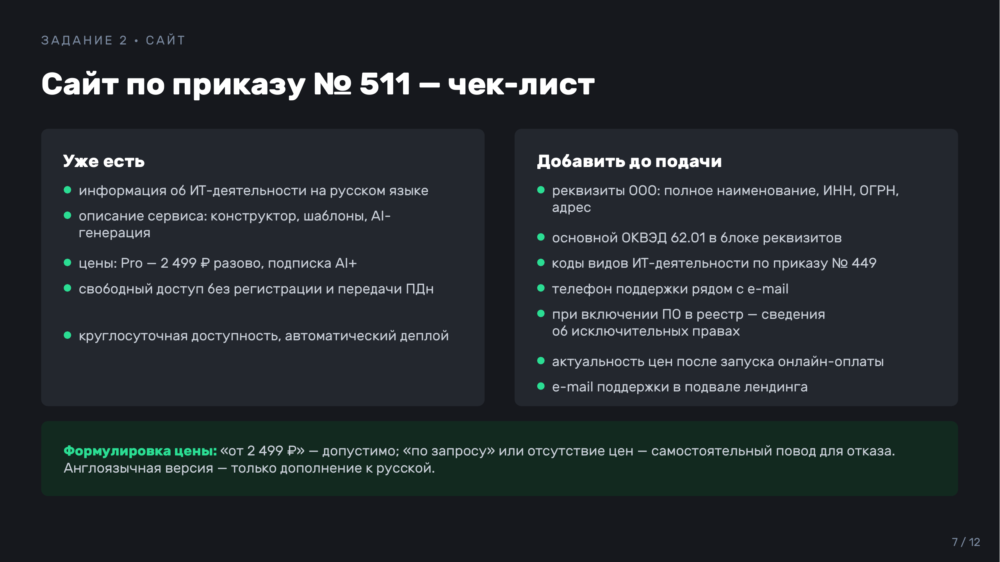
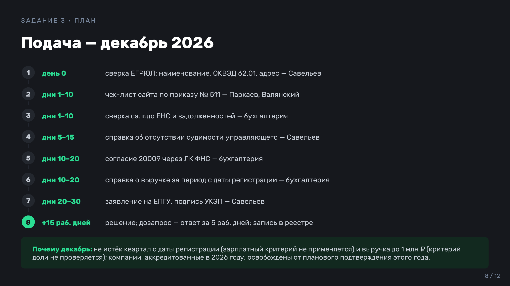
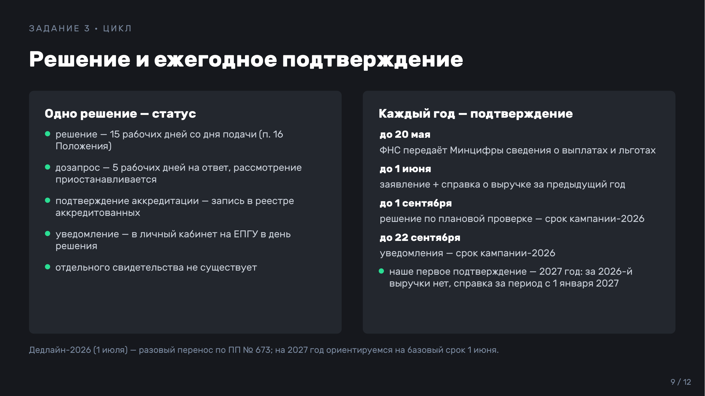
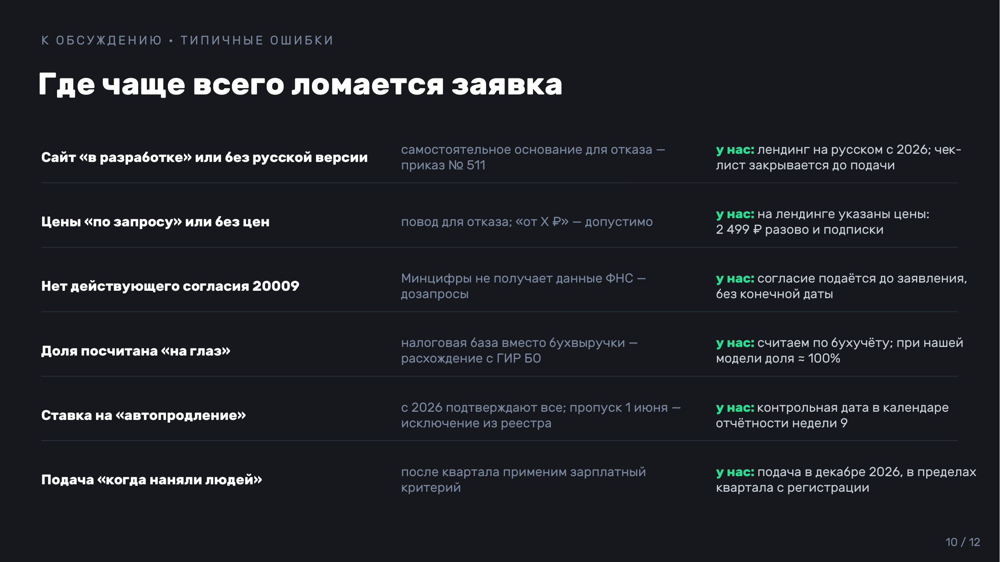
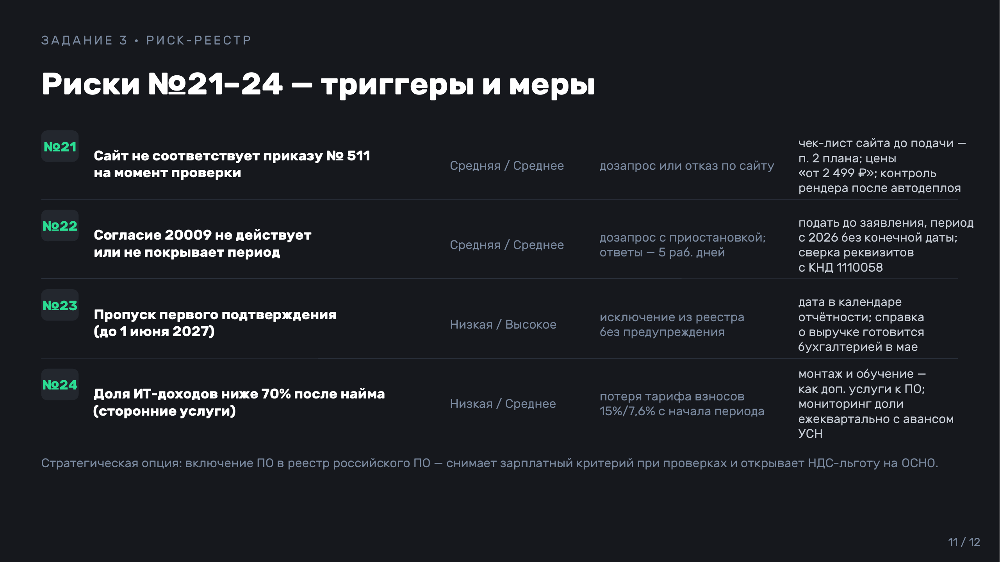
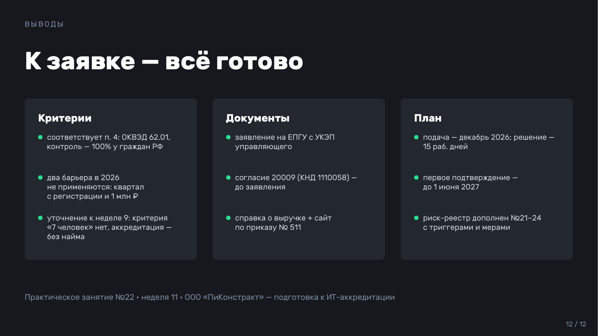

---

## Выводы

**Критерии.** ООО «ПиКонстракт» соответствует критериям аккредитации по действующей редакции Положения № 1729 (ред. от 01.06.2026): основной ОКВЭД 62.01 — класс 62 перечня, 100% долей у российских граждан, задолженностей и судимостей нет, сайт с описанием ИТ-деятельности на русском языке есть. Два барьера, блокирующие молодые компании, к нам в этом году не применяются: зарплатный критерий не действует для компаний младше квартала, выручечный — при выручке до 1 млн ₽ в году регистрации. Уточнена ошибка недели 9: критерия «численность от 7 человек» в Положении нет — это условие льготы МСП по ст. 427 НК РФ, а аккредитация доступна сразу после регистрации, без найма. Разделены пороги: более 30% ИТ-выручки — для статуса (Минцифры, бухучёт), не менее 70% ИТ-доходов — для налоговых льгот (ФНС).

**Документы.** Комплект минимален: заявление через личный кабинет ИТ-компании на Госуслугах с УКЭП управляющего (подпись у ИП Савельева уже есть), согласие на раскрытие налоговой тайны с кодом 20009 (форма КНД 1110058, период с 2026 года, без конечной даты) и справка о выручке по форме уполномоченного органа — прототипы в attachments. Остальные сведения (ЕНС, судимость, ЕГРЮЛ, бухотчётность) Минцифры получает межведомственно. Главная содержательная работа — доводка сайта по приказу № 511: реквизиты ООО, основной ОКВЭД, коды видов ИТ-деятельности, телефон поддержки, цены «от 2 499 ₽».

**План и риски.** Подача — декабрь 2026, решение — 15 рабочих дней, дозапрос — 5 рабочих дней; компании, созданные и аккредитованные в 2026 году, освобождены от планового подтверждения 2026-го, первое подтверждение — до 1 июня 2027 (сведения ФНС — до 20 мая; решение по итогам проверки — до 1 сентября, срок кампании-2026). Автопродления с 2026 года нет — дата в календаре отчётности недели 9. Риск-реестр дополнен №21–24: сайт по приказу № 511, действие согласия 20009, пропуск ежегодного подтверждения и доля ИТ-доходов ниже 70% после найма — с триггерами и мерами. Стратегическая развилка на будущее — включение ПО в реестр российского ПО: снимает зарплатный критерий при проверках и открывает НДС-льготу на ОСНО.
