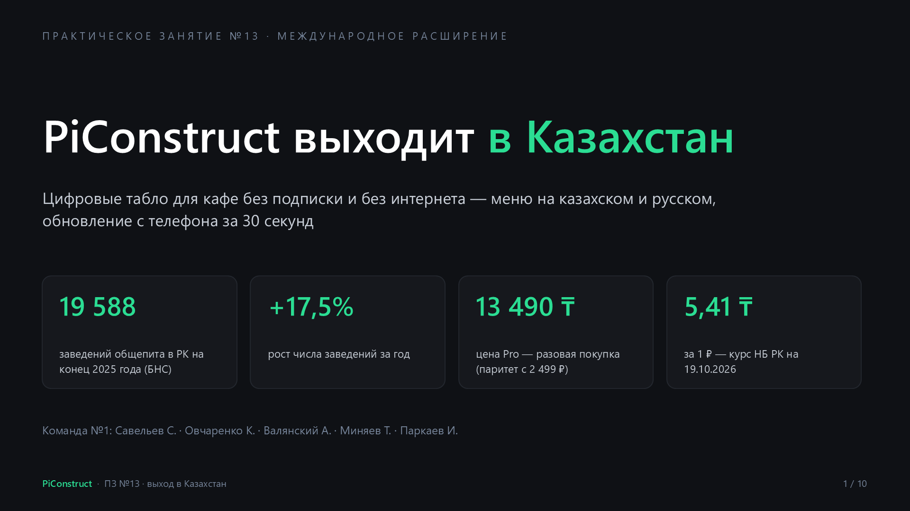
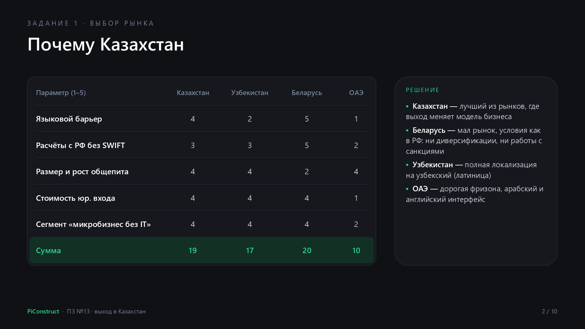
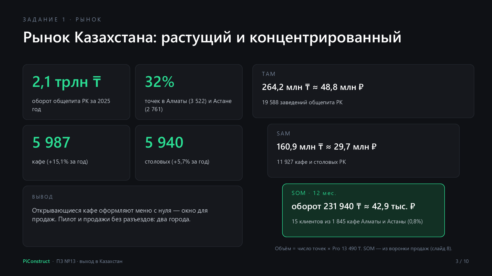
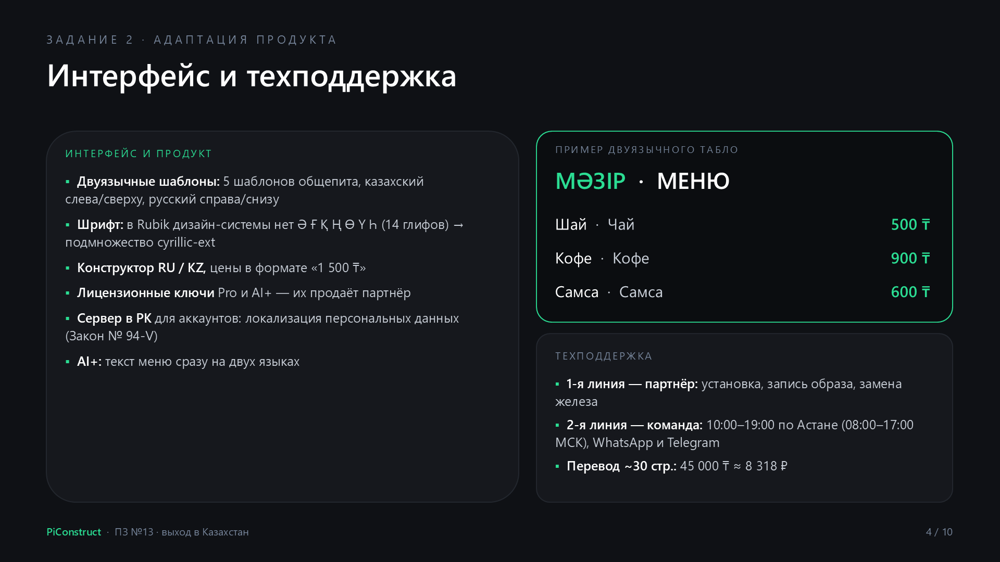
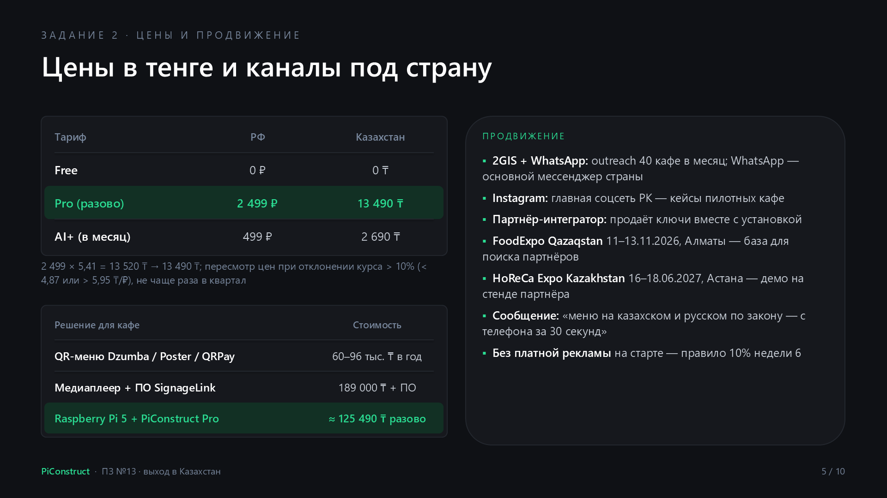
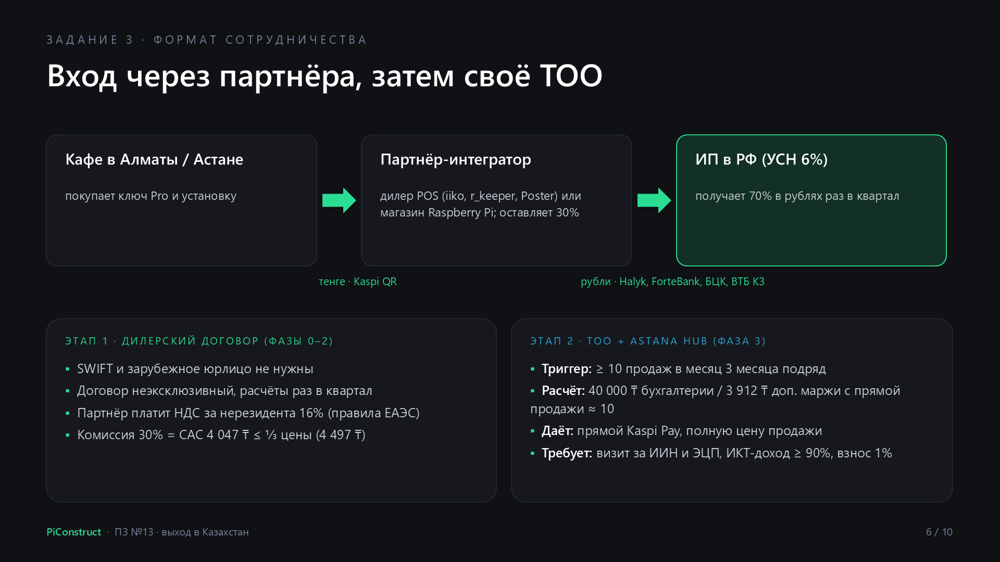
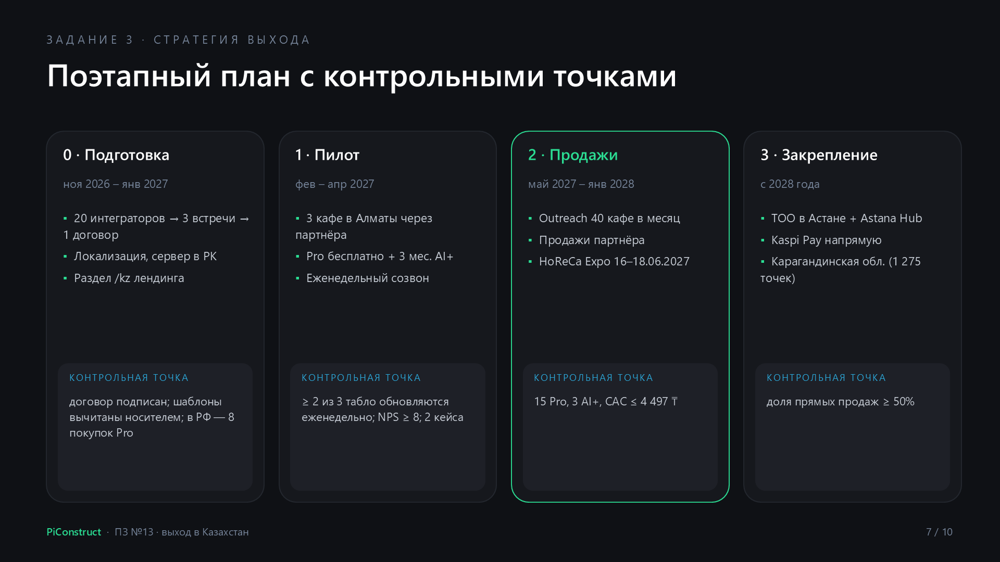
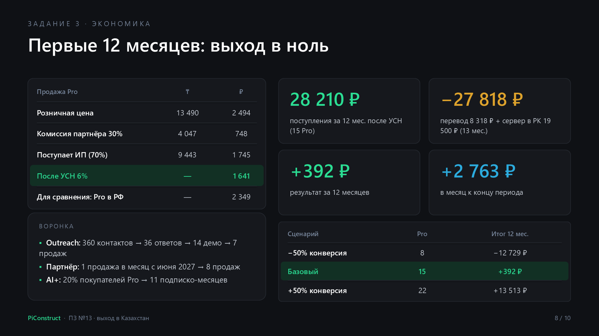
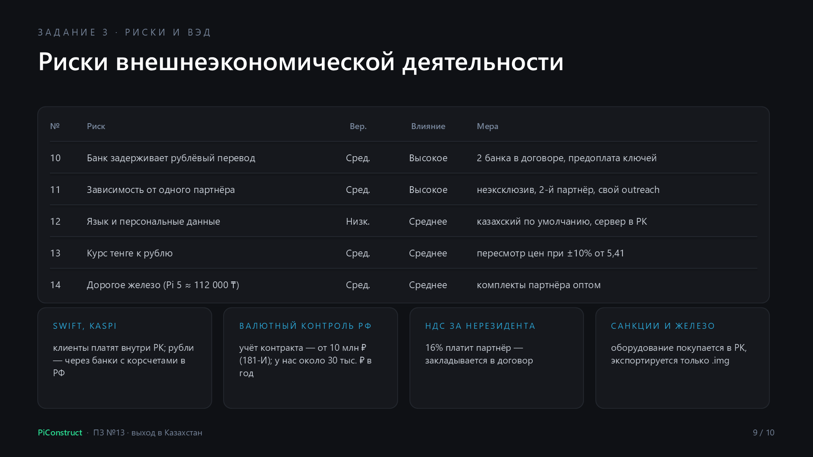
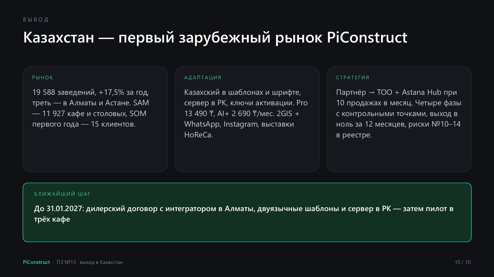

# Стартап в информационных технологиях
## Участники команды №1:

| ФИО                  | Роль                     |
| -------------------- | ------------------------ |
| Овчаренко Константин | Архитектор/Разработчик 💀 |
| Миняев Тимофей       | Маркетолог 🗣️           |
| Паркаев Илья         | Аналитик ✍️              |
| Савельев Сергей      | Тимлид/Дизайнер 🧑‍🎨    |
| Валянский Андрей     | Разработчик 💻           |

---
## Практическая неделя 7
## Тема практического занятия: Планирование и осуществление международного расширения стартапа, изучение международных рынков.

Все данные приведены по состоянию на 2026 год. Курс для пересчёта - **5,41 ₸ за 1 ₽** (официальный курс Национального банка Республики Казахстан (НБ РК)).

## Задание №1. Выбор целевого международного рынка

**Выбранный рынок: Республика Казахстан** - на первом этапе Алматы и Астана.

### Сравнение рынков-кандидатов

Рассмотрены дружественные к РФ направления из теоретической части занятия. Оценка от 1 (неблагоприятно) до 5 (благоприятно) по параметрам, критичным именно для PiConstruct: продукт русскоязычный, команда без бюджета на юрлицо за рубежом, целевой сегмент - кафе и столовые с 1–3 точками без IT-специалиста.

| Параметр | Казахстан | Узбекистан | Беларусь | ОАЭ |
|---|:-:|:-:|:-:|:-:|
| Языковой барьер (русскоязычный интерфейс и продажи) | 4 | 2 | 5 | 1 |
| Расчёты с РФ без SWIFT | 3 | 3 | 5 | 2 |
| Размер и рост рынка общепита | 4 | 4 | 2 | 4 |
| Стоимость юридического входа | 4 | 4 | 4 | 1 |
| Соответствие сегмента (микробизнес без IT) | 4 | 4 | 4 | 2 |
| **Сумма** | **19** | **17** | **20** | **10** |

Беларусь набирает наибольшую сумму, однако рынок мал, а условия ведения бизнеса практически совпадают с российскими: тема занятия (санкционные ограничения, адаптация под иностранную аудиторию) на нём не прорабатывается, а диверсификации рисков выход почти не даёт. Узбекистан требует полной локализации на узбекский язык (латиница), ОАЭ - дорогой лицензии свободной экономической зоны и интерфейса на арабском и английском. **Казахстан** - наибольшая сумма среди рынков, где выход действительно меняет модель бизнеса.

### Ключевые параметры рынка Казахстана

| Параметр | Значение | Вывод для PiConstruct |
|---|---|---|
| Объём рынка | 19 588 заведений общепита на конец 2025 года; оборот услуг общепита - 2,1 трлн ₸ | сопоставимо с крупным регионом РФ; достаточно для пилота и первых продаж |
| Темпы роста | +17,5% заведений за год (16 674 → 19 588); кафе +15,1% (5 202 → 5 987) | открывающимся заведениям нужно оформление с нуля - окно для продаж |
| Структура | кафе 5 987, столовые 5 940, рестораны 3 024, прочие 4 637 | ядро ЦА - кафе и столовые: 11 927 точек |
| Концентрация | Алматы 3 522 + Астана 2 761 = 6 283 точки (32% рынка); кафе: Алматы 1 036, Астана 809 | два города дают треть рынка - пилот и продажи без разъездов |
| Конкуренция | QR-меню по подписке: Dzumba 5 000 ₸/мес, Poster QR-меню 5 200 ₸/мес, QRPay от 8 000 ₸/мес; медиаплееры для табло от 149 000–189 000 ₸; глобальные Yodeck, Screenly, PiSignage - по подписке | локального офлайн-решения с разовой покупкой в открытом поиске не найдено - УТП сохраняется |
| Язык | русский широко используется в бизнесе; визуальная информация, включая меню и ценники, размещается на государственном (казахском) языке, русский - дополнительно (ст. 21 Закона «О языках») | продукт применим без перевода продаж, но шаблоны табло обязаны поддерживать казахский - это и требование, и аргумент продаж |
| Регуляторная среда | ЕАЭС: нет таможенных барьеров для услуг; с 01.01.2026 новый Налоговый кодекс - НДС 16%, упрощённый режим 4%; персональные данные граждан РК хранятся на территории РК (Закон № 94-V) | нужен сервер в Казахстане; налоговые последствия учитываются в модели входа (задание №3) |
| Расчёты | тенге; часть банков (Halyk Bank, ForteBank, Bank CenterCredit, ВТБ Казахстан) принимает рублёвые переводы из РФ, Kaspi - нет | клиенты платят партнёру в тенге через Kaspi, партнёр рассчитывается с нами в рублях |
| Часовой пояс | UTC+5, разница с Москвой +2 часа | поддержка без ночных смен |

### Объём рынка (расчёт снизу)

Расчёт выполнен от официальной статистики Бюро национальной статистики (БНС) РК и цены Pro в тенге (13 490 ₸, задание №2), без опоры на допущения питч-дека недели 4.

| Уровень | Определение | Точек | Объём (Pro × точки) |
|---|---|:-:|---|
| TAM | все заведения общепита РК | 19 588 | 264,2 млн ₸ ≈ 48,8 млн ₽ |
| SAM | кафе и столовые РК | 11 927 | 160,9 млн ₸ ≈ 29,7 млн ₽ |
| SOM (первые 12 месяцев продаж) | кафе Алматы и Астаны | 1 845 | 15 клиентов (0,8% точек): оборот 231 940 ₸ ≈ 42,9 тыс. ₽ |

Ограничение расчёта: БНС не выделяет точки сетевых операторов, поэтому SAM - верхняя граница (сегмент «1–3 точки» меньше). SOM получен из воронки продаж (задание №3), а не из доли рынка.

### Обоснование выбора

1. **Минимальная адаптация продукта:** русскоязычный интерфейс, документация и скрипты продаж применимы сразу; доработки - казахский язык в шаблонах, тенге, локальное хранение данных.
2. **Растущий целевой сегмент:** число кафе за 2025 год выросло на 15,1%, а треть рынка сосредоточена в двух городах.
3. **Ценовое окно:** местные QR-меню стоят 60 000–96 000 ₸ в год по подписке; Pro за 13 490 ₸ разово окупается за 1,7–2,7 месяца подписки конкурента - сохраняется ключевое УТП из питч-дека (неделя 4).
4. **Законодательный повод для покупки:** требование размещать меню на государственном языке превращает двуязычное табло, обновляемое с телефона, в способ выполнить закон без перепечатки.
5. **Решаемые барьеры ВЭД:** нет необходимости в SWIFT и зарубежном юрлице на старте - расчёты через партнёра в рублях; переход к собственному ТОО и статусу участника Astana Hub - при подтверждённом спросе.

---

## Задание №2. Адаптация продукта под целевой рынок

### Интерфейс и продукт

| № | Изменение | Зачем | Ответственный |
|:-:|---|---|---|
| 1 | Казахский язык в шаблонах табло: 5 шаблонов для общепита (меню, бизнес-ланч, акции, цены, объявления) в двуязычной вёрстке - казахский текст слева или сверху, русский справа или снизу | требование ст. 21 Закона «О языках» к меню и ценникам | Савельев (макеты), Валянский (вёрстка) |
| 2 | Шрифт с поддержкой казахского алфавита: в текущих файлах Rubik дизайн-системы и лендинга (подмножество cyrillic) отсутствуют 14 глифов - Ә ә, Ғ ғ, Қ қ, Ң ң, Ө ө, Ү ү, Һ һ (проверено по таблице символов файлов); подключить подмножество cyrillic-ext | без него казахский текст на табло отображается запасным шрифтом или «квадратами» | Валянский |
| 3 | Интерфейс конструктора на казахском (переключатель RU / KZ); русский остаётся основным | лояльность казахоязычных владельцев, требование партнёров к локализации | Валянский |
| 4 | Тенге в блоках цен: формат «1 500 ₸», пробел-разделитель разрядов | цены на табло - основной контент общепита | Валянский |
| 5 | Активация Pro и AI+ лицензионным ключом (ключ продаёт партнёр) вместо онлайн-оплаты на сайте | на первом этапе платежи из Казахстана идут через партнёра (задание №3) | Овчаренко |
| 6 | Отдельный сервер для казахстанских аккаунтов в дата-центре на территории РК (2 vCPU / 4 ГБ, 1 020–1 710 ₽/мес по предложениям хостеров) | требование локализации персональных данных граждан РК | Овчаренко |
| 7 | AI-помощник: генерация текста меню сразу на двух языках (по roadmap AI+) | двуязычное меню без ручного перевода - аргумент для AI+ | Овчаренко |

Офлайн-работа табло, `.img`-образ и обновление по локальному Wi-Fi не меняются: продукт не зависит от интернета и зарубежных облаков - блокировки сервисов в регионе на работу табло не влияют.

### Ценовая политика

Цены в тенге установлены по паритету с российскими с психологическим округлением вниз.

| Тариф | РФ | Казахстан | Расчёт |
|---|---|---|---|
| Free | 0 ₽ | 0 ₸ | - |
| Pro (разово) | 2 499 ₽ | **13 490 ₸** | 2 499 × 5,41 = 13 520 ₸ → округление (−0,2%) |
| AI+ (в месяц) | 499 ₽ | **2 690 ₸** | 499 × 5,41 = 2 700 ₸ → округление (−0,4%) |

Сравнение для клиента:

| Решение | Стоимость |
|---|---|
| QR-меню Dzumba / Poster / QRPay | 60 000 / 62 400 / от 96 000 ₸ в год - по подписке, меню только на телефоне гостя |
| Медиаплеер для табло (Avis Electronics, ПО SignageLink) | 189 000 ₸ за плеер + ПО |
| **PiConstruct**: Raspberry Pi 5 4 ГБ (≈ 112 000 ₸ в рознице Казахстана) + Pro 13 490 ₸ | **≈ 125 490 ₸ разово** - на 63 510 ₸ дешевле плеера, без абонентской платы |

Правило пересмотра: если курс отклоняется от 5,41 ₸/₽ более чем на 10% (ниже 4,87 или выше 5,95 ₸/₽), цены в тенге пересматриваются, но не чаще раза в квартал. Для справки: за первые три недели октября 2026 года курс вырос с 5,27 до 5,41 ₸/₽ (+2,7%).

### Маркетинг и продвижение

| Направление | РФ (текущее) | Казахстан |
|---|---|---|
| Поиск клиентов | cold outreach по 2GIS, Telegram | cold outreach по 2GIS - самый популярный геосервис в Казахстане; первый контакт - **WhatsApp** (основной мессенджер страны), Telegram - вторичный |
| Контент | Telegram-канал, SEO | Instagram - главная соцсеть страны по объёму контента и числу авторов (Brand Analytics, 2026): кейсы пилотных кафе, видео «меню на двух языках за 30 секунд» |
| Партнёрский канал | отложен (альтернатива А3 недели 5) | основной: интегратор POS-систем для общепита продаёт ключи вместе с установкой |
| Выставки | - | FoodExpo Qazaqstan (11–13.11.2026, Алматы, «Атакент») - каталог участников как база контактов для поиска партнёра; HoReCa Expo Kazakhstan (16–18.06.2027, Астана, EXPO) - демонстрация на стенде партнёра |
| Лендинг | piconstruct.monconnect.xyz | раздел `/kz`: цены в ₸, двуязычные примеры табло, кнопка WhatsApp |
| Ключевое сообщение | «табло без подписки и без интернета» | «меню на казахском и русском по закону - обновляется с телефона за 30 секунд, без подписки» |

Рекламные материалы и посты для Казахстана публикуются на казахском с русским дублированием (ст. 21 Закона «О языках»). Платная реклама на первом этапе не запускается - действуют правила недели 6: сначала органические и партнёрские каналы, новый платный канал - не более 10% бюджета.

### Техподдержка

| Линия | Кто | Что | Время |
|---|---|---|---|
| 1-я | партнёр-интегратор | установка Raspberry Pi и экрана, запись образа, замена оборудования, первичные вопросы | часы работы партнёра |
| 2-я | команда PiConstruct (Валянский, Овчаренко) | конструктор, сборка `.img`, обновление по Wi-Fi, ключи | 10:00–19:00 по Астане (08:00–17:00 МСК), WhatsApp Business и Telegram |

База знаний и видеоинструкции по прошивке (инициатива №14 бэклога недели 14) переводятся на казахский или снабжаются казахскими субтитрами. Объём перевода - около 30 страниц: лендинг - 4,9 страницы (8 691 знак текста `index.html` и `privacy.html`, подсчитано по файлам), интерфейс конструктора, шаблоны и FAQ - около 25 страниц (оценка команды). Стоимость - 45 000 ₸ ≈ 8 318 ₽ (1 500 ₸ за страницу 1 800 знаков - тариф бюро переводов). Перевод вычитывает носитель языка со стороны партнёра.

---

## Задание №3. Стратегия международного расширения

### Формат входа: партнёр → собственное ТОО

**Этап 1 (фазы 0–2): дилерский договор с казахстанским партнёром.** В РФ тимлид регистрирует ИП на упрощённой системе налогообложения (УСН «доходы», 6%), если оно не зарегистрировано к старту. Партнёр - интегратор POS-систем для общепита в Алматы (кандидаты для переговоров - дилеры iiko, r_keeper, Poster) или магазин Raspberry Pi (Brick Store, Alash electronics). Договор неэксклюзивный.

Схема денег:

1. Кафе оплачивает партнёру ключ Pro и установку в тенге (Kaspi QR, счёт).
2. Партнёр ежеквартально переводит ИП 70% розничной цены проданных ключей в рублях через банк, работающий с РФ (Halyk Bank, ForteBank, Bank CenterCredit, ВТБ Казахстан); SWIFT не требуется.
3. Партнёр оставляет себе 30% и зарабатывает на оборудовании и установке.

**Этап 2 (фаза 3): собственное ТОО в Астане** со 100% участием команды и заявка на статус участника Astana Hub. Даёт прямой приём оплаты через Kaspi Pay и полную цену с продажи; требует личного визита для получения ИИН и ЭЦП, бухгалтерии (от 40 000 ₸ ≈ 7 394 ₽ в месяц) и подтверждения доли дохода от ИКТ-деятельности не ниже 90% для налоговых льгот (членский взнос 1% от дохода).

**Расчётный триггер перехода к ТОО.** Прямая продажа приносит на 4 047 ₸ больше, чем продажа через партнёра; за вычетом комиссии Kaspi (~1%, около 135 ₸) - 3 912 ₸. Бухгалтерия ТОО окупается при 40 000 / 3 912 ≈ **10 прямых продажах в месяц**. Триггер: не менее 10 продаж в месяц в Казахстане три месяца подряд.

### Юнит-экономика продажи

| Показатель | ₸ | ₽ |
|---|---|---|
| Розничная цена Pro | 13 490 | 2 494 |
| Комиссия партнёра 30% (= CAC канала) | 4 047 | 748 |
| Поступает ИП (70%) | 9 443 | 1 745 |
| После УСН 6% | - | **1 641** |
| Для сравнения: продажа Pro в РФ после УСН 6% | - | 2 349 |
| AI+ в месяц: поступает ИП (70% от 2 690 ₸) | 1 883 | 348 |

Продажа в Казахстане приносит 70% от российской, но не требует затрат на привлечение со стороны команды. Комиссия партнёра 4 047 ₸ не превышает порог CAC из правил недели 6 - трети цены продукта (4 497 ₸).

Налоговая особенность ЕАЭС: при покупке прав на ПО у российского ИП местом реализации считается Казахстан, поэтому партнёр уплачивает НДС за нерезидента - 16% от суммы, перечисляемой ИП (1 511 ₸ с ключа Pro). Плательщик НДС принимает его к зачёту; партнёр на упрощённом режиме - нет, тогда его доход с ключа снижается до 2 536 ₸. Это условие обсуждается при подписании договора.

### Поэтапный план выхода

| Фаза | Срок | Действия | Ответственный | Контрольная точка (критерий перехода) |
|---|---|---|---|---|
| **0. Подготовка** | ноябрь 2026 – январь 2027 | поиск партнёра: 20 интеграторов и магазинов из 2GIS и каталога FoodExpo Qazaqstan → 3 встречи онлайн → 1 договор; локализация (пп. 1–6 задания №2); сервер в РК; перевод материалов; раздел `/kz` лендинга; договор, банк для рублёвых расчётов | Савельев (партнёр, договор), Овчаренко и Валянский (продукт), Миняев (материалы) | подписан дилерский договор; двуязычные шаблоны вычитаны носителем; в РФ выполнена цель недели 14 - 8 покупок Pro |
| **1. Пилот** | февраль – апрель 2027 | 3 кафе в Алматы через партнёра: бесплатный Pro и 3 месяца AI+ в обмен на отзыв и кейс; еженедельный созвон с партнёром | Миняев + партнёр, Паркаев (метрики) | через 60 дней не менее 2 из 3 табло работают и обновляются еженедельно (heartbeat-телеметрия); NPS ≥ 8; 2 опубликованных кейса |
| **2. Продажи** | май 2027 – январь 2028 (9 мес.) | outreach 40 контактов в месяц (2GIS + WhatsApp) по Алматы и Астане; продажи партнёра; Instagram с кейсами пилота; HoReCa Expo Kazakhstan (16–18.06.2027) - демо на стенде партнёра | Миняев, партнёр, Паркаев | 15 продаж Pro, 3 подписки AI+; CAC ≤ 4 497 ₸ |
| **3. Закрепление** | с 2028 года | при выполнении триггера (≥ 10 продаж в месяц три месяца подряд): ТОО в Астане, заявка в Astana Hub, Kaspi Pay; выход в Карагандинскую область (третий регион - 1 275 точек) | Савельев, Паркаев | собственный канал продаж, доля прямых продаж ≥ 50% |

Если контрольная точка фазы не выполнена, переход к следующей фазе откладывается, а причины разбираются по правилам недели 6 (без поиска виноватых, решения по фактам воронки).

### Прогноз на первые 12 месяцев (февраль 2027 – январь 2028)

Воронка outreach - по фактическим и плановым показателям российских продаж: доля ответов 10% (факт первого cold outreach), из ответивших на демонстрацию - 40%, из демонстраций в оплату - 50% (план sales test недели 11 прошлого семестра). 360 контактов → 36 ответов → 14 демонстраций → **7 продаж**. Партнёр - 1 продажа в месяц с июня 2027 года → **8 продаж**. Подписка AI+ - у 20% покупателей Pro, как в финансовой модели недели 11.

| Месяц | май | июн | июл | авг | сен | окт | ноя | дек | янв | Итого |
|---|:-:|:-:|:-:|:-:|:-:|:-:|:-:|:-:|:-:|:-:|
| Продажи Pro: outreach | 0 | 1 | 1 | 1 | 1 | 1 | 1 | 1 | 0 | 7 |
| Продажи Pro: партнёр | 0 | 1 | 1 | 1 | 1 | 1 | 1 | 1 | 1 | 8 |
| Покупателей Pro нарастающим итогом | 0 | 2 | 4 | 6 | 8 | 10 | 12 | 14 | 15 | 15 |
| Подписок AI+ | 0 | 0 | 0 | 1 | 1 | 2 | 2 | 2 | 3 | 11 подписко-месяцев |

| Статья | Сумма |
|---|---|
| Поступления ИП: Pro 15 × 9 443 ₸ + AI+ 11 × 1 883 ₸ | 162 358 ₸ ≈ 30 011 ₽ |
| После УСН 6% | **28 210 ₽** |
| Перевод на казахский (30 страниц) | −8 318 ₽ |
| Сервер в РК: 1 500 ₽ × 13 месяцев (январь 2027 – январь 2028) | −19 500 ₽ |
| **Результат за 12 месяцев** | **≈ +392 ₽ (безубыточность)** |
| Чистый поток к концу периода (2 продажи Pro и 3 подписки AI+ в месяц − сервер) | ≈ +2 763 ₽/мес |

Чувствительность (по методике недели 11 - ±50% к конверсии):

| Сценарий | Продаж Pro | Поступления после УСН | Результат за 12 мес. |
|---|:-:|---|---|
| Консервативный (−50%) | 8 | 15 089 ₽ | −12 729 ₽ |
| Базовый | 15 | 28 210 ₽ | +392 ₽ |
| Оптимистичный (+50%) | 22 | 41 331 ₽ | +13 513 ₽ |

Поездки на фазах 0–2 не планируются: пилот запускает партнёр, выставку представляет его стенд. Первая поездка - на фазе 3 для регистрации ТОО (перелёт Москва - Алматы туда-обратно - 20–35 тыс. ₽ по данным агрегаторов на октябрь 2026 года). Курсовая чувствительность: при 5,27 ₸/₽ поступления после УСН - 28 959 ₽, при 5,95 ₸/₽ - 25 650 ₽.

### Риски и особенности внешнеэкономической деятельности

| Особенность | Как учтена |
|---|---|
| SWIFT недоступен для ряда российских банков; Kaspi не принимает переводы из РФ | клиенты платят партнёру внутри Казахстана; партнёр переводит рубли ИП через банки с корреспондентскими отношениями с РФ |
| Валютный контроль РФ | расчёты в рублях по внешнеторговому договору; постановка контракта на учёт в банке не требуется - она обязательна для экспортных контрактов от 10 млн ₽ (Инструкция Банка России № 181-И), а годовой объём - около 30 тыс. ₽ |
| НДС за нерезидента 16% (правила ЕАЭС) | закладывается в договор с партнёром (см. юнит-экономику) |
| Оборудование и санкционные ограничения | железо через границу не перемещается: Raspberry Pi покупается в Казахстане, команда экспортирует только программный образ |
| Персональные данные граждан РК | сервер в РК (задание №2, п. 6) |
| Язык визуальной информации | казахский - по умолчанию в шаблонах для РК, вычитка носителем |

Дополнение к риск-реестру (неделя 14 прошлого семестра - риски №1–5, неделя 5 - №6–7, неделя 6 - №8–9):

| № | Риск | Вероятность | Влияние | Триггер для реакции | Мера |
|:-:|---|:-:|:-:|---|---|
| 10 | Банк партнёра задерживает или отклоняет рублёвый перевод | Средняя | Высокое | платёж не поступил в течение 10 рабочих дней | два банка в договоре (основной и резервный), квартальные расчёты, предоплата партии ключей |
| 11 | Зависимость от одного партнёра (кейс №4 недели 5) | Средняя | Высокое | менее 1 продажи партнёра два месяца подряд | неэксклюзивный договор, второй партнёр к фазе 2, собственный outreach |
| 12 | Нарушение языковых требований или требований к персональным данным | Низкая | Среднее | жалоба клиента, проверка | казахский по умолчанию в шаблонах для РК, вычитка носителем, сервер в РК до первой продажи |
| 13 | Курсовые колебания тенге к рублю | Средняя | Среднее | отклонение курса от 5,41 ₸/₽ более чем на 10% | ежеквартальный пересмотр цен в тенге |
| 14 | Высокая цена Raspberry Pi в рознице Казахстана (≈ 112 000 ₸ за Pi 5 4 ГБ) | Средняя | Среднее | отказ клиентов из-за стоимости оборудования | партнёр закупает комплекты оптом и продаёт их вместе с установкой |

---

## Презентация

Результаты оформлены в виде презентации на 10 слайдов (выбор рынка → рынок Казахстана → адаптация → формат входа → план → экономика → риски → вывод): [PiConstruct_Казахстан.pptx](attachments/PiConstruct_Казахстан.pptx).

---

## Выводы

**Выбор рынка.** Для первого международного выхода выбран Казахстан: 19 588 заведений общепита (+17,5% за 2025 год), треть которых сосредоточена в Алматы и Астане; русскоязычный продукт применим без перевода продаж, а расчёты возможны без SWIFT. Объём рынка рассчитан снизу по данным БНС РК: SAM - 11 927 кафе и столовых (160,9 млн ₸), SOM первых 12 месяцев - 15 клиентов в Алматы и Астане.

**Адаптация продукта.** Обязательные доработки определяются законодательством и инфраструктурой: казахский язык в шаблонах табло (меню - визуальная информация на государственном языке), шрифт с казахскими буквами (в текущих файлах Rubik нет 14 глифов), сервер в РК для персональных данных, активация по лицензионному ключу. Цены установлены по паритету: Pro 13 490 ₸, AI+ 2 690 ₸/мес - табло с Raspberry Pi дешевле медиаплеера и окупается быстрее года подписки на QR-меню. Каналы продвижения перестроены под страну: 2GIS + WhatsApp, Instagram, партнёрская сеть и выставки HoReCa.

**Стратегия расширения.** Вход в два этапа: дилерский договор с местным интегратором (без зарубежного юрлица, оплата клиентов через Kaspi, рублёвые расчёты с партнёром) → собственное ТОО и статус участника Astana Hub при 10 продажах в месяц - расчётной точке окупаемости бухгалтерии. План из четырёх фаз с контрольными точками даёт безубыточность за первые 12 месяцев (+392 ₽ в базовом сценарии) и положительный поток около 2 800 ₽ в месяц к концу периода. Риски ВЭД (банковские расчёты, зависимость от партнёра, язык и персональные данные, курс, стоимость железа) внесены в риск-реестр под №10–14 с триггерами и мерами.