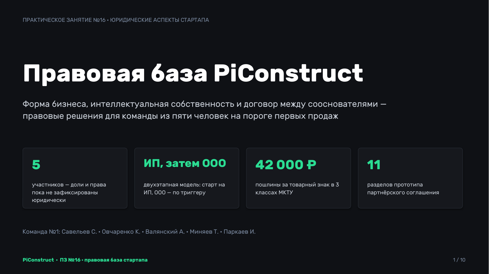
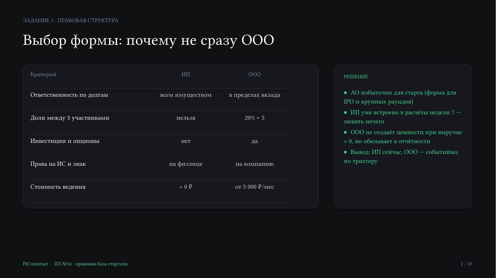
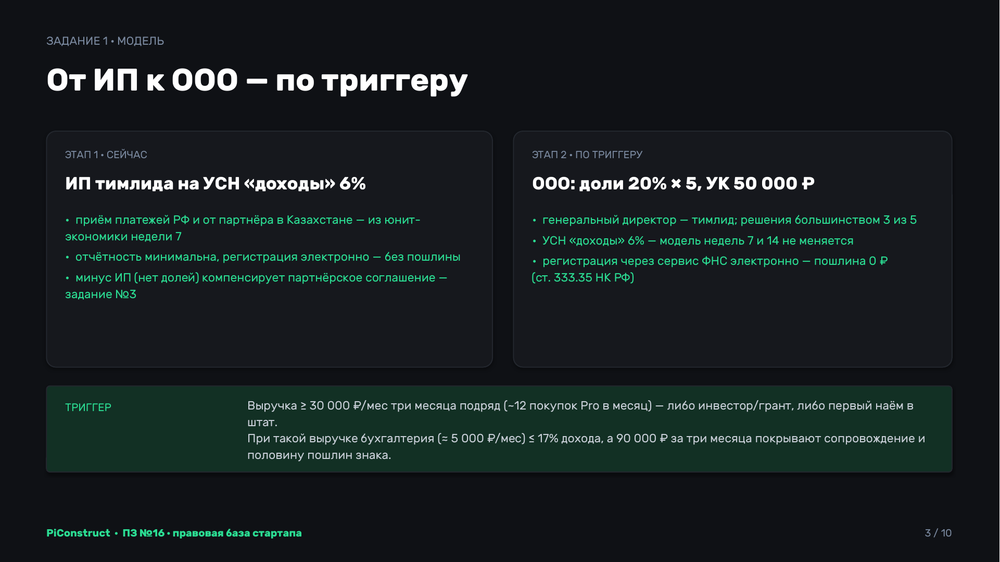
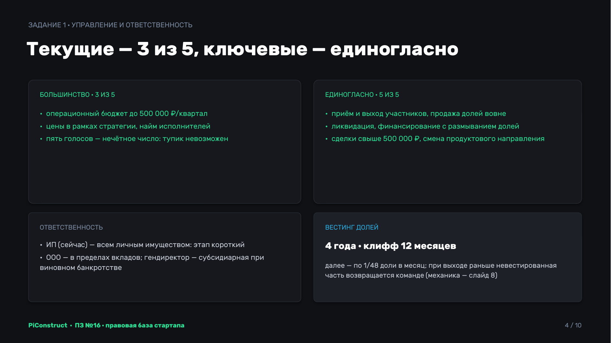
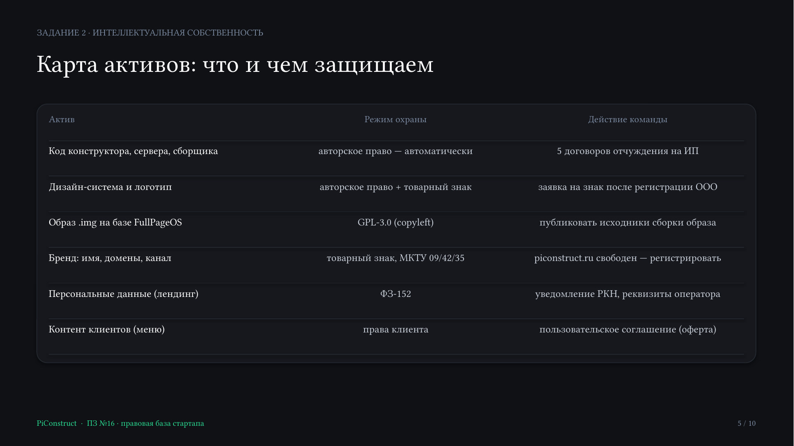
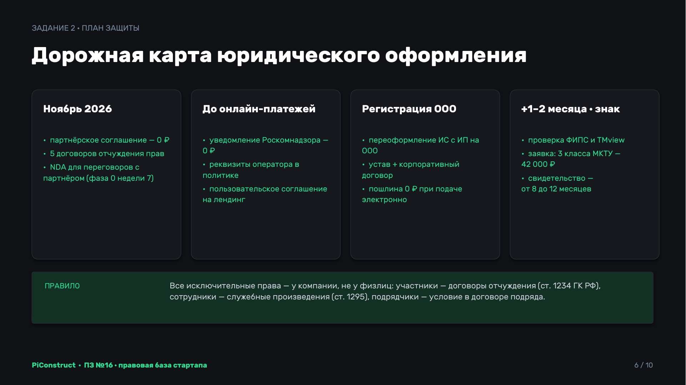
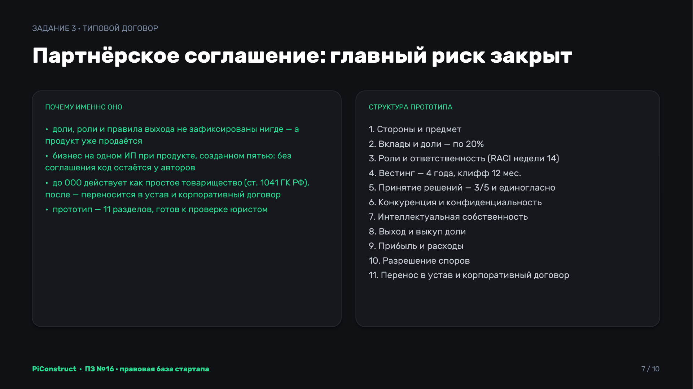
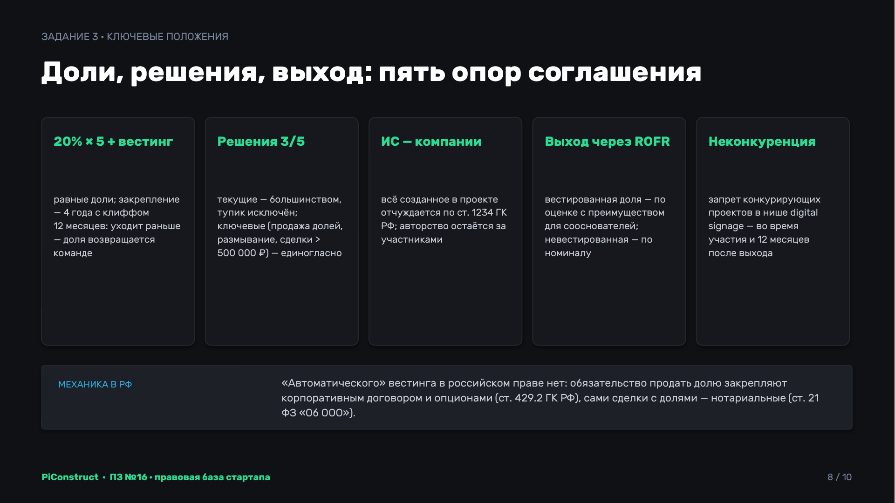
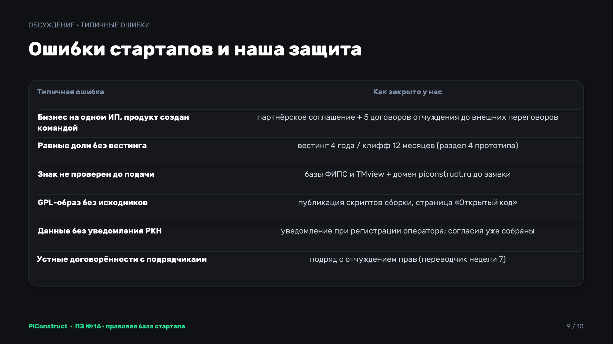
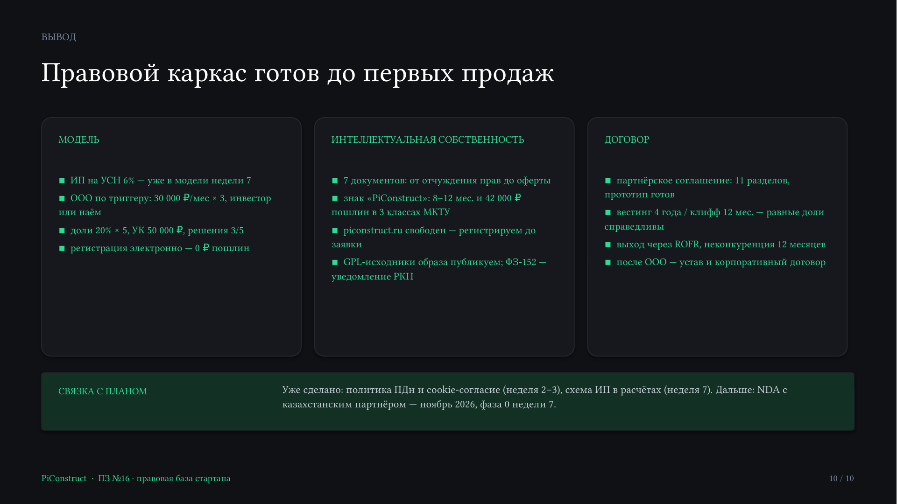

# Стартап в информационных технологиях
## Участники команды №1:

| ФИО                  | Роль                     |
| -------------------- | ------------------------ |
| Овчаренко Константин | Архитектор/Разработчик 💀 |
| Миняев Тимофей       | Маркетолог 🗣️           |
| Паркаев Илья         | Аналитик ✍️              |
| Савельев Сергей      | Тимлид/Дизайнер 🧑‍🎨    |
| Валянский Андрей     | Разработчик 💻           |

---
## Практическая неделя 8
## Тема практического занятия: Понимание юридических аспектов стартапа, защита интеллектуальной собственности, разработка договоров

Решения опираются на действующее законодательство РФ и пошлины по официальной таблице Роспатента по состоянию на 25 октября 2026 года и согласованы с прежними неделями: ИП на УСН 6% для расчётов с казахстанским партнёром уже заложено в стратегию недели 7, модель команды и загрузка участников — из недели 14 прошлого семестра. Часть правовой работы уже сделана в предыдущих неделях — политика обработки персональных данных лендинга (неделя 2–3), сервер в Казахстане и схема расчётов с партнёром (неделя 7); здесь эти решения сведены в целостный план.

## Задание №1. Правовая структура стартапа

### Исходное состояние

Проект работает без юридического лица: продукт создан и развивается пятью участниками, продажи стартуют, бренд уже используется публично (лендинг, Telegram-канал, домен). Что уже зафиксировано и что нет:

| Юридический вопрос | Текущий статус | Источник |
|---|---|---|
| Приём платежей в РФ и от партнёра в Казахстане | ИП тимлида (Савельев) на УСН «доходы» 6% — заложено в юнит-экономику | неделя 7 |
| Доли сооснователей | нигде не зафиксированы | — |
| Права на код, дизайн, бренд | остаются у авторов-физлиц, договоров нет | — |
| Оператор персональных данных | «команда PiConstruct» без реквизитов — заменить на полные данные при регистрации ИП/ООО | неделя 2–3 |
| Пользовательское соглашение, оферта | отсутствуют | — |

Главная уязвимость — не налоги и не отчётность, а то, что доли и права на интеллектуальную собственность держатся на дружбе и устных договорённостях: продукт уже создан, а юридически он принадлежит пяти физическим лицам без каких-либо обязательств между ними.

### Сравнение организационно-правовых форм

| Критерий | ИП | ООО | АО |
|---|---|---|---|
| Ответственность по обязательствам | всем личным имуществом | в пределах вклада в уставный капитал | в пределах акций |
| Разделение бизнеса на доли | нельзя | да, доли в уставном капитале | да, акции |
| Привлечение инвестиций | нет (нечего продавать) | да: доли, корпоративный договор, опционы | да, но избыточно для старта |
| Регистрация прав на ИС и товарный знак | можно, но права «висят» на физлице | да, на компанию | да |
| Отчётность и документооборот | минимальные | устав, протоколы, бухучёт | сложнее и дороже ООО |
| Стоимость ведения (на наших объёмах) | фиксированные взносы ИП «за себя» — 57 390 ₽ за 2026 год (+1% с дохода свыше 300 000 ₽); налог УСН уменьшается на взносы, поэтому при доходе до ≈ 950 000 ₽ в год налог к уплате — 0 ₽, а реальный расход — сами взносы | бухгалтерия на аутсорсе, оценка — от 5 000 ₽/мес; директор по трудовому договору — ещё ≈ 15 000 ₽/мес (см. ниже), если не передать управление ИП | существенно дороже |

АО отбрасываем сразу (форма для IPO и крупных раундов — по теоретической части занятия). ИП подходит для старта, но по трём критериям из шести не работает для команды из пяти человек: доли не разделить, инвестиции не привлечь, а вся ценность проекта — код, дизайн и бренд — формально остаётся у авторов, а не у бизнеса.

### Решение: двухэтапная модель «ИП → ООО»

**Этап 1 (сейчас — до триггера): ИП тимлида + партнёрское соглашение.** ИП на УСН «доходы» 6% уже встроено в финансовую модель недели 7 (приём 70% от продаж партнёра в Казахстане) — менять это решение нет причин: регистрация и закрытие просты, отчётность минимальна, госпошлины при электронной подаче нет. Бесплатным ИП не является: главный расход — фиксированные страховые взносы 57 390 ₽ за 2026 год (≈ 4 800 ₽/мес); налог УСН уменьшается на них полностью, поэтому при выручке базового плана (≈ 132 000 ₽ в год) налог к уплате — 0 ₽, а весь расход — взносы. Ключевой минус ИП для команды — отсутствие долей — компенсируется партнёрским соглашением пяти участников (задание №3): до учреждения ООО оно фиксирует доли, роли, vesting и правила выхода, а после учреждения переносится в устав и корпоративный договор.

**Этап 2 (по триггеру): ООО.** Переход на ООО — не календарный, а событийный, по той же логике триггеров, что и переход к ТОО в неделе 7. Триггер — первое из наступивших:

1. выручка ≥ 30 000 ₽/мес три месяца подряд (≈ 12 покупок Pro в месяц; для сравнения, цель недели 14 — 8 покупок Pro за первые 6 месяцев суммарно);
2. договорённость с инвестором или грантодателем, которому нужно юрлицо;
3. первый наём сотрудника в штат (план недели 14: QA и sales с 4-го месяца после старта продаж).

Экономика триггера: при 30 000 ₽/мес бухгалтерия на аутсорсе (≈ 5 000 ₽/мес) занимает ≈ 17% выручки. Условие — руководство ООО передаётся ИП тимлида как управляющему (ниже): если оформить директора по трудовому договору, расходы ООО вырастут ещё на ≈ 15 000 ₽/мес и порог в 30 000 ₽ перестанет оправдывать переход. Регистрировать ООО раньше — значит тратить на сопровождение больше, чем проект зарабатывает.

### Целевая модель ООО: ключевые юридические параметры

| Параметр | Решение | Обоснование |
|---|---|---|
| Доли участников | Савельев — __%, Овчаренко — __%, Валянский — __%, Миняев — __%, Паркаев — __% | не поровну: доли учитывают вклад и загрузку (1,0 FTE у троих и 0,75 FTE у двоих участников — неделя 14), а также риски тимлида, на ИП которого оформлены платежи; конкретные значения согласуются командой до подписания партнёрского соглашения |
| Vesting | 4 года, клифф 12 месяцев, далее линейно по 1/48 в месяц | защита от сценария «участник ушёл через месяц и сохранил всю долю» |
| Управление | полномочия единоличного исполнительного органа передаются управляющему — ИП Савельева (ст. 42 ФЗ «Об ООО»), по договору с минимальным вознаграждением | при нескольких участниках директор по трудовому договору обязателен; с 2026 года взносы за него начисляются не меньше чем с МРОТ (27 093 ₽) даже при неполной ставке — ≈ 8 200 ₽/мес только взносов, вместе с окладом на 0,25 ставки ≈ 15 000 ₽/мес; управляющий-ИП этого расхода не создаёт |
| Текущие решения | более половины голосов участников (голоса — пропорционально долям, ст. 32 ФЗ «Об ООО») | операционные вопросы не требуют согласия всех |
| Ключевые решения | не менее 3/4 голосов: приём и выход участников, продажа долей третьим лицам, привлечение финансирования с размыванием долей, сделки свыше 500 000 ₽, смена продуктового направления; реорганизация и ликвидация — единогласно, как требует закон (ст. 37 ФЗ «Об ООО») | квалифицированное большинство защищает от решений «за спиной» части команды, но не даёт одному участнику права вето по всем ключевым вопросам |
| Ответственность | участники — в пределах вкладов; руководитель (управляющий) и контролирующие лица — субсидиарная при доведении до банкротства виновными действиями | стандартная конструкция ООО |
| Уставный капитал | 10 000 ₽ — законный минимум, вносится деньгами пропорционально долям | для старта больше не требуется; деньги остаются в компании и расходуются на её нужды |
| Налоговый режим | УСН «доходы» 6% — как у ИП сейчас; прибыль — дивиденды с НДФЛ 13% (на наших объёмах) | смена формы не ломает финансовую модель недель 7 и 14 |
| Корпоративный договор | обязателен, переносит условия партнёрского соглашения (задание №3) | ст. 67.2 ГК РФ, ст. 11 ФЗ «Об ООО» |

### Порядок и стоимость регистрации ООО

Документы — по теоретической части занятия: заявление Р11001, устав, протокол общего собрания (решение об учреждении), договор об учреждении, документ на юридический адрес. Подача — через МФЦ: учредители подписывают заявление лично, поэтому электронная подпись не нужна. При самостоятельной электронной подаче через сервис ФНС усиленная квалифицированная электронная подпись нужна каждому из пяти учредителей, а бесплатно ФНС выдаёт её только руководителям организаций и ИП.

Разовые расходы на регистрацию:

| Статья | Сумма |
|---|---|
| Госпошлина при бумажной подаче в налоговую | 4 000 ₽ |
| Госпошлина при подаче через МФЦ или в электронном виде | 0 ₽ (подп. 32 п. 3 ст. 333.35 НК РФ) |
| Юридический адрес — по месту жительства участника с согласия собственников жилья (письмо Минфина от 17.12.2024 № 03-12-13/127455) | 0 ₽ |
| Уставный капитал | 10 000 ₽ (не расход: деньги остаются в компании) |
| Открытие расчётного счёта | 0 ₽ (тарифы банков для новых ООО) |
| **Итого разовых безвозвратных затрат** | **0 ₽** |

Ежемесячные расходы ООО:

| Статья | Сумма |
|---|---|
| Бухгалтерия на аутсорсе (оценка команды) | ≈ 5 000 ₽/мес |
| Руководство — управляющий ИП Савельева | вознаграждение по договору; взносы ИП уплачиваются и сейчас |
| Для сравнения: директор по трудовому договору на 0,25 ставки | ≈ 15 000 ₽/мес (оклад 6 773 ₽ + взносы 30,2% с МРОТ 27 093 ₽ ≈ 8 182 ₽) |

Расчётный счёт открывается сразу после регистрации — без него невозможны ни эквайринг на сайте, ни расчёты с казахстанским партнёром (неделя 7).

---

## Задание №2. Интеллектуальная собственность

### Инвентаризация активов

| Актив | Где существует | Правовой режим | Статус |
|---|---|---|---|
| Веб-конструктор (React + визуальный редактор) | frontend/vite-project | программа для ЭВМ, авторское право возникает автоматически (ст. 1259, 1261 ГК РФ) | права у авторов-физлиц, не оформлены |
| Backend-сервис (FastAPI) и сборщик образов (Node.js) | backend/constructor-service, pi-image-builder | то же | то же |
| Дизайн-система: токены, шрифты, логотип | неделя 1 (сем. 7), лендинг | произведение графики (авторское право) + обозначение для товарного знака | права у авторов, знак не подан |
| Базовый образ .img (FullPageOS) | pi-image-builder/images | стороннее ПО под GPL-3.0 | есть неисполненные обязательства лицензии |
| Бренд: имя PiConstruct, домен piconstruct.monconnect.xyz, t.me/piconstruct, hello@piconstruct.ru | лендинг, канал | товарный знак (не зарегистрирован), домены/аккаунты на физлиц | риск: активы не привязаны к бизнесу |
| Персональные данные пользователей (форма заявки, Яндекс Метрика) | лендинг | ФЗ-152 «О персональных данных» | политика есть (неделя 2–3), оператор без реквизитов |
| Контент клиентов (меню кафе, созданные в конструкторе) | облако сервиса | права клиента; условия хранения — пользовательское соглашение | соглашения нет |
| Финансовая модель, скрипты продаж, база 30 регистраций | документы команды | конфиденциальная информация (ноу-хау) | режим не установлен, NDA нет |

### Принцип: все исключительные права — у компании

Права оформляются на ИП сейчас и переоформляются на ООО после регистрации (ст. 1234 ГК РФ — договор об отчуждении исключительного права):

| Кто создаёт | Инструмент | Когда |
|---|---|---|
| 5 участников | договоры отчуждения прав на всё созданное к дате подписания; создаваемое далее — по акту приёмки раз в квартал | ноябрь 2026 |
| Будущие сотрудники (QA, sales — план недели 14) | служебные произведения (ст. 1295 ГК РФ): права работодателю автоматически, условие прямо в трудовом договоре | при найме |
| Подрядчики (перевод на казахский — 45 000 ₸, неделя 7) | договор подряда с условием отчуждения прав — без него перевод останется у переводчика | до заказа перевода |
| Пользователи (Free/Pro/AI+) | простая неисключительная лицензия в пользовательском соглашении (ст. 1235 ГК РФ); контент меню — собственность клиента | при запуске онлайн-оплаты |

Государственная регистрация программы для ЭВМ в Роспатенте добровольная (ст. 1262 ГК РФ) — на старте не делаем: авторское право охраняет код и без реестра, а свидетельство понадобится только инвестору или в споре.

### Товарный знак «PiConstruct»

Что регистрируем: словесный знак «PiConstruct» и комбинированный (логотип дизайн-системы недели 1). Классы МКТУ:

| Класс | Что закрывает |
|---|---|
| 09 | загружаемое и записываемое ПО — конструктор и .img-образ |
| 42 | разработка ПО, SaaS-конструктор |
| 35 | реклама и онлайн-продажи (лендинг, продвижение) |

Пошлины (официальная таблица Роспатента, расчёт для 3 классов, перечень товаров в классе — не более 10 наименований):

| Действие | Ставка | За 3 класса |
|---|---|---|
| Подача заявки и формальная экспертиза (п. 2.1) | 4 000 ₽ + 1 000 ₽ за класс свыше 1 | 6 000 ₽ |
| Экспертиза по существу (п. 2.4) | 13 000 ₽ + 2 500 ₽ за класс свыше 1 (+500 ₽ за товар свыше 10 в классе) | 18 000 ₽ |
| Регистрация и свидетельство в электронном виде (п. 2.11) | 18 000 ₽ (доплата — только свыше 5 классов) | 18 000 ₽ |
| **Итого пошлин** | | **42 000 ₽** |

Сроки: 8–12 месяцев по теоретической части занятия; на практике 2026 года экспертиза занимает до 12–18 месяцев. Знак действует 10 лет с даты подачи заявки с неограниченными продлениями (ст. 1491 ГК РФ); после регистрации появляется право на символ ® и основание пресекать копирование.

До подачи (обязательный шаг): проверка на тождество и сходство по открытым базам ФИПС и TMview — включая домены: **piconstruct.ru и piconstruct.com свободны на 25.10.2026**. Домен piconstruct.ru (≈ 300 ₽/год у аккредитованных регистраторов) регистрируем сразу, не дожидаясь заявки: на лендинге и в политике ПДн уже указан адрес hello@piconstruct.ru, который без домена не работает, а свободное имя могут перехватить.

Заявку подаёт ООО (а не ИП), чтобы знак сразу принадлежал компании и не требовал переоформления: передача знака с ИП на ООО потребовала бы отдельной государственной регистрации отчуждения с собственной пошлиной Роспатента.

### Свободное ПО и лицензии

Продукт стоит на открытом стеке, и это создаёт обязанности, а не только экономию:

| Компонент | Лицензия | Обязательство |
|---|---|---|
| FullPageOS (базовый образ .img) и входящие в него пакеты Raspberry Pi OS | GPL-3.0 (FullPageOS), GPL и другие свободные лицензии (пакеты ОС) | образ распространяется клиентам (прошивка SD-карты): при передаче копии нужно давать лицензии и исходный текст GPL-компонентов — публикуем ссылки на точные версии исходников FullPageOS и пакетов ОС, а также наши изменения образа (скрипты pi-image-builder, конфиги hostapd, dnsmasq, systemd-сервиса) в открытый репозиторий; собственный конструктор и backend распространяются как веб-сервис и GPL-обязанностей не создают |
| React, Vite, Tailwind, FastAPI, SQLAlchemy, Express | MIT | сохранить упоминания авторов в копиях ПО |
| Шрифт Rubik (дизайн-система недели 1) | SIL Open Font License 1.1 | свободное использование, в том числе в вебе; нельзя продавать шрифт отдельно |

Сейчас в репозитории нет ни одного LICENSE-файла — добавляем лицензии зависимостей и страницу «Открытый код» на лендинг со ссылками на исходники сборки образа.

### Персональные данные (ФЗ-152)

Сделано раньше: политика обработки ПДн с редакцией от 22.09.2026, чекбокс согласия на форму, cookie-баннер, загрузка Яндекс Метрики только после согласия, маскирование поля ввода в Вебизоре (неделя 2–3). Для данных граждан Казахстана — сервер на территории РК (неделя 7).

Осталось:

| Шаг | Условие |
|---|---|
| Указать в политике полные реквизиты оператора (сейчас указана обезличенная команда, а оператором может быть только конкретное лицо — ИП или организация) | сразу после регистрации ИП |
| Подать уведомление в Роскомнадзор как оператор ПДн (ст. 22 ФЗ-152, бесплатно) | сразу после регистрации ИП: уведомление подаётся до начала обработки, а лендинг уже собирает данные через форму заявки и Яндекс Метрику. С 30.05.2025 за неподачу штраф по ч. 10 ст. 13.11 КоАП РФ: для граждан 5 000–10 000 ₽, для юрлиц 100 000–300 000 ₽ |
| Перенести политику на piconstruct.ru | после регистрации домена (ноябрь 2026) |

### Дорожная карта юридического оформления ИС

| Срок | Действие | Стоимость |
|---|---|---|
| ноябрь 2026 | регистрация ИП; уведомление Роскомнадзора и реквизиты оператора в политике; домен piconstruct.ru; партнёрское соглашение (задание №3); 5 договоров отчуждения прав на ИП; NDA для переговоров с казахстанским партнёром (фаза 0 недели 7 начинается в ноябре); LICENSE-файлы и страница «Открытый код» | ≈ 300 ₽/год за домен; взносы ИП — 57 390 ₽ в год |
| до первых онлайн-платежей | пользовательское соглашение (оферта) на лендинг | 0 ₽ |
| регистрация ООО (триггер задания №1) | переоформление ИС с ИП на ООО; устав, договор об учреждении и корпоративный договор; договор с управляющим — ИП Савельева | 0 ₽ пошлин (подача через МФЦ); бухгалтерия ≈ 5 000 ₽/мес |
| +1–2 месяца после ООО | проверка баз + заявка на товарный знак, 3 класса | 42 000 ₽ |
| +8–18 месяцев | свидетельство на товарный знак, символ ® | — |

---

## Задание №3. Типовой договор: партнёрское соглашение сооснователей

### Почему выбран этот документ

Из трёх вариантов занятия (партнёрское соглашение, договор с разработчиком, пользовательское соглашение) первый закрывает самый большой риск: доли, роли и правила выхода для пяти участников не зафиксированы нигде, при этом продукт уже создан и продаётся. Пользовательское соглашение и договор с подрядчиком-переводчиком готовятся по мере надобности (дорожная карта задания №2), партнёрское соглашение нужно немедленно — оно же служит фундаментом устава и корпоративного договора будущего ООО.

### Структура прототипа

| № | Раздел | Ключевое положение |
|---|---|---|
| 1 | Стороны и предмет | пять участников; цель — совместная разработка и коммерциализация PiConstruct, учреждение ООО на условиях раздела 2 |
| 2 | Вклады и доли | вклады — время, компетенции и уже созданные результаты (программный комплекс, дизайн-система, контент); доли будущего ООО — не поровну, с учётом вклада и загрузки; значения вписываются командой до подписания |
| 3 | Роли и зоны ответственности | распределение по RACI недели 14; занятость на старте: 1,0 FTE × 3, 0,75 FTE × 2 |
| 4 | Vesting | 4 года с клиффом 12 месяцев; при выходе до окончания — невестированная часть доли перераспределяется между оставшимися |
| 5 | Принятие решений | до учреждения ООО — один голос у каждого: текущие решения — 3 из 5, ключевые (список из задания №1) — 4 из 5, протокол собрания; после учреждения — голоса пропорционально долям: текущие — более половины, ключевые — не менее 3/4, реорганизация и ликвидация — единогласно |
| 6 | Конкуренция и конфиденциальность | запрет конкурирующих проектов в нише digital signage / конструкторов табло на срок участия; после выхода — конфиденциальность 3 года (запрет конкуренции после выхода для граждан спорен и может быть признан ничтожным как ограничение правоспособности, п. 3 ст. 22 ГК РФ); условия NDA для всех внутренних материалов |
| 7 | Интеллектуальная собственность | всё созданное в рамках проекта отчуждается компании (ИП сейчас, ООО после учреждения) по договорам из задания №2; подписание соглашения означает согласие на отчуждение |
| 8 | Выход и выкуп | уведомление за 30 дней; выкуп вестированной части — по справедливой оценке с правом преимущественной покупки сооснователями; невестированной — по номиналу |
| 9 | Прибыль | распределение после покрытия расходов и резерва затрат на 6 месяцев, пропорционально долям |
| 10 | Споры | переговоры 15 дней, затем суд: до учреждения ООО — суд общей юрисдикции (стороны — граждане), после — арбитражный суд (корпоративный спор, ст. 225.1 АПК РФ) |
| 11 | Заключительные положения | после учреждения ООО положения переносятся в устав и корпоративный договор |

Прототип договора: [Партнёрское_соглашение_PiConstruct.docx](attachments/Партнёрское_соглашение_PiConstruct.docx).

### Юридическая механика (почему прототип устроен именно так)

До учреждения ООО соглашение работает как непоименованный договор (п. 2 ст. 421 ГК РФ): стороны вправе заключить договор, не предусмотренный законом, и закрепить в нём обязательство учредить ООО на согласованных условиях и передать исключительные права. Оформить его как простое товарищество нельзя: сторонами товарищества для предпринимательской деятельности могут быть только ИП и коммерческие организации (п. 2 ст. 1041 ГК РФ), а четверо из пяти участников — граждане без статуса ИП. После регистрации ООО те же условия получают силу через устав и корпоративный договор (ст. 67.2 ГК РФ, ст. 11 ФЗ «Об ООО»): им можно обязать участника продать долю — это и есть механика vesting в России, потому что «автоматического» вестинга, как в Delaware C-Corp, в российском праве нет. Все сделки с долями ООО совершаются в нотариальной форме (ст. 21 ФЗ «Об ООО») — поэтому правило о выкупе закрепляется заранее, а не в момент конфликта.

---

## Типичные ошибки и как они закрыты (к обсуждению)

| Ошибка стартапов | Чем грозит | Как закрыто у нас |
|---|---|---|
| Продукт создан командой, бизнес оформлен на одного (ИП) | при конфликте или выходе автора код остаётся у физлица; у инвестора нет объекта покупки | партнёрское соглашение + 5 договоров отчуждения до первых внешних переговоров |
| Доли поровну и без vesting | вклад и риски участников не учтены; участник уходит через полгода с полной долей и блокирует решения | доли с учётом вклада и загрузки + vesting 4 года / клифф 12 месяцев (разделы 2 и 4 прототипа) |
| Название не проверено до заявки на товарный знак | отказ Роспатента, потеря пошлин 42 000 ₽ или спор с владельцем тождественного знака | проверка баз ФИПС/TMview и регистрация домена до подачи |
| Образ на GPL-ядре распространяется без исходников | нарушение лицензии, требование исходников от любого получателя образа | публикация скриптов сборки образа, страница «Открытый код» |
| Сбор данных без уведомления Роскомнадзора | административная ответственность (ст. 13.11 КоАП РФ) | уведомление РКН при регистрации оператора; согласия уже собраны (неделя 2–3) |
| Устные договорённости с подрядчиками | права на перевод и дизайн остаются у исполнителей | договор подряда с отчуждением прав (переводчик недели 7) |

Дополнение к риск-реестру (неделя 14 прошлого семестра — №1–5, неделя 5 — №6–7, неделя 6 — №8–9, неделя 7 — №10–14):

| № | Риск | Вероятность | Влияние | Триггер для реакции | Мера |
|---|---|---|---|---|---|
| 15 | ИС остаётся у авторов-физлиц, участник выходит из проекта с правами на свой модуль | Средняя | Высокое | участник не подписал договор отчуждения в течение 30 дней | подписание пакета (партнёрское соглашение + отчуждение) всеми пятью до старта фазы 0 недели 7 |
| 16 | Столкновение заявки «PiConstruct» с тождественным/сходным знаком | Низкая | Среднее | отказ формальной экспертизы, возражение правообладателя | предварительная проверка ФИПС/TMview; резервные обозначения (PiConstruct Pro, имя продукта без приставки); заявка в 3 классах с компактным перечнем |
| 17 | Блокировка счёта ИП по 115-ФЗ из-за регулярных переводов из Казахстана | Низкая | Высокое | запрос банка о происхождении средств | понятные назначения платежей, внешнеторговый договор с партнёром (неделя 7), документы по запросу банка, резервный банк в договоре |

---

## Презентация

Результаты оформлены в виде презентации на 10 слайдов (модель «ИП → ООО» → параметры ООО → карта ИС → план защиты ИС → договор: структура и ключевые положения → типичные ошибки → вывод): [PiConstruct_Правовая_база.pptx](attachments/PiConstruct_Правовая_база.pptx).

---

## Выводы

**Правовая структура.** Выбрана двухэтапная модель: сейчас ИП тимлида на УСН «доходы» 6% (уже заложено в расчёты недели 7; главный расход — фиксированные взносы 57 390 ₽ в год) с партнёрским соглашением пяти участников, затем — ООО с долями по вкладу и загрузке участников, уставным капиталом 10 000 ₽ и управляющим — ИП тимлида (без расходов на директора по трудовому договору, ≈ 15 000 ₽/мес). Текущие решения — большинством голосов, ключевые — не менее 3/4, реорганизация и ликвидация — единогласно. Переход — по триггеру (выручка ≥ 30 000 ₽/мес три месяца подряд, инвестор или первый наём), при котором бухгалтерия ООО занимает около 17% выручки; регистрация через МФЦ — без госпошлины и без электронных подписей учредителей, юрадрес — по месту жительства участника.

**Интеллектуальная собственность.** Вся ценность проекта — код конструктора, дизайн-система, образ и бренд — переводится на компанию договорами отчуждения (ст. 1234 ГК РФ) от участников, служебными произведениями от сотрудников и подрядными условиями от исполнителей. На товарный знак «PiConstruct» подаётся заявка в трёх классах МКТУ (09, 42, 35) сразу после регистрации ООО: пошлины 42 000 ₽ по официальной таблице Роспатента, срок 8–12 месяцев по теоретической части (на практике до 12–18), действие — 10 лет с даты подачи (ст. 1491 ГК РФ); домен piconstruct.ru свободен и регистрируется сразу — от него зависит почта hello@piconstruct.ru на лендинге. Для GPL-компонентов образа публикуются ссылки на исходники и наши изменения; по ФЗ-152 уведомление Роскомнадзора и реквизиты оператора — сразу после регистрации ИП, потому что лендинг уже собирает данные.

**Договор.** Разработан прототип партнёрского соглашения — документ, закрывающий главный риск проекта: пять участников без зафиксированных долей. Структура из 11 разделов: вклады и доли с учётом вклада и загрузки, vesting 4 года с клиффом 12 месяцев, большинство по текущим и квалифицированное большинство по ключевым решениям, отчуждение ИС компании, выход через преимущественный выкуп, неконкуренция на срок участия и конфиденциальность после выхода. До учреждения ООО соглашение действует как непоименованный договор (п. 2 ст. 421 ГК РФ) — простым товариществом оно быть не может, так как участники не ИП (п. 2 ст. 1041 ГК РФ); после — переносится в устав и корпоративный договор (ст. 67.2 ГК РФ); сделки с долями — нотариальные (ст. 21 ФЗ «Об ООО»).
