# Стартап в информационных технологиях
## Участники команды №1:

| ФИО                  | Роль                     |
| -------------------- | ------------------------ |
| Овчаренко Константин | Архитектор/Разработчик 💀 |
| Миняев Тимофей       | Маркетолог 🗣️           |
| Паркаев Илья         | Аналитик ✍️              |
| Савельев Сергей      | Тимлид/Дизайнер 🧑‍🎨    |
| Валянский Андрей     | Разработчик 💻           |

---
## Практическая неделя 9
## Тема практического занятия: Регистрация компании. Юридические аспекты

Решения опираются на действующее законодательство РФ по состоянию на ноябрь 2026 года и согласованы с прежними неделями: двухэтапная модель «ИП → ООО» и пороги решений — из недели 8, загрузка участников — из недели 14 прошлого семестра, расчёты с казахстанским партнёром — из недели 7. В неделе 8 ООО учреждается по триггеру, а конкретные значения долей оставлены «__%» до согласования. Занятие требует подготовить полный комплект документов для регистрации ООО — подготовка бесплатна (подача через МФЦ без госпошлины), поэтому пакет готовится заранее: к моменту триггера регистрация занимает 3 рабочих дня (с передачей документов через МФЦ — до 5), а спорные вопросы — доли, адрес, руководитель — решаются на спокойной стадии, а не в момент триггера. Здесь фиксируется всё, что в неделе 8 осталось открытым, выбирается налоговый режим с расчётом обязательств за первый квартал работы ООО и составляется план первого месяца. Шаблоны документов — в папке attachments.

## Задание №1. Регистрация компании

### Открытые вопросы из недели 8

| Вопрос | Статус в неделе 8 | Решение в неделе 9 |
|---|---|---|
| Размер долей участников | «__%» — согласование до подписания партнёрского соглашения | 28 / 24 / 20 / 14 / 14 — обоснование ниже |
| Юридический адрес | «по месту жительства участника с согласия собственников» | адрес места жительства управляющего (Савельева), согласия собственников прилагаются |
| Руководитель | управляющий — ИП Савельева (ст. 42 ФЗ «Об ООО») | ФИО управляющего для ЕГРЮЛ — Савельев Сергей |
| Устав | «устав, договор об учреждении и корпоративный договор» | собственный устав — типовые уставы не позволяют ни управляющего-ИП, ни порогов 3/4 |
| Сроки и процедура | «подача через МФЦ» | полный комплект из 6 документов, регистрация 3 рабочих дня |

### Решение: параметры компании

| Параметр | Значение |
|---|---|
| Полное фирменное наименование | Общество с ограниченной ответственностью «ПиКонстракт» |
| Сокращённое наименование | ООО «ПиКонстракт» |
| Юридический адрес | адрес места жительства управляющего — Савельева Сергея (письмо Минфина от 17.12.2024 № 03-12-13/127455); согласие собственников жилья — приложение к комплекту; полный адрес указывается в Р11001 |
| Уставный капитал | 10 000 ₽ — законный минимум; оплата деньгами в течение 4 месяцев с даты регистрации (п. 1 ст. 16 ФЗ «Об ООО»), фактически — сразу после открытия счёта |
| Единоличный исполнительный орган | управляющий — индивидуальный предприниматель Савельев Сергей, срок полномочий 3 года, вознаграждение по договору о передаче полномочий (ст. 42 ФЗ «Об ООО») |
| Налоговый режим | УСН «доходы» 6% — задание №2 |
| Печать | не применяется (необязательна с 2015 года) |
| Основной ОКВЭД | 62.01 «Разработка компьютерного программного обеспечения»; дополнительные: 62.02, 62.03, 62.09, 63.11, 58.29 |

### Размер долей

| Учредитель | Роль (неделя 14) | Загрузка | Доля | Взнос в УК 10 000 ₽ |
|---|---|:-:|:-:|:-:|
| Савельев Сергей | Тимлид/дизайнер, продажи, приём платежей на ИП | 1,0 FTE | 28% | 2 800 ₽ |
| Овчаренко Константин | Архитектор, backend, интеграция AI | 1,0 FTE | 24% | 2 400 ₽ |
| Валянский Андрей | Разработчик, frontend | 1,0 FTE | 20% | 2 000 ₽ |
| Миняев Тимофей | Маркетолог | 0,75 FTE | 14% | 1 400 ₽ |
| Паркаев Илья | Аналитик | 0,75 FTE | 14% | 1 400 ₽ |

**Комментарий:** доли отражают загрузку (1,0 FTE у троих против 0,75 у двоих — неделя 14) и дополнительные риски тимлида: платежи РФ и Казахстана проходят через его ИП (риск №17 недели 8 — блокировка по 115-ФЗ), на нём же роль управляющего. Разница между Савельевым и Овчаренко — 4 п. п. за руководящую роль и принятые риски; между 1,0 и 0,75 FTE — 6 п. п. Значения выносятся на подписание партнёрского соглашения (задание №3 недели 8) — после подписания они переносятся в протокол и договор об учреждении.

### Комплект документов для регистрации

При пяти учредителях «решение о создании» задания оформляется протоколом общего собрания учредителей — решение единственного учредителя неприменимо. Комплект:

| № | Документ | Что фиксирует | Примечание |
|:-:|---|---|---|
| 1 | Заявление Р11001 | наименование, адрес, УК, руководитель (управляющий), виды деятельности | заявители — все пять учредителей, по листу Н на каждого |
| 2 | Устав | орган управления, пороги решений, управляющий-ИП, распределение прибыли | собственный — см. ниже |
| 3 | Протокол общего собрания учредителей № 1 | учреждение, утверждение устава и УК, доли, избрание управляющего, поручение подать документы | решения — единогласно |
| 4 | Договор об учреждении | доли, порядок оплаты УК, ведение дел до регистрации | обязателен при 2+ учредителях (ст. 89 ГК РФ, ст. 11 ФЗ «Об ООО»); в ФНС не подаётся |
| 5 | Согласия собственников жилья на юридический адрес | согласие на использование жилого помещения как адреса ООО | помещение в долевой собственности (доля учредителя < 50%) — согласия всех собственников |
| 6 | Уведомление о переходе на УСН (форма 26.2-1) | выбор УСН «доходы» 6% | подаётся вместе с комплектом (абз. 2 п. 2 ст. 346.13 НК РФ); пропущенный 30-дневный срок = ОСНО с НДС 22% с даты регистрации, УСН — только с 1 января следующего года |

Подача — через МФЦ: подписи заявителей ставятся лично в присутствии сотрудника, электронные подписи учредителей не нужны (бесплатно УКЭП ФНС выдаёт только руководителям и ИП — управляющий-ИП Савельев подпись уже имеет). Госпошлина при подаче через МФЦ — 0 ₽ (подп. 32 п. 3 ст. 333.35 НК РФ), срок регистрации — 3 рабочих дня. После регистрации: лист записи ЕГРЮЛ и устав с отметкой приходят электронно, на регистрацию налогового учёта это не влияет — уведомление об УСН уже в комплекте.

### Ключевые поля заявления Р11001

| Раздел | Что указываем |
|---|---|
| Наименование | ООО «ПиКонстракт» (полное — «Общество с ограниченной ответственностью «ПиКонстракт»») |
| Адрес | адрес места жительства Савельева С.; для адреса учредителя-физлица подтверждающие документы не требуются, согласия собственников — в комплекте |
| Уставный капитал | 10 000 ₽ |
| Руководитель | управляющий — ИП Савельев Сергей (ОГРНИП, ИНН) |
| Заявители | пять учредителей — по листу Н на каждого; подпись собственноручно в присутствии сотрудника МФЦ |

### Шаблоны регистрационных документов

Прототипы документов (даты, паспортные данные, адреса и ИНН/ОГРНИП заполняются при подаче):

| Документ | Содержание прототипа |
|---|---|
| [Протокол общего собрания учредителей № 1](attachments/Протокол_об_учреждении_ООО_ПиКонстракт.docx) | повестка из 8 вопросов: учреждение, наименование, место нахождения, устав, УК и доли, договор об учреждении, управляющий-ИП, поручение подать документы; решения единогласно |
| [Договор об учреждении](attachments/Договор_об_учреждении_ООО_ПиКонстракт.docx) | предмет — учреждение ООО на условиях проекта устава; доли 28/24/20/14/14 и номиналы; оплата УК деньгами в 4-месячный срок; расходы на регистрацию — пропорционально долям; сделки, необходимые для учреждения, до регистрации заключают уполномоченные учредители с последующим одобрением общества (ст. 986, 987 ГК РФ) |
| [Устав ООО «ПиКонстракт»](attachments/Устав_ООО_ПиКонстракт.docx) | 7 разделов: общие положения; участники и УК; органы управления (ОСУ, управляющий-ИП); распределение прибыли; переход долей; хранение документов; реорганизация и ликвидация |

Почему устав не типовой: типовые уставы (приказ Минэкономразвития № 411) не предусматривают ни передачу полномочий управляющему-ИП, ни наши пороги голосования. В устав переносятся решения недели 8:

| Положение устава | Формулировка |
|---|---|
| Текущие решения ОСУ | более половины голосов участников, голоса — пропорционально долям (ст. 32 ФЗ «Об ООО») |
| Ключевые решения | не менее 3/4 голосов: приём и выход участников, продажа долей третьим лицам, привлечение финансирования с размыванием долей, сделки свыше 500 000 ₽, смена продуктового направления |
| Реорганизация и ликвидация | единогласно (ст. 37 ФЗ «Об ООО») |
| Управление | полномочия ЕИО переданы управляющему — ИП Савельева (ст. 42 ФЗ «Об ООО»); избирается ОСУ на 3 года; объём полномочий и вознаграждение — по договору |
| Переход долей | преимущественное право участников, сделки с долями — нотариальные (ст. 21 ФЗ «Об ООО»); vesting из партнёрского соглашения — через корпоративный договор (ст. 67.2 ГК РФ), а не устав |

---

## Задание №2. Выбор налогового режима

### Выбранный режим: УСН «доходы», 6%

Режим уже работает у ИП тимлида (недели 7–8): смена формы не меняет налоговый режим, финансовая модель недель 7 и 14 не ломается. Проверка против альтернатив по состоянию на 2026 год:

| Критерий | ОСНО | УСН «доходы минус расходы» 15% | **УСН «доходы» 6%** |
|---|---|---|---|
| Налог с выручки | налог на прибыль 25% | 15% с разницы (минимальный налог 1% от выручки) | **6% с выручки** |
| НДС | 22% с первой продажи | освобождение до 20 млн ₽/год (ст. 145 НК РФ в редакции 425-ФЗ от 28.11.2025) | то же — **20 млн ₽/год; запас ≈ 37 раз даже при росте +50% к триггеру (540 000 ₽/год)** |
| Учёт расходов | полный учёт | документы на каждый расход, кассовый метод | **расходы не нужны — не подтверждаем** |
| Смена режима | - | объект меняется только с начала года (п. 2 ст. 346.14 НК РФ) | то же |

Порог безубыточности режимов: 6% × доход = 15% × (доход − расходы) → расходы выгодны при «доходы минус расходы», когда превышают 60% выручки. Расходы ООО при триггерной выручке 30 000 ₽/мес: бухгалтерия ≈ 5 000 ₽, два сервера ≈ 3 000 ₽ (РФ + Казахстан, неделя 7), домен и сервисы ≈ 1 000 ₽ — итого ≈ 9 000 ₽/мес, или 30% выручки. Запас до порога — двукратный.

**Комментарий:** при базовом плане недели 14 (выручка ≈ 132 000 ₽/год, расходы ≈ 100 000 ₽/год с переводом и серверами) «доходы минус расходы» за квартал дал бы 1 200 ₽ против 1 980 ₽ на «доходах» — экономия меньше 1 000 ₽ в квартал не оправдывает документальный учёт каждого расхода и теряется при первом же росте выручки: на уровне триггера «доходы минус расходы» стоит 9 450 ₽ за квартал против 5 400 ₽ на «доходах». Режим фиксируем на весь год — сменить внутри года нельзя.

### Расчёт налоговых обязательств за квартал

Механика: налог — 6% доходов; ООО без сотрудников не уменьшает налог (уменьшение — на страховые взносы за работников до 50%, пп. 1 п. 3.1 ст. 346.21 НК РФ); вознаграждение управляющему-ИП взносами ООО не облагается. ООО, в отличие от ИП, не платит фиксированные взносы «за себя» (57 390 ₽ за 2026 год) — это часть экономики перехода недели 8.

| Сценарий выручки за квартал | УСН 6% | Комментарий |
|---|:-:|---|
| Базовый план недели 14: 33 000 ₽ (132 000/4) | 1 980 ₽ | первый квартал, если ООО учреждено до выхода на триггер |
| Триггер недели 8: 90 000 ₽ (30 000 × 3) | 5 400 ₽ | первый квартал работы ООО при выручке перехода |
| Рост +50% к триггеру: 135 000 ₽ | 8 100 ₽ | ≈ 18 покупок Pro в месяц или рост подписок AI+ |

Чувствительность линейна: каждый 10 000 ₽ выручки за квартал — 600 ₽ налога. При найме (QA и sales — план недели 14) налог уменьшается на взносы за работников до 50%: например, при выручке триггера и sales-менеджере на 0,25 ставки (взносы ≈ 8 200 ₽/мес с МРОТ 27 093 ₽ — расчёт недели 8) квартальный налог 5 400 ₽ снизится до 2 700 ₽.

| Дополнительные обязательства | Расчёт |
|---|---|
| НДС | не уплачивается: выручка за год на порядок ниже порога 20 млн ₽ (при превышении НДС возникает с 1-го числа месяца превышения) |
| Дивиденды при распределении прибыли | НДФЛ 13% у участников (ставка до 2,4 млн ₽/год) |
| ИТ-аккредитация (взносы 15% в пределах базы и 7,6% сверх — с 2026 года, ст. 427 НК РФ) | перспектива после первого найма: с 2026 для аккредитации снова требуется среднесписочная численность от 7 человек; доля ИТ-доходов ≥ 70% у нас выполняется |
| Отчётность при нулевой деятельности | «нулевая» декларация УСН и бухгалтерская отчётность — даже без продаж |

### Календарь платежей и отчётности ООО

| Что | Срок |
|---|---|
| Уведомление по ЕНП об авансовом платеже за I квартал | до 25 апреля |
| Авансовый платёж за I квартал | до 28 апреля |
| II квартал (уведомление / платёж) | до 25 / 28 июля |
| III квартал (уведомление / платёж) | до 25 / 28 октября |
| Декларация УСН за год | до 25 марта |
| Налог за год | до 28 марта |
| Бухгалтерская отчётность за год | до 31 марта |

---

## Задание №3. Финансово-административная модель: первый месяц после регистрации

План запускается с даты регистрации (день 0). Принцип — переезд с ИП на ООО без разрыва в работе сервиса: счёта работают параллельно, дилерский договор с партнёром и приём платежей переключаются только после открытия счёта ООО и оферты с новыми реквизитами.

| № | Срок | Действие | Ответственный | Внешний сервис |
|:-:|---|---|---|---|
| 1 | день 0 | получить лист записи ЕГРЮЛ и устав с отметкой; проверить запись в ЕГРЮЛ | Савельев | ФНС (сервис выдачи документов) |
| 2 | дни 1–3 | открыть расчётный счёт: основной — в банке ИП (история операций упрощает комплаенс по расчётам с Казахстаном), резервный — второй банк (риск №17); заявка на эквайринг | Савельев | банки |
| 3 | дни 1–5 | внести УК 10 000 ₽ пропорционально долям, назначение платежа — «оплата доли в уставном капитале» | все 5 участников | банк |
| 4 | дни 1–7 | договор с онлайн-бухгалтерией: УСН «доходы», календарь ЕНП с автоплатежами, первая нулевая отчётность | Савельев | бухгалтерский сервис (≈ 5 000 ₽/мес — оценка недели 8) |
| 5 | дни 1–10 | проконтролировать приём уведомления 26.2-1 о применении УСН | бухгалтерия | ФНС |
| 6 | дни 5–15 | подключить ЭДО для отчётности и договоров; УКЭП управляющего — у ИП Савельева уже есть | бухгалтерия | оператор ЭДО (Диадок, СБИС, Такском) |
| 7 | дни 10–20 | перевести активы с ИП на ООО: договоры отчуждения исключительных прав (неделя 8), перезаключение дилерского договора с партнёром Казахстана — замена стороны, уведомление банка о расчётах с РК | Савельев, Овчаренко | банк (валютный контроль; экспортный контракт до 10 млн ₽ на учёте не стоит — Инструкция ЦБ № 181-И, неделя 7) |
| 8 | до первых онлайн-платежей | облачная онлайн-касса (54-ФЗ) для продажи Pro на сайте; пользовательское соглашение и оферта с реквизитами ООО | Овчаренко, Миняев | оператор ККТ/ОФД (≈ 3 000 ₽/мес) |
| 9 | дни 15–25 | уведомление Роскомнадзора от имени ООО — новый оператор персональных данных; обновление политики ПДн на лендинге | Паркаев | Роскомнадзор (форма на сайте РКН) |
| 10 | дни 20–30 | корпоративный договор — перенос партнёрского соглашения недели 8 (доли, vesting, пороги, выход) в силу ст. 67.2 ГК РФ; список участников ООО | все участники | нотариус — для будущих сделок с долями (ст. 21 ФЗ «Об ООО») |
| 11 | постоянно | календарь отчётности из задания №2 | бухгалтерия | бухгалтерский сервис |

Бюджет первого месяца:

| Статья | Сумма |
|---|---|
| Внесение УК (не расход — деньги остаются на счёте) | 10 000 ₽ |
| Бухгалтерский сервис | ≈ 5 000 ₽/мес |
| Онлайн-касса с ОФД | ≈ 3 000 ₽/мес (только к запуску онлайн-оплаты) |
| Расчётный счёт, ЭДО для отчётности, уведомление РКН | 0 ₽ (тарифы для новых ООО, ЭДО входит в бухгалтерский сервис, уведомление бесплатно) |
| **Итого операционно** | **≈ 8 000 ₽/мес** |

**Комментарий:** 8 000 ₽/мес — 27% выручки триггера (30 000 ₽), вместе с налогом 6% (1 800 ₽) — 33%. Контур первого месяца укладывается в экономику перехода недели 8: бухгалтерия ≈ 17% выручки, всё остальное (касса) — только при прямых онлайн-платежах, продажи ключей через партнёра Казахстана в кассе РФ не участвуют.

---

## Типичные ошибки и как они закрыты (к обсуждению)

| Ошибка стартапов | Чем грозит | Как закрыто у нас |
|---|---|---|
| Пропущен 30-дневный срок уведомления о переходе на УСН | ОСНО с даты регистрации: НДС 22% с первой же продажи и налог на прибыль 25%, УСН — только с 1 января следующего года | форма 26.2-1 подаётся вместе с комплектом; контроль приёма — п. 5 плана первого месяца |
| Ошибки в Р11001 или «массовый» юридический адрес | приостановка регистрации по ст. 23 ФЗ-129, потеря 1–2 месяцев | адрес — место жительства учредителя с согласиями собственников; комплект проверяется по чек-листу ФНС; повторная подача — без пошлины |
| УК внесён без назначения платежа или не всеми учредителями | неполная оплата доли: голоса и отчуждение ограничены оплаченной частью (п. 3 ст. 16, п. 3 ст. 21 ФЗ «Об ООО») | назначение платежа «оплата доли в уставном капитале» прописано в п. 3 плана |
| Оператором ПДн остаётся ИП, а данные собирает лендинг ООО | ООО — новый оператор без уведомления РКН: штраф 100 000–300 000 ₽ (ч. 10 ст. 13.11 КоАП РФ) | уведомление РКН от имени ООО — п. 9 плана, политика обновляется в те же сроки |
| Пакет документов готовится «когда понадобится» | в момент триггера доли, адрес и руководитель решаются в спешке и с ошибками | комплект и доли зафиксированы заранее (задание №1), обновляются при подаче |
| Типовой устав из интернета без своих порогов | решения блокируются или принимаются «за спиной» части команды | собственный устав с порогами недели 8 и управляющим-ИП |

Дополнение к риск-реестру (неделя 14 прошлого семестра — №1–5, неделя 5 — №6–7, неделя 6 — №8–9, неделя 7 — №10–14, неделя 8 — №15–17):

| № | Риск | Вероятность | Влияние | Триггер для реакции | Мера |
|:-:|---|:-:|:-:|---|---|
| 18 | Приостановка или отказ в регистрации ООО (ст. 23 ФЗ-129) | Средняя | Среднее | сообщение ИФНС о приостановке с перечнем причин | чек-лист ФНС по комплекту, согласия на адрес, повторная подача через МФЦ без пошлины |
| 19 | Разрыв операционного перехода ИП → ООО: партнёр не может оплатить, покупатель не получает ключ | Средняя | Высокое | партнёр сообщил о невозможности оплаты, первая продажа зависла | счёта ИП и ООО работают параллельно, дилерский договор перезаключается до первой оплаты на ООО (п. 7 плана), ключи активируются вручную (неделя 7) |
| 20 | Пропуск первого налогового платежа или отчёта при занятости команды (совмещение с учёбой) | Средняя | Среднее | уведомление ФНС о задолженности, пени по ЕНП | бухгалтерский сервис с календарём и автосписанием ЕНП (п. 4 плана), сроки — в календаре задания №2 |

---

## Презентация

Результаты оформлены в виде презентации на 12 слайдов (модель и параметры компании → комплект документов → шаблоны → устав → Р11001 → налоговый режим → расчёт за квартал → план первого месяца → ошибки и риски → вывод): [PiConstruct_Регистрация_ООО.pptx](attachments/PiConstruct_Регистрация_ООО.pptx).

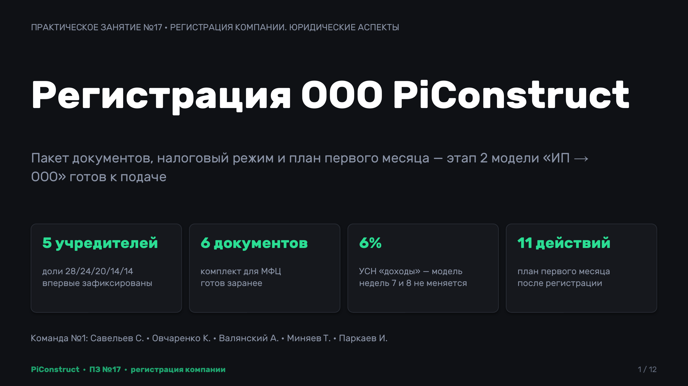
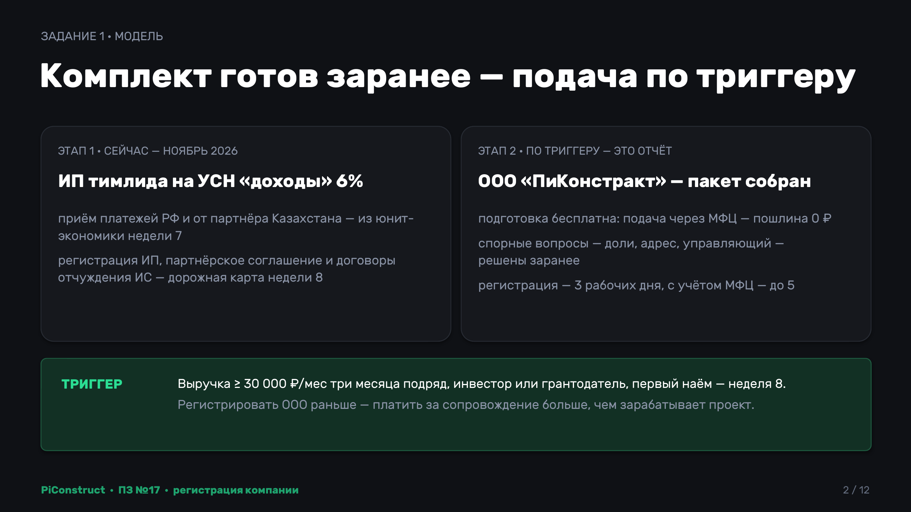
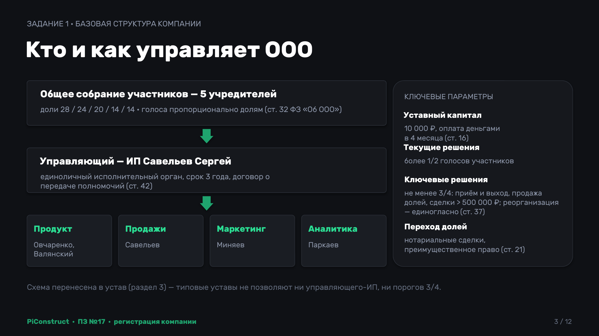
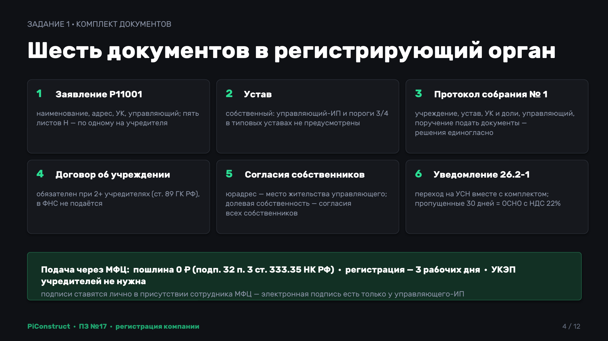
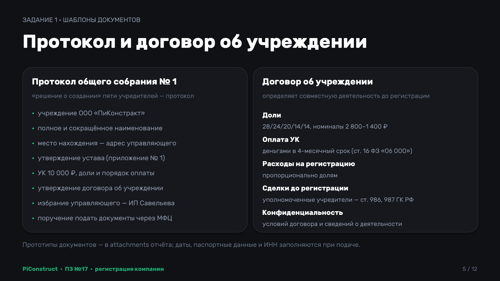
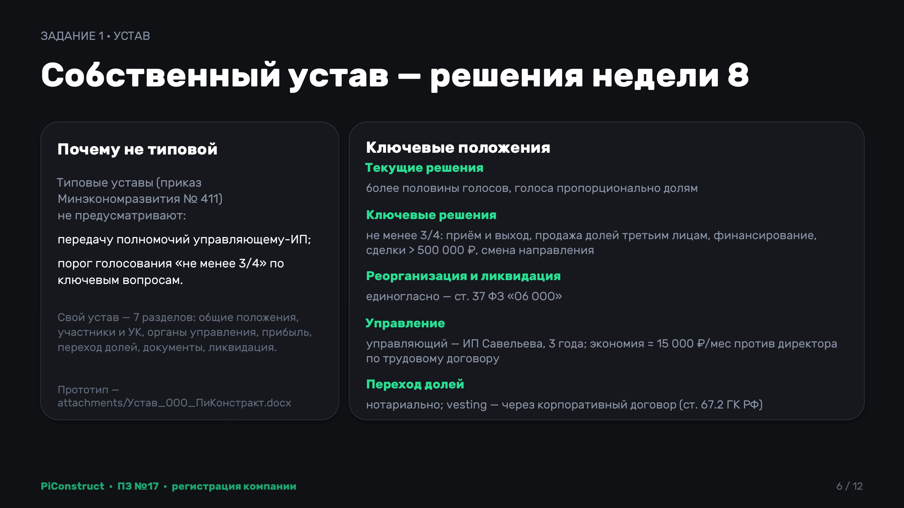
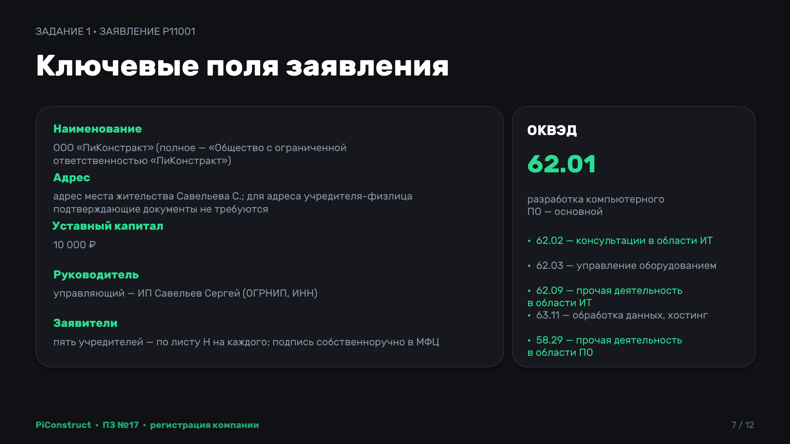
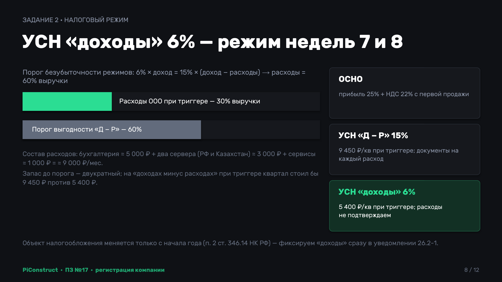
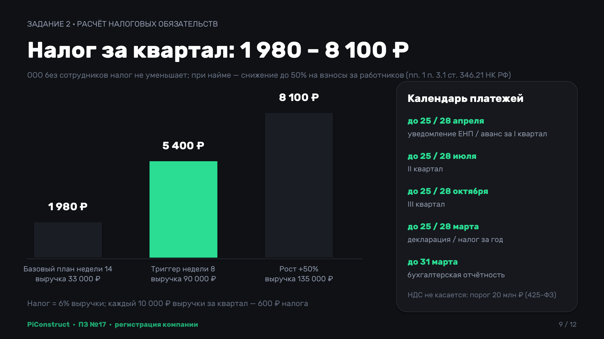
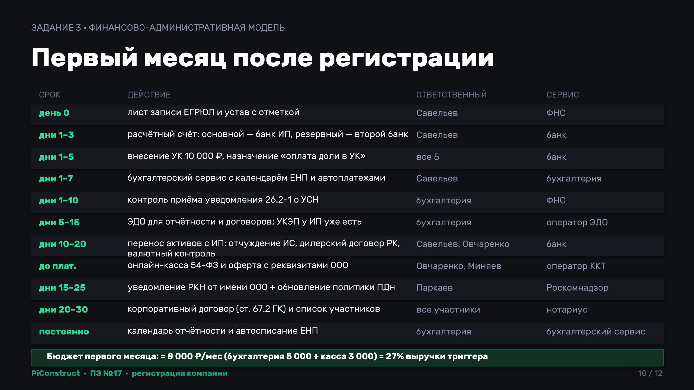
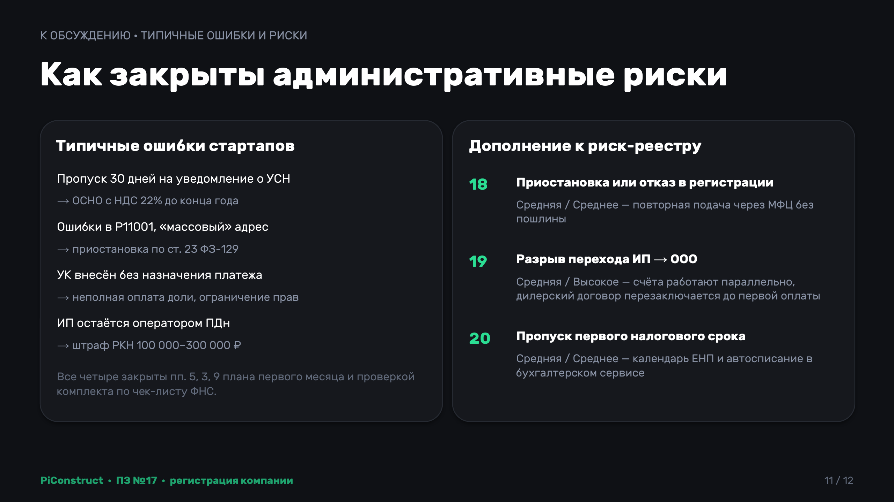
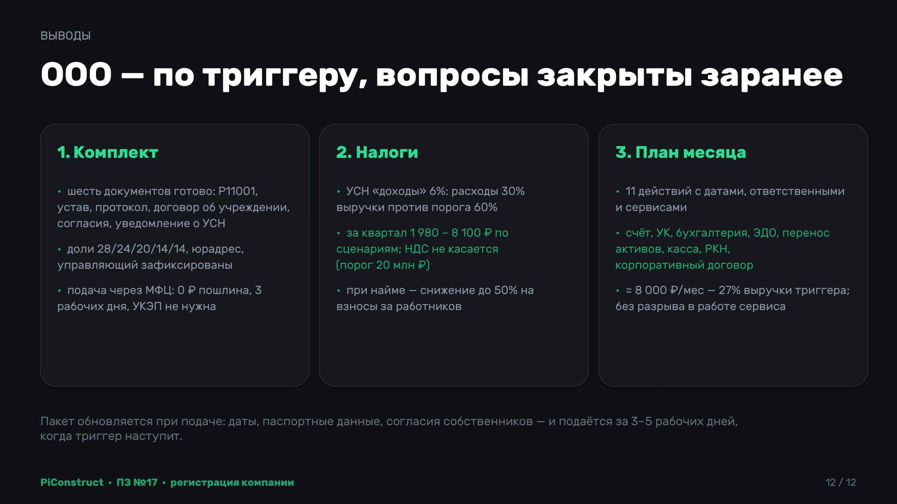

---

## Выводы

**Комплект документов.** Подготовлен полный пакет для регистрации ООО «ПиКонстракт»: устав, протокол общего собрания учредителей, договор об учреждении, Р11001 с пятью листами Н, согласия на адрес и уведомление о переходе на УСН — шаблоны в attachments. Зафиксировано то, что в неделе 8 осталось открытым: доли 28/24/20/14/14 (по загрузке 1,0/0,75 FTE и рискам тимлида, у которого проходит приём платежей), юрадрес — место жительства управляющего с согласиями собственников, руководитель — управляющий ИП Савельева. Устав — собственный: типовые не позволяют ни управляющего-ИП, ни порогов «более половины» по текущим и «не менее 3/4» по ключевым решениям. Подача через МФЦ: без госпошлины и без УКЭП учредителей, регистрация 3 рабочих дня, УК 10 000 ₽ — в течение 4 месяцев.

**Налоговый режим.** УСН «доходы» 6% — тот же режим, что у ИП, поэтому финансовая модель недель 7 и 14 не меняется. Обоснование: расходы ООО ≈ 30% выручки против порога 60%, при котором выгоднее «доходы минус расходы»; на уровне триггера альтернатива стоит 9 450 ₽ за квартал против 5 400 ₽. Налоговые обязательства за квартал — от 1 980 ₽ (базовый план) до 8 100 ₽ (рост +50% к триггеру); НДС не касается (порог 20 млн ₽ в редакции 425-ФЗ), при найме налог уменьшается на взносы за работников до 50%, а ИТ-аккредитация (взносы 15% в пределах базы и 7,6% сверх — с 2026 года) — перспектива после первого найма. Календарь платежей: авансы до 28 числа месяца после квартала, декларация до 25 марта, бухотчёт до 31 марта.

**План первого месяца.** 11 действий с датами, ответственными и внешними сервисами: счёт в банке (основной — банк ИП), УК с корректным назначением платежа, бухгалтерский сервис с автоплатежами ЕНП, ЭДО, перенос активов и дилерского договора с ИП на ООО без разрыва в работе сервиса, касса 54-ФЗ к запуску онлайн-оплаты, уведомление РКН от имени ООО, корпоративный договор. Бюджет — ≈ 8 000 ₽/мес (27% выручки триггера), риск-реестр дополнен №18–20: приостановка регистрации, разрыв операционного перехода и пропуск первых налоговых сроков — с триггерами и мерами.
